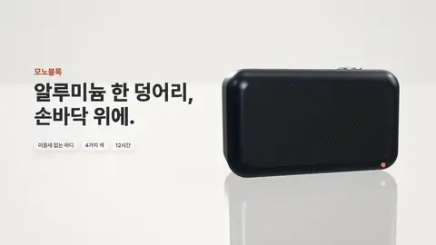
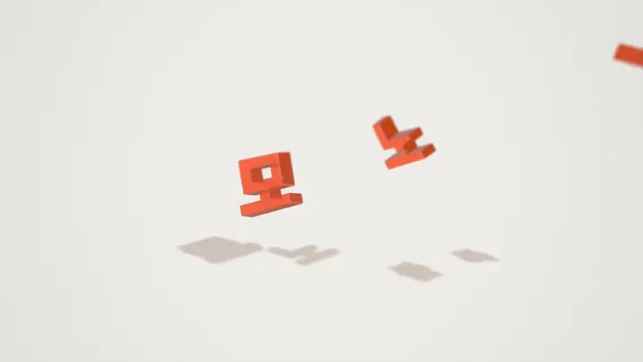
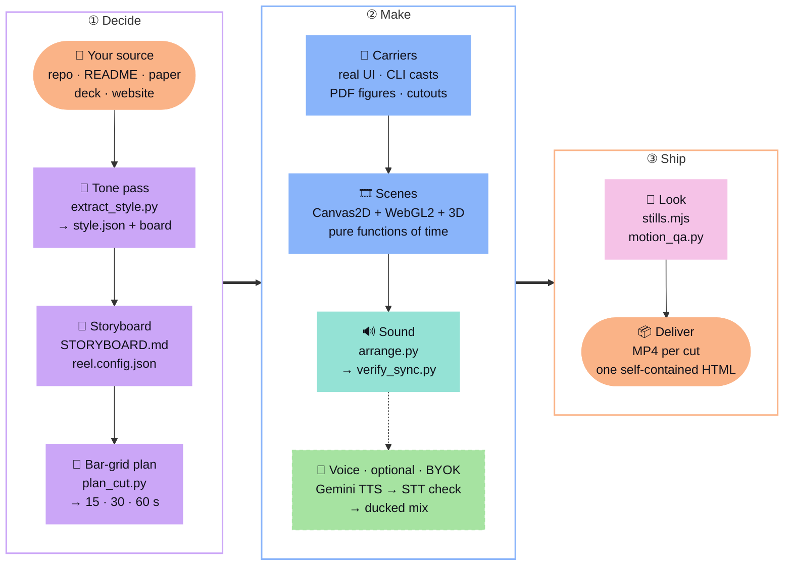

<div align="center">


# Awesome Showreels

### 무엇에 대해서든, 그 자료의 스타일로 모션그래픽 쇼릴을 만듭니다.

레포, 논문, 브랜드, 가게, 행사, 아이디어 한 줄까지. 자료나 몇 줄짜리 설명만 주면 에이전트가 디자인하고 음악을 붙여 렌더링합니다.<br/>
Claude Code, Codex CLI, Gemini CLI 등 어떤 코딩 에이전트에서도 쓰는 스킬이며, MP4로 결과를 냅니다.

<a href="LICENSE"></a>
<a href="#install"></a>


<a href="#bring-your-own-key"></a>

**[예제](#예제) · [실제 제작물](#실제-제작물) · [기능](#기능) · [설치](#설치) · [FAQ](#자주-묻는-질문) · [🇺🇸 English](README.md)**

</div>

---

## 예제

예제는 89개입니다. 그중 16개는 toyz.kr에 실제로 배포된 웹앱을 각자의 프로덕션 빌드에서 캡처해 만들었습니다. 24개는 영상 [〈모션그래픽 20가지 톤〉](https://www.youtube.com/watch?v=oCRQP5S-900)(Ai-Con Lab)에 나오는 그림체를 하나씩 골라, 그 그림체에 어울리는 가상의 프로젝트를 한국어로 만든 것입니다. 또 24개는 코드로 영상을 만드는 공개 저장소 8곳에서 그림체를 하나씩 골라 같은 방식으로 만들었습니다(출처는 예제 아래에 적었습니다). 나머지 예제는 서로 다른 원본에서 만들었고, 쇼릴마다 팔레트, 서체, 모션, 음악을 테마 목록이 아니라 원본에서 가져왔습니다. 그중 `solid-3d`는 입체 3D 층을 보여 주는 예제입니다. 빛을 받는 재질, 쇼릴 글꼴로 만든 입체 글자, 분해도, 3D 전환을 씁니다.

<table>
<tr>
<td align="center" valign="top" width="50%">
<a href="https://raw.githack.com/AwesomeZun/Awesome-Showreels/main/skills/motion-showreel/examples/orbit-note/dist/orbit-note-v1.0.1.html"></a>
<br/><b>Orbit Note</b> · <code>orbit-note</code>
<br/><sub>연결 노트 앱 → 홀로그램 위키 그래프 · 시네마틱 96 BPM</sub>
<br/><sub><a href="https://raw.githack.com/AwesomeZun/Awesome-Showreels/main/skills/motion-showreel/examples/orbit-note/dist/orbit-note-v1.0.1.html">▶ 재생</a> · <a href="skills/motion-showreel/examples/orbit-note/dist/orbit-note-v1.0.1.html">HTML</a> · <a href="skills/motion-showreel/examples/orbit-note">원본·코드</a></sub>
</td>
<td align="center" valign="top" width="50%">
<a href="https://raw.githack.com/AwesomeZun/Awesome-Showreels/main/skills/motion-showreel/examples/offgrid/dist/offgrid-v1.0.0.html"></a>
<br/><b>OFFGRID</b> · <code>offgrid</code>
<br/><sub>동네 지도 → 서울에서 골목 산책로까지 한 번에 · 스윙 96 BPM</sub>
<br/><sub><a href="https://raw.githack.com/AwesomeZun/Awesome-Showreels/main/skills/motion-showreel/examples/offgrid/dist/offgrid-v1.0.0.html">▶ 재생</a> · <a href="skills/motion-showreel/examples/offgrid/dist/offgrid-v1.0.0.html">HTML</a> · <a href="skills/motion-showreel/examples/offgrid">원본·코드</a></sub>
</td>
</tr>
<tr>
<td align="center" valign="top" width="50%">
<a href="https://raw.githack.com/AwesomeZun/Awesome-Showreels/main/skills/motion-showreel/examples/playful-app/dist/mochi-notes-v1.1.0.html"></a>
<br/><b>Mochi Notes</b> · <code>playful-app</code>
<br/><sub>앱 README → 파스텔 마스코트, 실제 앱 화면 · 브라이트 팝 120 BPM</sub>
<br/><sub><a href="https://raw.githack.com/AwesomeZun/Awesome-Showreels/main/skills/motion-showreel/examples/playful-app/dist/mochi-notes-v1.1.0.html">▶ 재생</a> · <a href="assets/demo-playful-app-v1.1.0.mp4">MP4</a> · <a href="skills/motion-showreel/examples/playful-app/dist/mochi-notes-v1.1.0.html">HTML</a> · <a href="skills/motion-showreel/examples/playful-app">원본·코드</a></sub>
</td>
<td align="center" valign="top" width="50%">
<a href="https://raw.githack.com/AwesomeZun/Awesome-Showreels/main/skills/motion-showreel/examples/pixel-arcade/dist/one-credit-jam-v1.0.0.html"></a>
<br/><b>ONE CREDIT JAM</b> · <code>pixel-arcade</code>
<br/><sub>게임잼 → 픽셀 아트, CRT · 칩튠 144 BPM</sub>
<br/><sub><a href="https://raw.githack.com/AwesomeZun/Awesome-Showreels/main/skills/motion-showreel/examples/pixel-arcade/dist/one-credit-jam-v1.0.0.html">▶ 재생</a> · <a href="assets/demo-pixel-arcade-v1.0.0.mp4">MP4</a> · <a href="skills/motion-showreel/examples/pixel-arcade/dist/one-credit-jam-v1.0.0.html">HTML</a> · <a href="skills/motion-showreel/examples/pixel-arcade">원본·코드</a></sub>
</td>
</tr>
<tr>
<td align="center" valign="top" width="50%">
<a href="https://raw.githack.com/AwesomeZun/Awesome-Showreels/main/skills/motion-showreel/examples/paper-imaging/dist/zebrafish-light-sheet-v2.0.0.html"></a>
<br/><b>Light-sheet zebrafish embryo</b> · <code>paper-imaging</code>
<br/><sub>현미경 논문 → 빛의 막이 배아를 한 층씩 쌓음 · 92 BPM</sub>
<br/><sub><a href="https://raw.githack.com/AwesomeZun/Awesome-Showreels/main/skills/motion-showreel/examples/paper-imaging/dist/zebrafish-light-sheet-v2.0.0.html">▶ 재생</a> · <a href="skills/motion-showreel/examples/paper-imaging/dist/zebrafish-light-sheet-v2.0.0.html">HTML</a> · <a href="skills/motion-showreel/examples/paper-imaging">원본·코드</a></sub>
</td>
<td align="center" valign="top" width="50%">
<a href="https://raw.githack.com/AwesomeZun/Awesome-Showreels/main/skills/motion-showreel/examples/paper-behaviour/dist/gut-metabolite-anxiety-v1.0.0.html"></a>
<br/><b>Gut metabolite and anxiety</b> · <code>paper-behaviour</code>
<br/><sub>생쥐 행동 논문 → 위에서 본 이동 궤적 · 104 BPM</sub>
<br/><sub><a href="https://raw.githack.com/AwesomeZun/Awesome-Showreels/main/skills/motion-showreel/examples/paper-behaviour/dist/gut-metabolite-anxiety-v1.0.0.html">▶ 재생</a> · <a href="skills/motion-showreel/examples/paper-behaviour/dist/gut-metabolite-anxiety-v1.0.0.html">HTML</a> · <a href="skills/motion-showreel/examples/paper-behaviour">원본·코드</a></sub>
</td>
</tr>
<tr>
<td align="center" valign="top" width="50%">
<a href="https://raw.githack.com/AwesomeZun/Awesome-Showreels/main/skills/motion-showreel/examples/research-cli/dist/spark-bench-v1.1.0.html"></a>
<br/><b>spark-bench</b> · <code>research-cli</code>
<br/><sub>연구용 CLI → GPU 점, 실제 터미널 · 다크 신스 128 BPM</sub>
<br/><sub><a href="https://raw.githack.com/AwesomeZun/Awesome-Showreels/main/skills/motion-showreel/examples/research-cli/dist/spark-bench-v1.1.0.html">▶ 재생</a> · <a href="assets/demo-research-cli-v1.1.0.mp4">MP4</a> · <a href="skills/motion-showreel/examples/research-cli/dist/spark-bench-v1.1.0.html">HTML</a> · <a href="skills/motion-showreel/examples/research-cli">원본·코드</a></sub>
</td>
<td align="center" valign="top" width="50%">
<a href="https://raw.githack.com/AwesomeZun/Awesome-Showreels/main/skills/motion-showreel/examples/academic-paper/dist/alveolar-repair-atlas-v2.0.0.html"></a>
<br/><b>Alveolar repair atlas v2</b> · <code>academic-paper</code>
<br/><sub>싱글셀 논문 → 핵 하나가 조직에서 3D 아틀라스로, 다시 조직으로 · 96 BPM</sub>
<br/><sub><a href="https://raw.githack.com/AwesomeZun/Awesome-Showreels/main/skills/motion-showreel/examples/academic-paper/dist/alveolar-repair-atlas-v2.0.0.html">▶ 재생</a> · <a href="skills/motion-showreel/examples/academic-paper/dist/alveolar-repair-atlas-v2.0.0.html">HTML</a> · <a href="skills/motion-showreel/examples/academic-paper">원본·코드</a></sub>
</td>
</tr>
<tr>
<td align="center" valign="top" width="50%">
<a href="https://raw.githack.com/AwesomeZun/Awesome-Showreels/main/skills/motion-showreel/examples/paper-transformer/dist/attention-explainer-v1.0.0.html"></a>
<br/><b>Attention Is All You Need, explained</b> · <code>paper-transformer</code>
<br/><sub>기념비적 논문 → 논문처럼 조판, 어텐션은 실제 계산 · 110 BPM</sub>
<br/><sub><a href="https://raw.githack.com/AwesomeZun/Awesome-Showreels/main/skills/motion-showreel/examples/paper-transformer/dist/attention-explainer-v1.0.0.html">▶ 재생</a> · <a href="skills/motion-showreel/examples/paper-transformer/dist/attention-explainer-v1.0.0.html">HTML</a> · <a href="skills/motion-showreel/examples/paper-transformer">원본·코드</a></sub>
</td>
<td align="center" valign="top" width="50%">
<a href="https://raw.githack.com/AwesomeZun/Awesome-Showreels/main/skills/motion-showreel/examples/paper-organoid/dist/wnt-pulse-organoids-v2.0.0.html"></a>
<br/><b>WNT-pulse organoids</b> · <code>paper-organoid</code>
<br/><sub>오가노이드 논문 → 스스로 써지는 실험 노트 · 100 BPM</sub>
<br/><sub><a href="https://raw.githack.com/AwesomeZun/Awesome-Showreels/main/skills/motion-showreel/examples/paper-organoid/dist/wnt-pulse-organoids-v2.0.0.html">▶ 재생</a> · <a href="skills/motion-showreel/examples/paper-organoid/dist/wnt-pulse-organoids-v2.0.0.html">HTML</a> · <a href="skills/motion-showreel/examples/paper-organoid">원본·코드</a></sub>
</td>
</tr>
<tr>
<td align="center" valign="top" width="50%">
<a href="https://raw.githack.com/AwesomeZun/Awesome-Showreels/main/skills/motion-showreel/examples/swiss-grid/dist/haus-fur-musik-v1.0.0.html"></a>
<br/><b>House of Music</b> · <code>swiss-grid</code>
<br/><sub>건축 공모 브리프 → 12단 그리드, 빨강 하나 · 124 BPM</sub>
<br/><sub><a href="https://raw.githack.com/AwesomeZun/Awesome-Showreels/main/skills/motion-showreel/examples/swiss-grid/dist/haus-fur-musik-v1.0.0.html">▶ 재생</a> · <a href="assets/demo-swiss-grid-v1.0.0.mp4">MP4</a> · <a href="skills/motion-showreel/examples/swiss-grid/dist/haus-fur-musik-v1.0.0.html">HTML</a> · <a href="skills/motion-showreel/examples/swiss-grid">원본·코드</a></sub>
</td>
<td align="center" valign="top" width="50%">
<a href="https://raw.githack.com/AwesomeZun/Awesome-Showreels/main/skills/motion-showreel/examples/explainer-llm/dist/next-word-explainer-v1.0.0.html"></a>
<br/><b>How a language model picks the next word</b> · <code>explainer-llm</code>
<br/><sub>LLM 해설 → 화살표가 된 단어, 수학 애니메이션 · 15/30/60초 · 96 BPM</sub>
<br/><sub><a href="https://raw.githack.com/AwesomeZun/Awesome-Showreels/main/skills/motion-showreel/examples/explainer-llm/dist/next-word-explainer-v1.0.0.html">▶ 재생</a> · <a href="skills/motion-showreel/examples/explainer-llm/dist/next-word-explainer-v1.0.0.html">HTML</a> · <a href="skills/motion-showreel/examples/explainer-llm">원본·코드</a></sub>
</td>
</tr>
<tr>
<td align="center" valign="top" width="50%">
<a href="https://raw.githack.com/AwesomeZun/Awesome-Showreels/main/skills/motion-showreel/examples/explainer-sunlight/dist/sunlight-for-breakfast-v1.0.0.html"></a>
<br/><b>Sunlight for Breakfast</b> · <code>explainer-sunlight</code>
<br/><sub>과학 해설 → 평면 벡터, 태양에서 토스트까지 · 15/30/60초 · 128 BPM</sub>
<br/><sub><a href="https://raw.githack.com/AwesomeZun/Awesome-Showreels/main/skills/motion-showreel/examples/explainer-sunlight/dist/sunlight-for-breakfast-v1.0.0.html">▶ 재생</a> · <a href="skills/motion-showreel/examples/explainer-sunlight/dist/sunlight-for-breakfast-v1.0.0.html">HTML</a> · <a href="skills/motion-showreel/examples/explainer-sunlight">원본·코드</a></sub>
</td>
<td align="center" valign="top" width="50%">
<a href="https://raw.githack.com/AwesomeZun/Awesome-Showreels/main/skills/motion-showreel/examples/riso-zine/dist/paper-jam-07-v1.0.0.html"></a>
<br/><b>PAPER JAM #07</b> · <code>riso-zine</code>
<br/><sub>진(zine) → 어긋난 리소 잉크 · 160 BPM</sub>
<br/><sub><a href="https://raw.githack.com/AwesomeZun/Awesome-Showreels/main/skills/motion-showreel/examples/riso-zine/dist/paper-jam-07-v1.0.0.html">▶ 재생</a> · <a href="assets/demo-riso-zine-v1.0.0.mp4">MP4</a> · <a href="skills/motion-showreel/examples/riso-zine/dist/paper-jam-07-v1.0.0.html">HTML</a> · <a href="skills/motion-showreel/examples/riso-zine">원본·코드</a></sub>
</td>
</tr>
<tr>
<td align="center" valign="top" width="50%">
<a href="https://raw.githack.com/AwesomeZun/Awesome-Showreels/main/skills/motion-showreel/examples/sketchnote/dist/visual-notes-lab-v1.0.0.html"></a>
<br/><b>Visual Notes Lab</b> · <code>sketchnote</code>
<br/><sub>워크숍 핸드아웃 → 스스로 써지는 마커 · 104 BPM</sub>
<br/><sub><a href="https://raw.githack.com/AwesomeZun/Awesome-Showreels/main/skills/motion-showreel/examples/sketchnote/dist/visual-notes-lab-v1.0.0.html">▶ 재생</a> · <a href="assets/demo-sketchnote-v1.0.0.mp4">MP4</a> · <a href="skills/motion-showreel/examples/sketchnote/dist/visual-notes-lab-v1.0.0.html">HTML</a> · <a href="skills/motion-showreel/examples/sketchnote">원본·코드</a></sub>
</td>
<td align="center" valign="top" width="50%">
<a href="https://raw.githack.com/AwesomeZun/Awesome-Showreels/main/skills/motion-showreel/examples/sumi-wabi/dist/yohakuan-v1.0.0.html"></a>
<br/><b>여백암</b> · <code>sumi-wabi</code>
<br/><sub>료칸 웹사이트 → 먹, 세로쓰기 · 고토 72 BPM</sub>
<br/><sub><a href="https://raw.githack.com/AwesomeZun/Awesome-Showreels/main/skills/motion-showreel/examples/sumi-wabi/dist/yohakuan-v1.0.0.html">▶ 재생</a> · <a href="assets/demo-sumi-wabi-v1.0.0.mp4">MP4</a> · <a href="skills/motion-showreel/examples/sumi-wabi/dist/yohakuan-v1.0.0.html">HTML</a> · <a href="skills/motion-showreel/examples/sumi-wabi">원본·코드</a></sub>
</td>
</tr>
<tr>
<td align="center" valign="top" width="50%">
<a href="https://raw.githack.com/AwesomeZun/Awesome-Showreels/main/skills/motion-showreel/examples/paper-perturbseq/dist/perturb-seq-exhaustion-v2.0.0.html"></a>
<br/><b>Perturb-seq: T-cell exhaustion</b> · <code>paper-perturbseq</code>
<br/><sub>CRISPR 스크린 논문 → 일러스트, 데이터, 다시 일러스트 · 116 BPM</sub>
<br/><sub><a href="https://raw.githack.com/AwesomeZun/Awesome-Showreels/main/skills/motion-showreel/examples/paper-perturbseq/dist/perturb-seq-exhaustion-v2.0.0.html">▶ 재생</a> · <a href="skills/motion-showreel/examples/paper-perturbseq/dist/perturb-seq-exhaustion-v2.0.0.html">HTML</a> · <a href="skills/motion-showreel/examples/paper-perturbseq">원본·코드</a></sub>
</td>
<td align="center" valign="top" width="50%">
<a href="https://raw.githack.com/AwesomeZun/Awesome-Showreels/main/skills/motion-showreel/examples/pixel-pocket/dist/ridgeline-pocket-v2.0.0.html"></a>
<br/><b>Ridgeline Pocket</b> · <code>pixel-pocket</code>
<br/><sub>등산 앱 → 초록 4단계 휴대용 게임기 · 칩튠 108 BPM</sub>
<br/><sub><a href="https://raw.githack.com/AwesomeZun/Awesome-Showreels/main/skills/motion-showreel/examples/pixel-pocket/dist/ridgeline-pocket-v2.0.0.html">▶ 재생</a> · <a href="skills/motion-showreel/examples/pixel-pocket/dist/ridgeline-pocket-v2.0.0.html">HTML</a> · <a href="skills/motion-showreel/examples/pixel-pocket">원본·코드</a></sub>
</td>
</tr>
<tr>
<td align="center" valign="top" width="50%">
<a href="https://raw.githack.com/AwesomeZun/Awesome-Showreels/main/skills/motion-showreel/examples/newsprint/dist/tamsin-valley-courier-v1.0.0.html"></a>
<br/><b>The Tamsin Valley Courier</b> · <code>newsprint</code>
<br/><sub>지역 신문 → 인쇄기, 망점 · 96 BPM</sub>
<br/><sub><a href="https://raw.githack.com/AwesomeZun/Awesome-Showreels/main/skills/motion-showreel/examples/newsprint/dist/tamsin-valley-courier-v1.0.0.html">▶ 재생</a> · <a href="assets/demo-newsprint-v1.0.0.mp4">MP4</a> · <a href="skills/motion-showreel/examples/newsprint/dist/tamsin-valley-courier-v1.0.0.html">HTML</a> · <a href="skills/motion-showreel/examples/newsprint">원본·코드</a></sub>
</td>
<td align="center" valign="top" width="50%">
<a href="https://raw.githack.com/AwesomeZun/Awesome-Showreels/main/skills/motion-showreel/examples/trove/dist/trove-v1.0.1.html"></a>
<br/><b>Trove</b> · <code>trove</code>
<br/><sub>북마크 앱 → 크롬 토러스, 궤도로 빨려 드는 링크 · 다크 신스 128 BPM</sub>
<br/><sub><a href="https://raw.githack.com/AwesomeZun/Awesome-Showreels/main/skills/motion-showreel/examples/trove/dist/trove-v1.0.1.html">▶ 재생</a> · <a href="skills/motion-showreel/examples/trove/dist/trove-v1.0.1.html">HTML</a> · <a href="skills/motion-showreel/examples/trove">원본·코드</a></sub>
</td>
</tr>
<tr>
<td align="center" valign="top" width="50%">
<a href="https://raw.githack.com/AwesomeZun/Awesome-Showreels/main/skills/motion-showreel/examples/pulse/dist/pulse-v1.0.1.html"></a>
<br/><b>Pulse</b> · <code>pulse</code>
<br/><sub>메이커 대시보드 → 브러시드 알루미늄, 움직이는 계기판 · 브라이트 팝 112 BPM</sub>
<br/><sub><a href="https://raw.githack.com/AwesomeZun/Awesome-Showreels/main/skills/motion-showreel/examples/pulse/dist/pulse-v1.0.1.html">▶ 재생</a> · <a href="skills/motion-showreel/examples/pulse/dist/pulse-v1.0.1.html">HTML</a> · <a href="skills/motion-showreel/examples/pulse">원본·코드</a></sub>
</td>
<td align="center" valign="top" width="50%">
<a href="https://raw.githack.com/AwesomeZun/Awesome-Showreels/main/skills/motion-showreel/examples/frame/dist/frame-v1.0.1.html"></a>
<br/><b>Frame</b> · <code>frame</code>
<br/><sub>포트폴리오 빌더 → 입력하는 대로 바뀌는 미리보기 · 코퍼레이트 112 BPM</sub>
<br/><sub><a href="https://raw.githack.com/AwesomeZun/Awesome-Showreels/main/skills/motion-showreel/examples/frame/dist/frame-v1.0.1.html">▶ 재생</a> · <a href="skills/motion-showreel/examples/frame/dist/frame-v1.0.1.html">HTML</a> · <a href="skills/motion-showreel/examples/frame">원본·코드</a></sub>
</td>
</tr>
<tr>
<td align="center" valign="top" width="50%">
<a href="https://raw.githack.com/AwesomeZun/Awesome-Showreels/main/skills/motion-showreel/examples/tiny-beat/dist/tiny-beat-v1.0.1.html"></a>
<br/><b>Tiny Beat</b> · <code>tiny-beat</code>
<br/><sub>하루 한 곡 비트 메이커 → 빛나는 스텝 시퀀서 · 로파이 80 BPM</sub>
<br/><sub><a href="https://raw.githack.com/AwesomeZun/Awesome-Showreels/main/skills/motion-showreel/examples/tiny-beat/dist/tiny-beat-v1.0.1.html">▶ 재생</a> · <a href="skills/motion-showreel/examples/tiny-beat/dist/tiny-beat-v1.0.1.html">HTML</a> · <a href="skills/motion-showreel/examples/tiny-beat">원본·코드</a></sub>
</td>
<td align="center" valign="top" width="50%">
<a href="https://raw.githack.com/AwesomeZun/Awesome-Showreels/main/skills/motion-showreel/examples/deploy-kit/dist/deploy-kit-v1.0.1.html"></a>
<br/><b>Deploy Kit</b> · <code>deploy-kit</code>
<br/><sub>출시 키트 → 파일들이 ZIP 하나로 · 드럼앤베이스 176 BPM</sub>
<br/><sub><a href="https://raw.githack.com/AwesomeZun/Awesome-Showreels/main/skills/motion-showreel/examples/deploy-kit/dist/deploy-kit-v1.0.1.html">▶ 재생</a> · <a href="skills/motion-showreel/examples/deploy-kit/dist/deploy-kit-v1.0.1.html">HTML</a> · <a href="skills/motion-showreel/examples/deploy-kit">원본·코드</a></sub>
</td>
</tr>
<tr>
<td align="center" valign="top" width="50%">
<a href="https://raw.githack.com/AwesomeZun/Awesome-Showreels/main/skills/motion-showreel/examples/read-room/dist/read-room-v1.0.1.html"></a>
<br/><b>Read Room</b> · <code>read-room</code>
<br/><sub>함께 읽는 열람실 → 펜 속도로 그어지는 밑줄 · 앰비언트 96 BPM</sub>
<br/><sub><a href="https://raw.githack.com/AwesomeZun/Awesome-Showreels/main/skills/motion-showreel/examples/read-room/dist/read-room-v1.0.1.html">▶ 재생</a> · <a href="skills/motion-showreel/examples/read-room/dist/read-room-v1.0.1.html">HTML</a> · <a href="skills/motion-showreel/examples/read-room">원본·코드</a></sub>
</td>
<td align="center" valign="top" width="50%">
<a href="https://raw.githack.com/AwesomeZun/Awesome-Showreels/main/skills/motion-showreel/examples/motion-kit/dist/motion-kit-v1.0.0.html"></a>
<br/><b>Motion Kit</b> · <code>motion-kit</code>
<br/><sub>마이크로 인터랙션 모음 → 앱의 애니메이션을 프레임 단위로 · 브라이트 팝 128 BPM</sub>
<br/><sub><a href="https://raw.githack.com/AwesomeZun/Awesome-Showreels/main/skills/motion-showreel/examples/motion-kit/dist/motion-kit-v1.0.0.html">▶ 재생</a> · <a href="skills/motion-showreel/examples/motion-kit/dist/motion-kit-v1.0.0.html">HTML</a> · <a href="skills/motion-showreel/examples/motion-kit">원본·코드</a></sub>
</td>
</tr>
<tr>
<td align="center" valign="top" width="50%">
<a href="https://raw.githack.com/AwesomeZun/Awesome-Showreels/main/skills/motion-showreel/examples/layr/dist/layr-v1.0.0.html"></a>
<br/><b>LAYR</b> · <code>layr</code>
<br/><sub>메모 워크스페이스 → 다섯 장의 유리판으로 떨어지는 메모 · 다크 신스 112 BPM</sub>
<br/><sub><a href="https://raw.githack.com/AwesomeZun/Awesome-Showreels/main/skills/motion-showreel/examples/layr/dist/layr-v1.0.0.html">▶ 재생</a> · <a href="skills/motion-showreel/examples/layr/dist/layr-v1.0.0.html">HTML</a> · <a href="skills/motion-showreel/examples/layr">원본·코드</a></sub>
</td>
<td align="center" valign="top" width="50%">
<a href="https://raw.githack.com/AwesomeZun/Awesome-Showreels/main/skills/motion-showreel/examples/tiny-tools/dist/tiny-tools-v1.0.0.html"></a>
<br/><b>tiny.tools</b> · <code>tiny-tools</code>
<br/><sub>개발 도구 모음 → 붙여넣으면 알맞은 도구를 · 칩튠 128 BPM</sub>
<br/><sub><a href="https://raw.githack.com/AwesomeZun/Awesome-Showreels/main/skills/motion-showreel/examples/tiny-tools/dist/tiny-tools-v1.0.0.html">▶ 재생</a> · <a href="skills/motion-showreel/examples/tiny-tools/dist/tiny-tools-v1.0.0.html">HTML</a> · <a href="skills/motion-showreel/examples/tiny-tools">원본·코드</a></sub>
</td>
</tr>
<tr>
<td align="center" valign="top" width="50%">
<a href="https://raw.githack.com/AwesomeZun/Awesome-Showreels/main/skills/motion-showreel/examples/mood-fm/dist/mood-fm-v1.0.0.html"></a>
<br/><b>MOOD FM</b> · <code>mood-fm</code>
<br/><sub>기분 라디오 → 화면이 기분의 색으로 · 로파이 96 BPM</sub>
<br/><sub><a href="https://raw.githack.com/AwesomeZun/Awesome-Showreels/main/skills/motion-showreel/examples/mood-fm/dist/mood-fm-v1.0.0.html">▶ 재생</a> · <a href="skills/motion-showreel/examples/mood-fm/dist/mood-fm-v1.0.0.html">HTML</a> · <a href="skills/motion-showreel/examples/mood-fm">원본·코드</a></sub>
</td>
<td align="center" valign="top" width="50%">
<a href="https://raw.githack.com/AwesomeZun/Awesome-Showreels/main/skills/motion-showreel/examples/form-01/dist/form-01-v1.0.0.html"></a>
<br/><b>FORM / 01</b> · <code>form-01</code>
<br/><sub>디자인 피드백 보드 → 작업물 위의 핀과 버전 · 시네마틱 112 BPM</sub>
<br/><sub><a href="https://raw.githack.com/AwesomeZun/Awesome-Showreels/main/skills/motion-showreel/examples/form-01/dist/form-01-v1.0.0.html">▶ 재생</a> · <a href="skills/motion-showreel/examples/form-01/dist/form-01-v1.0.0.html">HTML</a> · <a href="skills/motion-showreel/examples/form-01">원본·코드</a></sub>
</td>
</tr>
<tr>
<td align="center" valign="top" width="50%">
<a href="https://raw.githack.com/AwesomeZun/Awesome-Showreels/main/skills/motion-showreel/examples/loop/dist/loop-v1.0.0.html"></a>
<br/><b>LOOP</b> · <code>loop</code>
<br/><sub>습관 앱 → 탭할 때마다 차오르는 크롬 링 · 코퍼레이트 128 BPM</sub>
<br/><sub><a href="https://raw.githack.com/AwesomeZun/Awesome-Showreels/main/skills/motion-showreel/examples/loop/dist/loop-v1.0.0.html">▶ 재생</a> · <a href="skills/motion-showreel/examples/loop/dist/loop-v1.0.0.html">HTML</a> · <a href="skills/motion-showreel/examples/loop">원본·코드</a></sub>
</td>
<td align="center" valign="top" width="50%">
<a href="https://raw.githack.com/AwesomeZun/Awesome-Showreels/main/skills/motion-showreel/examples/focus-space/dist/focus-space-v1.0.0.html"></a>
<br/><b>FOCUS SPACE</b> · <code>focus-space</code>
<br/><sub>집중 타이머 → 아치형 문 안에서 빨리 감는 25분 · 앰비언트 96 BPM</sub>
<br/><sub><a href="https://raw.githack.com/AwesomeZun/Awesome-Showreels/main/skills/motion-showreel/examples/focus-space/dist/focus-space-v1.0.0.html">▶ 재생</a> · <a href="skills/motion-showreel/examples/focus-space/dist/focus-space-v1.0.0.html">HTML</a> · <a href="skills/motion-showreel/examples/focus-space">원본·코드</a></sub>
</td>
</tr>
<tr>
<td align="center" valign="top" width="50%">
<a href="https://raw.githack.com/AwesomeZun/Awesome-Showreels/main/skills/motion-showreel/examples/pixel-kit/dist/pixel-kit-v1.0.0.html"></a>
<br/><b>PIXEL KIT</b> · <code>pixel-kit</code>
<br/><sub>브랜드 이미지 도구 → 디자인 하나를 여섯 크기로, 킷 셋 · 스윙 128 BPM</sub>
<br/><sub><a href="https://raw.githack.com/AwesomeZun/Awesome-Showreels/main/skills/motion-showreel/examples/pixel-kit/dist/pixel-kit-v1.0.0.html">▶ 재생</a> · <a href="skills/motion-showreel/examples/pixel-kit/dist/pixel-kit-v1.0.0.html">HTML</a> · <a href="skills/motion-showreel/examples/pixel-kit">원본·코드</a></sub>
</td>
<td align="center" valign="top" width="50%">
<a href="https://raw.githack.com/AwesomeZun/Awesome-Showreels/main/skills/motion-showreel/examples/crayon/dist/crayon-v1.0.0.html"></a>
<br/><b>꼬마 화가</b> · <code>crayon</code>
<br/><sub>그림책 앱 → 도화지 위 크레파스, 보는 사이 그려지는 그림 · 브라이트 팝 112 BPM</sub>
<br/><sub><a href="https://raw.githack.com/AwesomeZun/Awesome-Showreels/main/skills/motion-showreel/examples/crayon/dist/crayon-v1.0.0.html">▶ 재생</a> · <a href="skills/motion-showreel/examples/crayon/dist/crayon-v1.0.0.html">HTML</a> · <a href="skills/motion-showreel/examples/crayon">원본·코드</a></sub>
</td>
</tr>
<tr>
<td align="center" valign="top" width="50%">
<a href="https://raw.githack.com/AwesomeZun/Awesome-Showreels/main/skills/motion-showreel/examples/paper-collage/dist/paper-collage-v1.0.0.html"></a>
<br/><b>종이비행 페스티벌 2026</b> · <code>paper-collage</code>
<br/><sub>음악 축제 → 박자마다 붙는 찢은 종이 · 브라이트 팝 128 BPM</sub>
<br/><sub><a href="https://raw.githack.com/AwesomeZun/Awesome-Showreels/main/skills/motion-showreel/examples/paper-collage/dist/paper-collage-v1.0.0.html">▶ 재생</a> · <a href="skills/motion-showreel/examples/paper-collage/dist/paper-collage-v1.0.0.html">HTML</a> · <a href="skills/motion-showreel/examples/paper-collage">원본·코드</a></sub>
</td>
<td align="center" valign="top" width="50%">
<a href="https://raw.githack.com/AwesomeZun/Awesome-Showreels/main/skills/motion-showreel/examples/whiteboard/dist/whiteboard-v1.0.0.html"></a>
<br/><b>피싱 메일 3초 판별법</b> · <code>whiteboard</code>
<br/><sub>보안 교육 → 긴 화이트보드에 손이 마커로 그리는 설명 · 코퍼레이트 112 BPM</sub>
<br/><sub><a href="https://raw.githack.com/AwesomeZun/Awesome-Showreels/main/skills/motion-showreel/examples/whiteboard/dist/whiteboard-v1.0.0.html">▶ 재생</a> · <a href="skills/motion-showreel/examples/whiteboard/dist/whiteboard-v1.0.0.html">HTML</a> · <a href="skills/motion-showreel/examples/whiteboard">원본·코드</a></sub>
</td>
</tr>
<tr>
<td align="center" valign="top" width="50%">
<a href="https://raw.githack.com/AwesomeZun/Awesome-Showreels/main/skills/motion-showreel/examples/infographic/dist/infographic-v1.0.0.html"></a>
<br/><b>한빛시 자전거 리포트 2026</b> · <code>infographic</code>
<br/><sub>도시 보고서 → 자라면서 숫자를 세는 아이소메트릭 차트 · 코퍼레이트 128 BPM</sub>
<br/><sub><a href="https://raw.githack.com/AwesomeZun/Awesome-Showreels/main/skills/motion-showreel/examples/infographic/dist/infographic-v1.0.0.html">▶ 재생</a> · <a href="skills/motion-showreel/examples/infographic/dist/infographic-v1.0.0.html">HTML</a> · <a href="skills/motion-showreel/examples/infographic">원본·코드</a></sub>
</td>
<td align="center" valign="top" width="50%">
<a href="https://raw.githack.com/AwesomeZun/Awesome-Showreels/main/skills/motion-showreel/examples/minimal-ui/dist/minimal-ui-v1.0.0.html"></a>
<br/><b>하루 세 칸</b> · <code>minimal-ui</code>
<br/><sub>습관 앱 → 흰 카드와 파랑 하나, 실제로 앱을 쓰는 커서 · 브라이트 팝 128 BPM</sub>
<br/><sub><a href="https://raw.githack.com/AwesomeZun/Awesome-Showreels/main/skills/motion-showreel/examples/minimal-ui/dist/minimal-ui-v1.0.0.html">▶ 재생</a> · <a href="skills/motion-showreel/examples/minimal-ui/dist/minimal-ui-v1.0.0.html">HTML</a> · <a href="skills/motion-showreel/examples/minimal-ui">원본·코드</a></sub>
</td>
</tr>
<tr>
<td align="center" valign="top" width="50%">
<a href="https://raw.githack.com/AwesomeZun/Awesome-Showreels/main/skills/motion-showreel/examples/blueprint/dist/blueprint-v1.0.0.html"></a>
<br/><b>폴드원 E1</b> · <code>blueprint</code>
<br/><sub>접이식 전기자전거 → 파란 도면 위 흰 선, 그리고 접히는 모습 · 시네마틱 112 BPM</sub>
<br/><sub><a href="https://raw.githack.com/AwesomeZun/Awesome-Showreels/main/skills/motion-showreel/examples/blueprint/dist/blueprint-v1.0.0.html">▶ 재생</a> · <a href="skills/motion-showreel/examples/blueprint/dist/blueprint-v1.0.0.html">HTML</a> · <a href="skills/motion-showreel/examples/blueprint">원본·코드</a></sub>
</td>
<td align="center" valign="top" width="50%">
<a href="https://raw.githack.com/AwesomeZun/Awesome-Showreels/main/skills/motion-showreel/examples/cutaway-3d/dist/cutaway-3d-v1.0.0.html"></a>
<br/><b>브루큐브</b> · <code>cutaway-3d</code>
<br/><sub>가정용 원두 로스터 → 열리고 돌아가는 3D 단면도 · 코퍼레이트 112 BPM</sub>
<br/><sub><a href="https://raw.githack.com/AwesomeZun/Awesome-Showreels/main/skills/motion-showreel/examples/cutaway-3d/dist/cutaway-3d-v1.0.0.html">▶ 재생</a> · <a href="skills/motion-showreel/examples/cutaway-3d/dist/cutaway-3d-v1.0.0.html">HTML</a> · <a href="skills/motion-showreel/examples/cutaway-3d">원본·코드</a></sub>
</td>
</tr>
<tr>
<td align="center" valign="top" width="50%">
<a href="https://raw.githack.com/AwesomeZun/Awesome-Showreels/main/skills/motion-showreel/examples/chrome-glass/dist/chrome-glass-v1.0.0.html"></a>
<br/><b>글래스 노트 No.3</b> · <code>chrome-glass</code>
<br/><sub>향수 → 뒤의 글자를 휘게 하는 레이마칭 유리병 · 앰비언트 96 BPM</sub>
<br/><sub><a href="https://raw.githack.com/AwesomeZun/Awesome-Showreels/main/skills/motion-showreel/examples/chrome-glass/dist/chrome-glass-v1.0.0.html">▶ 재생</a> · <a href="skills/motion-showreel/examples/chrome-glass/dist/chrome-glass-v1.0.0.html">HTML</a> · <a href="skills/motion-showreel/examples/chrome-glass">원본·코드</a></sub>
</td>
<td align="center" valign="top" width="50%">
<a href="https://raw.githack.com/AwesomeZun/Awesome-Showreels/main/skills/motion-showreel/examples/cinematic-3d/dist/cinematic-3d-v1.0.0.html"></a>
<br/><b>궤도 일곱</b> · <code>cinematic-3d</code>
<br/><sub>다큐멘터리 → 지구 가장자리로 떠오르는 해, 시네마스코프 · 시네마틱 96 BPM</sub>
<br/><sub><a href="https://raw.githack.com/AwesomeZun/Awesome-Showreels/main/skills/motion-showreel/examples/cinematic-3d/dist/cinematic-3d-v1.0.0.html">▶ 재생</a> · <a href="skills/motion-showreel/examples/cinematic-3d/dist/cinematic-3d-v1.0.0.html">HTML</a> · <a href="skills/motion-showreel/examples/cinematic-3d">원본·코드</a></sub>
</td>
</tr>
<tr>
<td align="center" valign="top" width="50%">
<a href="https://raw.githack.com/AwesomeZun/Awesome-Showreels/main/skills/motion-showreel/examples/solid-3d/dist/solid-3d-v1.0.0.html"></a>
<br/><b>모노블록</b> · <code>solid-3d</code>
<br/><sub>손바닥만 한 스피커 → 실제 3D: 입체 글자, 분해도, 3D 전환 · 브라이트 팝 128 BPM</sub>
<br/><sub><a href="https://raw.githack.com/AwesomeZun/Awesome-Showreels/main/skills/motion-showreel/examples/solid-3d/dist/solid-3d-v1.0.0.html">▶ 재생</a> · <a href="skills/motion-showreel/examples/solid-3d/dist/solid-3d-v1.0.0.html">HTML</a> · <a href="skills/motion-showreel/examples/solid-3d">원본·코드</a></sub>
</td>
<td align="center" valign="top" width="50%">
<a href="https://raw.githack.com/AwesomeZun/Awesome-Showreels/main/skills/motion-showreel/examples/voxel/dist/voxel-v1.0.0.html"></a>
<br/><b>블록 마을</b> · <code>voxel</code>
<br/><sub>어린이 코딩 캠프 → 코드 한 줄에 박자 맞춰 떨어지는 블록 하나 · 브라이트 팝 128 BPM</sub>
<br/><sub><a href="https://raw.githack.com/AwesomeZun/Awesome-Showreels/main/skills/motion-showreel/examples/voxel/dist/voxel-v1.0.0.html">▶ 재생</a> · <a href="skills/motion-showreel/examples/voxel/dist/voxel-v1.0.0.html">HTML</a> · <a href="skills/motion-showreel/examples/voxel">원본·코드</a></sub>
</td>
</tr>
<tr>
<td align="center" valign="top" width="50%">
<a href="https://raw.githack.com/AwesomeZun/Awesome-Showreels/main/skills/motion-showreel/examples/pixel-platformer/dist/pixel-platformer-v1.0.0.html"></a>
<br/><b>8비트 장터 2026</b> · <code>pixel-platformer</code>
<br/><sub>레트로 게임 박람회 → 4배 픽셀 횡스크롤, 박자마다 점프 · 칩튠 144 BPM</sub>
<br/><sub><a href="https://raw.githack.com/AwesomeZun/Awesome-Showreels/main/skills/motion-showreel/examples/pixel-platformer/dist/pixel-platformer-v1.0.0.html">▶ 재생</a> · <a href="skills/motion-showreel/examples/pixel-platformer/dist/pixel-platformer-v1.0.0.html">HTML</a> · <a href="skills/motion-showreel/examples/pixel-platformer">원본·코드</a></sub>
</td>
<td align="center" valign="top" width="50%">
<a href="https://raw.githack.com/AwesomeZun/Awesome-Showreels/main/skills/motion-showreel/examples/rock-stage/dist/rock-stage-v1.0.0.html"></a>
<br/><b>번개다방 〈볼륨 업〉</b> · <code>rock-stage</code>
<br/><sub>록 공연 → 악기마다 무대의 다른 부분이 반응 · 록 128 BPM</sub>
<br/><sub><a href="https://raw.githack.com/AwesomeZun/Awesome-Showreels/main/skills/motion-showreel/examples/rock-stage/dist/rock-stage-v1.0.0.html">▶ 재생</a> · <a href="skills/motion-showreel/examples/rock-stage/dist/rock-stage-v1.0.0.html">HTML</a> · <a href="skills/motion-showreel/examples/rock-stage">원본·코드</a></sub>
</td>
</tr>
<tr>
<td align="center" valign="top" width="50%">
<a href="https://raw.githack.com/AwesomeZun/Awesome-Showreels/main/skills/motion-showreel/examples/generative-art/dist/generative-art-v1.0.0.html"></a>
<br/><b>흐름의 지도</b> · <code>generative-art</code>
<br/><sub>미디어아트 전시 → 흐름 속 수천 개의 선이 제목으로 모임 · 앰비언트 96 BPM</sub>
<br/><sub><a href="https://raw.githack.com/AwesomeZun/Awesome-Showreels/main/skills/motion-showreel/examples/generative-art/dist/generative-art-v1.0.0.html">▶ 재생</a> · <a href="skills/motion-showreel/examples/generative-art/dist/generative-art-v1.0.0.html">HTML</a> · <a href="skills/motion-showreel/examples/generative-art">원본·코드</a></sub>
</td>
<td align="center" valign="top" width="50%">
<a href="https://raw.githack.com/AwesomeZun/Awesome-Showreels/main/skills/motion-showreel/examples/dark-neon/dist/dark-neon-v1.0.0.html"></a>
<br/><b>센티넬 X</b> · <code>dark-neon</code>
<br/><sub>AI 보안 → 네온관, 레이더가 지나야 드러나는 공격 · 다크 신스 128 BPM</sub>
<br/><sub><a href="https://raw.githack.com/AwesomeZun/Awesome-Showreels/main/skills/motion-showreel/examples/dark-neon/dist/dark-neon-v1.0.0.html">▶ 재생</a> · <a href="skills/motion-showreel/examples/dark-neon/dist/dark-neon-v1.0.0.html">HTML</a> · <a href="skills/motion-showreel/examples/dark-neon">원본·코드</a></sub>
</td>
</tr>
<tr>
<td align="center" valign="top" width="50%">
<a href="https://raw.githack.com/AwesomeZun/Awesome-Showreels/main/skills/motion-showreel/examples/cyberpunk/dist/cyberpunk-v1.0.0.html"></a>
<br/><b>네온 레인 2087</b> · <code>cyberpunk</code>
<br/><sub>SF 게임 → 비 내리는 서울, 한글 네온, 글리치 · 다크 신스 112 BPM</sub>
<br/><sub><a href="https://raw.githack.com/AwesomeZun/Awesome-Showreels/main/skills/motion-showreel/examples/cyberpunk/dist/cyberpunk-v1.0.0.html">▶ 재생</a> · <a href="skills/motion-showreel/examples/cyberpunk/dist/cyberpunk-v1.0.0.html">HTML</a> · <a href="skills/motion-showreel/examples/cyberpunk">원본·코드</a></sub>
</td>
<td align="center" valign="top" width="50%">
<a href="https://raw.githack.com/AwesomeZun/Awesome-Showreels/main/skills/motion-showreel/examples/hologram/dist/hologram-v1.0.0.html"></a>
<br/><b>오르빗 컨트롤</b> · <code>hologram</code>
<br/><sub>위성 관제 → 투사된 지구와 위성 300기 · 다크 신스 112 BPM</sub>
<br/><sub><a href="https://raw.githack.com/AwesomeZun/Awesome-Showreels/main/skills/motion-showreel/examples/hologram/dist/hologram-v1.0.0.html">▶ 재생</a> · <a href="skills/motion-showreel/examples/hologram/dist/hologram-v1.0.0.html">HTML</a> · <a href="skills/motion-showreel/examples/hologram">원본·코드</a></sub>
</td>
</tr>
<tr>
<td align="center" valign="top" width="50%">
<a href="https://raw.githack.com/AwesomeZun/Awesome-Showreels/main/skills/motion-showreel/examples/ascii/dist/ascii-v1.0.0.html"></a>
<br/><b>글자판 termpan</b> · <code>ascii</code>
<br/><sub>터미널 대시보드 → 날아와 회전하는 도넛이 되는 글자들 · 칩튠 128 BPM</sub>
<br/><sub><a href="https://raw.githack.com/AwesomeZun/Awesome-Showreels/main/skills/motion-showreel/examples/ascii/dist/ascii-v1.0.0.html">▶ 재생</a> · <a href="skills/motion-showreel/examples/ascii/dist/ascii-v1.0.0.html">HTML</a> · <a href="skills/motion-showreel/examples/ascii">원본·코드</a></sub>
</td>
<td align="center" valign="top" width="50%">
<a href="https://raw.githack.com/AwesomeZun/Awesome-Showreels/main/skills/motion-showreel/examples/clay/dist/clay-v1.0.0.html"></a>
<br/><b>말랑베이커리</b> · <code>clay</code>
<br/><sub>빵 배달 → 초당 12장으로 움직이는 말랑한 점토 · 브라이트 팝 112 BPM</sub>
<br/><sub><a href="https://raw.githack.com/AwesomeZun/Awesome-Showreels/main/skills/motion-showreel/examples/clay/dist/clay-v1.0.0.html">▶ 재생</a> · <a href="skills/motion-showreel/examples/clay/dist/clay-v1.0.0.html">HTML</a> · <a href="skills/motion-showreel/examples/clay">원본·코드</a></sub>
</td>
</tr>
<tr>
<td align="center" valign="top" width="50%">
<a href="https://raw.githack.com/AwesomeZun/Awesome-Showreels/main/skills/motion-showreel/examples/stop-motion/dist/stop-motion-v1.0.0.html"></a>
<br/><b>털뭉치 공방</b> · <code>stop-motion</code>
<br/><sub>펠트 인형 공방 → 한 장씩 찍은 펠트와 바늘땀 · 로파이 96 BPM</sub>
<br/><sub><a href="https://raw.githack.com/AwesomeZun/Awesome-Showreels/main/skills/motion-showreel/examples/stop-motion/dist/stop-motion-v1.0.0.html">▶ 재생</a> · <a href="skills/motion-showreel/examples/stop-motion/dist/stop-motion-v1.0.0.html">HTML</a> · <a href="skills/motion-showreel/examples/stop-motion">원본·코드</a></sub>
</td>
<td align="center" valign="top" width="50%">
<a href="https://raw.githack.com/AwesomeZun/Awesome-Showreels/main/skills/motion-showreel/examples/cartoon/dist/cartoon-v1.0.0.html"></a>
<br/><b>산책왕 멍멍</b> · <code>cartoon</code>
<br/><sub>반려견 산책 앱 → 잉크 선과 번짐, 1등에게 왕관 · 브라이트 팝 144 BPM</sub>
<br/><sub><a href="https://raw.githack.com/AwesomeZun/Awesome-Showreels/main/skills/motion-showreel/examples/cartoon/dist/cartoon-v1.0.0.html">▶ 재생</a> · <a href="skills/motion-showreel/examples/cartoon/dist/cartoon-v1.0.0.html">HTML</a> · <a href="skills/motion-showreel/examples/cartoon">원본·코드</a></sub>
</td>
</tr>
<tr>
<td align="center" valign="top" width="50%">
<a href="https://raw.githack.com/AwesomeZun/Awesome-Showreels/main/skills/motion-showreel/examples/character-show/dist/character-show-v1.0.0.html"></a>
<br/><b>콩이 첫 팬미팅</b> · <code>character-show</code>
<br/><sub>마스코트 팬미팅 → 매끈한 캐릭터 하나, 두 박자마다 새 포즈 · 브라이트 팝 128 BPM</sub>
<br/><sub><a href="https://raw.githack.com/AwesomeZun/Awesome-Showreels/main/skills/motion-showreel/examples/character-show/dist/character-show-v1.0.0.html">▶ 재생</a> · <a href="skills/motion-showreel/examples/character-show/dist/character-show-v1.0.0.html">HTML</a> · <a href="skills/motion-showreel/examples/character-show">원본·코드</a></sub>
</td>
<td align="center" valign="top" width="50%">
<a href="https://raw.githack.com/AwesomeZun/Awesome-Showreels/main/skills/motion-showreel/examples/anime/dist/anime-v1.0.0.html"></a>
<br/><b>벚꽃 정류장</b> · <code>anime</code>
<br/><sub>청춘 웹툰 → 애니 배경화, 벚꽃잎과 늘 늦는 버스 · 코퍼레이트 112 BPM</sub>
<br/><sub><a href="https://raw.githack.com/AwesomeZun/Awesome-Showreels/main/skills/motion-showreel/examples/anime/dist/anime-v1.0.0.html">▶ 재생</a> · <a href="skills/motion-showreel/examples/anime/dist/anime-v1.0.0.html">HTML</a> · <a href="skills/motion-showreel/examples/anime">원본·코드</a></sub>
</td>
</tr>
<tr>
<td align="center" valign="top" width="50%">
<a href="https://raw.githack.com/AwesomeZun/Awesome-Showreels/main/skills/motion-showreel/examples/ink-wash/dist/ink-wash-v1.0.0.html"></a>
<br/><b>도성 한 바퀴</b> · <code>ink-wash</code>
<br/><sub>한양도성 걷기 투어 → 두루마리처럼 펼쳐지는 수묵 산수 · 고토 96 BPM</sub>
<br/><sub><a href="https://raw.githack.com/AwesomeZun/Awesome-Showreels/main/skills/motion-showreel/examples/ink-wash/dist/ink-wash-v1.0.0.html">▶ 재생</a> · <a href="skills/motion-showreel/examples/ink-wash/dist/ink-wash-v1.0.0.html">HTML</a> · <a href="skills/motion-showreel/examples/ink-wash">원본·코드</a></sub>
</td>
<td align="center" valign="top" width="50%">
<a href="https://raw.githack.com/AwesomeZun/Awesome-Showreels/main/skills/motion-showreel/examples/old-film/dist/old-film-v1.0.0.html"></a>
<br/><b>동명극장 재개관</b> · <code>old-film</code>
<br/><sub>단관 극장 재개관 → 낡은 세피아 필름, 카운트다운과 자막 카드 · 스윙 128 BPM</sub>
<br/><sub><a href="https://raw.githack.com/AwesomeZun/Awesome-Showreels/main/skills/motion-showreel/examples/old-film/dist/old-film-v1.0.0.html">▶ 재생</a> · <a href="skills/motion-showreel/examples/old-film/dist/old-film-v1.0.0.html">HTML</a> · <a href="skills/motion-showreel/examples/old-film">원본·코드</a></sub>
</td>
</tr>
<tr>
<td align="center" valign="top" width="50%">
<a href="https://raw.githack.com/AwesomeZun/Awesome-Showreels/main/skills/motion-showreel/examples/woodcut/dist/woodcut-v1.0.0.html"></a>
<br/><b>솔뫼 양조장</b> · <code>woodcut</code>
<br/><sub>막걸리 양조장 → 스스로 새겨지는 목판화 · 코퍼레이트 96 BPM</sub>
<br/><sub><a href="https://raw.githack.com/AwesomeZun/Awesome-Showreels/main/skills/motion-showreel/examples/woodcut/dist/woodcut-v1.0.0.html">▶ 재생</a> · <a href="skills/motion-showreel/examples/woodcut/dist/woodcut-v1.0.0.html">HTML</a> · <a href="skills/motion-showreel/examples/woodcut">원본·코드</a></sub>
</td>
<td align="center" valign="top" width="50%">
<a href="https://raw.githack.com/AwesomeZun/Awesome-Showreels/main/skills/motion-showreel/examples/engraving/dist/engraving-v1.0.0.html"></a>
<br/><b>한반도 곤충 도감</b> · <code>engraving</code>
<br/><sub>곤충 도감 → 스스로 새겨지는 동판화 도판 · 코퍼레이트 112 BPM</sub>
<br/><sub><a href="https://raw.githack.com/AwesomeZun/Awesome-Showreels/main/skills/motion-showreel/examples/engraving/dist/engraving-v1.0.0.html">▶ 재생</a> · <a href="skills/motion-showreel/examples/engraving/dist/engraving-v1.0.0.html">HTML</a> · <a href="skills/motion-showreel/examples/engraving">원본·코드</a></sub>
</td>
</tr>
<tr>
<td align="center" valign="top" width="50%">
<a href="https://raw.githack.com/AwesomeZun/Awesome-Showreels/main/skills/motion-showreel/examples/silkscreen-poster/dist/silkscreen-poster-v1.0.0.html"></a>
<br/><b>바람섬 다섯 길</b> · <code>silkscreen-poster</code>
<br/><sub>섬 걷기 길 → 잉크 한 색씩 찍는 실크스크린 포스터 · 포크 112 BPM</sub>
<br/><sub><a href="https://raw.githack.com/AwesomeZun/Awesome-Showreels/main/skills/motion-showreel/examples/silkscreen-poster/dist/silkscreen-poster-v1.0.0.html">▶ 재생</a> · <a href="skills/motion-showreel/examples/silkscreen-poster/dist/silkscreen-poster-v1.0.0.html">HTML</a> · <a href="skills/motion-showreel/examples/silkscreen-poster">원본·코드</a></sub>
</td>
<td align="center" valign="top" width="50%">
<a href="https://raw.githack.com/AwesomeZun/Awesome-Showreels/main/skills/motion-showreel/examples/halftone-dossier/dist/halftone-dossier-v1.0.0.html"></a>
<br/><b>어디쯤 택배</b> · <code>halftone-dossier</code>
<br/><sub>택배 조회 앱 → 망점으로 찍힌 무표정한 사건 파일 · 스윙 128 BPM</sub>
<br/><sub><a href="https://raw.githack.com/AwesomeZun/Awesome-Showreels/main/skills/motion-showreel/examples/halftone-dossier/dist/halftone-dossier-v1.0.0.html">▶ 재생</a> · <a href="skills/motion-showreel/examples/halftone-dossier/dist/halftone-dossier-v1.0.0.html">HTML</a> · <a href="skills/motion-showreel/examples/halftone-dossier">원본·코드</a></sub>
</td>
</tr>
<tr>
<td align="center" valign="top" width="50%">
<a href="https://raw.githack.com/AwesomeZun/Awesome-Showreels/main/skills/motion-showreel/examples/stained-glass/dist/stained-glass-v1.0.0.html"></a>
<br/><b>빛뜰 미술관</b> · <code>stained-glass</code>
<br/><sub>유리 미술관 → 조각마다 불이 켜지는 스테인드글라스 · 앰비언트 80 BPM</sub>
<br/><sub><a href="https://raw.githack.com/AwesomeZun/Awesome-Showreels/main/skills/motion-showreel/examples/stained-glass/dist/stained-glass-v1.0.0.html">▶ 재생</a> · <a href="skills/motion-showreel/examples/stained-glass/dist/stained-glass-v1.0.0.html">HTML</a> · <a href="skills/motion-showreel/examples/stained-glass">원본·코드</a></sub>
</td>
<td align="center" valign="top" width="50%">
<a href="https://raw.githack.com/AwesomeZun/Awesome-Showreels/main/skills/motion-showreel/examples/shadow-puppet/dist/shadow-puppet-v1.0.0.html"></a>
<br/><b>그림자 토끼전</b> · <code>shadow-puppet</code>
<br/><sub>어린이 그림자극 → 등불 뒤 막대 인형 · 포크 96 BPM</sub>
<br/><sub><a href="https://raw.githack.com/AwesomeZun/Awesome-Showreels/main/skills/motion-showreel/examples/shadow-puppet/dist/shadow-puppet-v1.0.0.html">▶ 재생</a> · <a href="skills/motion-showreel/examples/shadow-puppet/dist/shadow-puppet-v1.0.0.html">HTML</a> · <a href="skills/motion-showreel/examples/shadow-puppet">원본·코드</a></sub>
</td>
</tr>
<tr>
<td align="center" valign="top" width="50%">
<a href="https://raw.githack.com/AwesomeZun/Awesome-Showreels/main/skills/motion-showreel/examples/paper-cut/dist/paper-cut-v1.0.0.html"></a>
<br/><b>오림 공방</b> · <code>paper-cut</code>
<br/><sub>전지 공예 수업 → 접고 오리고 펼치는 한지 · 브라이트 팝 112 BPM</sub>
<br/><sub><a href="https://raw.githack.com/AwesomeZun/Awesome-Showreels/main/skills/motion-showreel/examples/paper-cut/dist/paper-cut-v1.0.0.html">▶ 재생</a> · <a href="skills/motion-showreel/examples/paper-cut/dist/paper-cut-v1.0.0.html">HTML</a> · <a href="skills/motion-showreel/examples/paper-cut">원본·코드</a></sub>
</td>
<td align="center" valign="top" width="50%">
<a href="https://raw.githack.com/AwesomeZun/Awesome-Showreels/main/skills/motion-showreel/examples/one-line/dist/one-line-v1.0.0.html"></a>
<br/><b>이음 만년필</b> · <code>one-line</code>
<br/><sub>만년필 → 끊어지지 않는 금색 선 하나 · 앰비언트 80 BPM</sub>
<br/><sub><a href="https://raw.githack.com/AwesomeZun/Awesome-Showreels/main/skills/motion-showreel/examples/one-line/dist/one-line-v1.0.0.html">▶ 재생</a> · <a href="skills/motion-showreel/examples/one-line/dist/one-line-v1.0.0.html">HTML</a> · <a href="skills/motion-showreel/examples/one-line">원본·코드</a></sub>
</td>
</tr>
<tr>
<td align="center" valign="top" width="50%">
<a href="https://raw.githack.com/AwesomeZun/Awesome-Showreels/main/skills/motion-showreel/examples/shape-morph/dist/shape-morph-v1.0.0.html"></a>
<br/><b>한 점 플래너</b> · <code>shape-morph</code>
<br/><sub>일정 앱 → 한 번도 끊기지 않는 모양 하나 · 브라이트 팝 128 BPM</sub>
<br/><sub><a href="https://raw.githack.com/AwesomeZun/Awesome-Showreels/main/skills/motion-showreel/examples/shape-morph/dist/shape-morph-v1.0.0.html">▶ 재생</a> · <a href="skills/motion-showreel/examples/shape-morph/dist/shape-morph-v1.0.0.html">HTML</a> · <a href="skills/motion-showreel/examples/shape-morph">원본·코드</a></sub>
</td>
<td align="center" valign="top" width="50%">
<a href="https://raw.githack.com/AwesomeZun/Awesome-Showreels/main/skills/motion-showreel/examples/liquid/dist/liquid-v1.0.0.html"></a>
<br/><b>톡톡 스파클링</b> · <code>liquid</code>
<br/><sub>탄산수 → 웹GL로 그린 반짝이는 액체 덩어리 · 브라이트 팝 128 BPM</sub>
<br/><sub><a href="https://raw.githack.com/AwesomeZun/Awesome-Showreels/main/skills/motion-showreel/examples/liquid/dist/liquid-v1.0.0.html">▶ 재생</a> · <a href="skills/motion-showreel/examples/liquid/dist/liquid-v1.0.0.html">HTML</a> · <a href="skills/motion-showreel/examples/liquid">원본·코드</a></sub>
</td>
</tr>
<tr>
<td align="center" valign="top" width="50%">
<a href="https://raw.githack.com/AwesomeZun/Awesome-Showreels/main/skills/motion-showreel/examples/synthwave/dist/synthwave-v1.0.0.html"></a>
<br/><b>네온 하이웨이 1986</b> · <code>synthwave</code>
<br/><sub>아케이드 레이싱 → 아웃런 격자와 크롬 글자, 비디오테이프 · 신스웨이브 96 BPM</sub>
<br/><sub><a href="https://raw.githack.com/AwesomeZun/Awesome-Showreels/main/skills/motion-showreel/examples/synthwave/dist/synthwave-v1.0.0.html">▶ 재생</a> · <a href="skills/motion-showreel/examples/synthwave/dist/synthwave-v1.0.0.html">HTML</a> · <a href="skills/motion-showreel/examples/synthwave">원본·코드</a></sub>
</td>
<td align="center" valign="top" width="50%">
<a href="https://raw.githack.com/AwesomeZun/Awesome-Showreels/main/skills/motion-showreel/examples/spy-titles/dist/spy-titles-v1.0.0.html"></a>
<br/><b>작전명 비단</b> · <code>spy-titles</code>
<br/><sub>1960년대 첩보 드라마 → 오린 종이 타이틀 시퀀스 · 스윙 128 BPM</sub>
<br/><sub><a href="https://raw.githack.com/AwesomeZun/Awesome-Showreels/main/skills/motion-showreel/examples/spy-titles/dist/spy-titles-v1.0.0.html">▶ 재생</a> · <a href="skills/motion-showreel/examples/spy-titles/dist/spy-titles-v1.0.0.html">HTML</a> · <a href="skills/motion-showreel/examples/spy-titles">원본·코드</a></sub>
</td>
</tr>
<tr>
<td align="center" valign="top" width="50%">
<a href="https://raw.githack.com/AwesomeZun/Awesome-Showreels/main/skills/motion-showreel/examples/bauhaus/dist/bauhaus-v1.0.0.html"></a>
<br/><b>조형 연구소 여름 학교</b> · <code>bauhaus</code>
<br/><sub>조형 여름 학교 → 모듈 격자 위 도형, 한 박에 한 동작 · 다크 신스 128 BPM</sub>
<br/><sub><a href="https://raw.githack.com/AwesomeZun/Awesome-Showreels/main/skills/motion-showreel/examples/bauhaus/dist/bauhaus-v1.0.0.html">▶ 재생</a> · <a href="skills/motion-showreel/examples/bauhaus/dist/bauhaus-v1.0.0.html">HTML</a> · <a href="skills/motion-showreel/examples/bauhaus">원본·코드</a></sub>
</td>
<td align="center" valign="top" width="50%">
<a href="https://raw.githack.com/AwesomeZun/Awesome-Showreels/main/skills/motion-showreel/examples/variety-captions/dist/variety-captions-v1.0.0.html"></a>
<br/><b>냥이네 하숙집</b> · <code>variety-captions</code>
<br/><sub>예능 프로그램 → 세로 화면, 튀는 자막과 확대·정지 · 브라이트 팝 128 BPM</sub>
<br/><sub><a href="https://raw.githack.com/AwesomeZun/Awesome-Showreels/main/skills/motion-showreel/examples/variety-captions/dist/variety-captions-v1.0.0.html">▶ 재생</a> · <a href="skills/motion-showreel/examples/variety-captions/dist/variety-captions-v1.0.0.html">HTML</a> · <a href="skills/motion-showreel/examples/variety-captions">원본·코드</a></sub>
</td>
</tr>
<tr>
<td align="center" valign="top" width="50%">
<a href="https://raw.githack.com/AwesomeZun/Awesome-Showreels/main/skills/motion-showreel/examples/sticker-explainer/dist/sticker-explainer-v1.0.0.html"></a>
<br/><b>궁금상자</b> · <code>sticker-explainer</code>
<br/><sub>과학 채널 → 큰 보드 위 스티커, 미끄러지는 카메라 · 코퍼레이트 112 BPM</sub>
<br/><sub><a href="https://raw.githack.com/AwesomeZun/Awesome-Showreels/main/skills/motion-showreel/examples/sticker-explainer/dist/sticker-explainer-v1.0.0.html">▶ 재생</a> · <a href="skills/motion-showreel/examples/sticker-explainer/dist/sticker-explainer-v1.0.0.html">HTML</a> · <a href="skills/motion-showreel/examples/sticker-explainer">원본·코드</a></sub>
</td>
<td align="center" valign="top" width="50%">
<a href="https://raw.githack.com/AwesomeZun/Awesome-Showreels/main/skills/motion-showreel/examples/assembly-manual/dist/assembly-manual-v1.0.0.html"></a>
<br/><b>반듯 선반</b> · <code>assembly-manual</code>
<br/><sub>조립식 선반 → 글 없는 조립 설명서 · 코퍼레이트 112 BPM</sub>
<br/><sub><a href="https://raw.githack.com/AwesomeZun/Awesome-Showreels/main/skills/motion-showreel/examples/assembly-manual/dist/assembly-manual-v1.0.0.html">▶ 재생</a> · <a href="skills/motion-showreel/examples/assembly-manual/dist/assembly-manual-v1.0.0.html">HTML</a> · <a href="skills/motion-showreel/examples/assembly-manual">원본·코드</a></sub>
</td>
</tr>
<tr>
<td align="center" valign="top" width="50%">
<a href="https://raw.githack.com/AwesomeZun/Awesome-Showreels/main/skills/motion-showreel/examples/watercolour-toon/dist/watercolour-toon-v1.0.0.html"></a>
<br/><b>비 오는 날의 밤톨이</b> · <code>watercolour-toon</code>
<br/><sub>그림책 → 수채 물감, 표정과 몸짓으로 연기하는 인물 · 코퍼레이트 96 BPM</sub>
<br/><sub><a href="https://raw.githack.com/AwesomeZun/Awesome-Showreels/main/skills/motion-showreel/examples/watercolour-toon/dist/watercolour-toon-v1.0.0.html">▶ 재생</a> · <a href="skills/motion-showreel/examples/watercolour-toon/dist/watercolour-toon-v1.0.0.html">HTML</a> · <a href="skills/motion-showreel/examples/watercolour-toon">원본·코드</a></sub>
</td>
<td align="center" valign="top" width="50%">
<a href="https://raw.githack.com/AwesomeZun/Awesome-Showreels/main/skills/motion-showreel/examples/lyric-video/dist/lyric-video-v1.0.0.html"></a>
<br/><b>파란 버스</b> · <code>lyric-video</code>
<br/><sub>밴드 신곡 → 엔진이 직접 부르는 가사 영상 · 브라이트 팝 112 BPM</sub>
<br/><sub><a href="https://raw.githack.com/AwesomeZun/Awesome-Showreels/main/skills/motion-showreel/examples/lyric-video/dist/lyric-video-v1.0.0.html">▶ 재생</a> · <a href="skills/motion-showreel/examples/lyric-video/dist/lyric-video-v1.0.0.html">HTML</a> · <a href="skills/motion-showreel/examples/lyric-video">원본·코드</a></sub>
</td>
</tr>
<tr>
<td align="center" valign="top" width="50%">
<a href="https://raw.githack.com/AwesomeZun/Awesome-Showreels/main/skills/motion-showreel/examples/collision-music/dist/collision-music-v1.0.0.html"></a>
<br/><b>통통 악기 놀이</b> · <code>collision-music</code>
<br/><sub>음악 놀이 앱 → 부딪히는 건반을 연주하는 구슬 · 앰비언트 128 BPM</sub>
<br/><sub><a href="https://raw.githack.com/AwesomeZun/Awesome-Showreels/main/skills/motion-showreel/examples/collision-music/dist/collision-music-v1.0.0.html">▶ 재생</a> · <a href="skills/motion-showreel/examples/collision-music/dist/collision-music-v1.0.0.html">HTML</a> · <a href="skills/motion-showreel/examples/collision-music">원본·코드</a></sub>
</td>
<td align="center" valign="top" width="50%">
<a href="https://raw.githack.com/AwesomeZun/Awesome-Showreels/main/skills/motion-showreel/examples/chronicle/dist/chronicle-v1.0.0.html"></a>
<br/><b>소리상회 100년</b> · <code>chronicle</code>
<br/><sub>악기점 100년 → 다섯 시대의 같은 가게 · 코퍼레이트 112 BPM</sub>
<br/><sub><a href="https://raw.githack.com/AwesomeZun/Awesome-Showreels/main/skills/motion-showreel/examples/chronicle/dist/chronicle-v1.0.0.html">▶ 재생</a> · <a href="skills/motion-showreel/examples/chronicle/dist/chronicle-v1.0.0.html">HTML</a> · <a href="skills/motion-showreel/examples/chronicle">원본·코드</a></sub>
</td>
</tr>
<tr>
<td align="center" valign="top" width="50%">
<a href="https://raw.githack.com/AwesomeZun/Awesome-Showreels/main/skills/motion-showreel/examples/microgame/dist/microgame-v1.0.0.html"></a>
<br/><b>5초 미션</b> · <code>microgame</code>
<br/><sub>파티 게임 → 점점 짧아지는 미니 게임 · 칩튠 144 BPM</sub>
<br/><sub><a href="https://raw.githack.com/AwesomeZun/Awesome-Showreels/main/skills/motion-showreel/examples/microgame/dist/microgame-v1.0.0.html">▶ 재생</a> · <a href="skills/motion-showreel/examples/microgame/dist/microgame-v1.0.0.html">HTML</a> · <a href="skills/motion-showreel/examples/microgame">원본·코드</a></sub>
</td>
<td align="center" valign="top" width="50%">
<a href="https://raw.githack.com/AwesomeZun/Awesome-Showreels/main/skills/motion-showreel/examples/zoom-dive/dist/zoom-dive-v1.0.0.html"></a>
<br/><b>끝없는 확대</b> · <code>zoom-dive</code>
<br/><sub>과학관 특별전 → 열 배씩, 1 m에서 0.1 nm까지 · 앰비언트 96 BPM</sub>
<br/><sub><a href="https://raw.githack.com/AwesomeZun/Awesome-Showreels/main/skills/motion-showreel/examples/zoom-dive/dist/zoom-dive-v1.0.0.html">▶ 재생</a> · <a href="skills/motion-showreel/examples/zoom-dive/dist/zoom-dive-v1.0.0.html">HTML</a> · <a href="skills/motion-showreel/examples/zoom-dive">원본·코드</a></sub>
</td>
</tr>
<tr>
<td align="center" valign="top" width="50%">
<a href="https://raw.githack.com/AwesomeZun/Awesome-Showreels/main/skills/motion-showreel/examples/mosaic/dist/mosaic-v1.0.0.html"></a>
<br/><b>유리 타일 정원</b> · <code>mosaic</code>
<br/><sub>지하철역 공공미술 → 뒤집히는 유리 타일 14,400장 · 앰비언트 112 BPM</sub>
<br/><sub><a href="https://raw.githack.com/AwesomeZun/Awesome-Showreels/main/skills/motion-showreel/examples/mosaic/dist/mosaic-v1.0.0.html">▶ 재생</a> · <a href="skills/motion-showreel/examples/mosaic/dist/mosaic-v1.0.0.html">HTML</a> · <a href="skills/motion-showreel/examples/mosaic">원본·코드</a></sub>
</td>
<td align="center" valign="top" width="50%">
<a href="https://raw.githack.com/AwesomeZun/Awesome-Showreels/main/skills/motion-showreel/examples/cel-anime-80s/dist/cel-anime-80s-v1.0.0.html"></a>
<br/><b>한강 시티 라이트 1988</b> · <code>cel-anime-80s</code>
<br/><sub>TV 애니메이션 → 2코마 셀 채색과 VHS · 시티팝 112 BPM</sub>
<br/><sub><a href="https://raw.githack.com/AwesomeZun/Awesome-Showreels/main/skills/motion-showreel/examples/cel-anime-80s/dist/cel-anime-80s-v1.0.0.html">▶ 재생</a> · <a href="skills/motion-showreel/examples/cel-anime-80s/dist/cel-anime-80s-v1.0.0.html">HTML</a> · <a href="skills/motion-showreel/examples/cel-anime-80s">원본·코드</a></sub>
</td>
</tr>
<tr>
<td align="center" valign="top" width="50%">
<a href="https://raw.githack.com/AwesomeZun/Awesome-Showreels/main/skills/motion-showreel/examples/neo-brutal/dist/kablok-v1.0.0.html"></a>
<br/><b>kablok</b> · <code>neo-brutal</code>
<br/><sub>랜딩 페이지 → 하드 섀도, 슬래브 · 펑크 112 BPM</sub>
<br/><sub><a href="https://raw.githack.com/AwesomeZun/Awesome-Showreels/main/skills/motion-showreel/examples/neo-brutal/dist/kablok-v1.0.0.html">▶ 재생</a> · <a href="assets/demo-neo-brutal-v1.0.0.mp4">MP4</a> · <a href="skills/motion-showreel/examples/neo-brutal/dist/kablok-v1.0.0.html">HTML</a> · <a href="skills/motion-showreel/examples/neo-brutal">원본·코드</a></sub>
</td>
<td align="center" valign="top" width="50%">
<a href="https://raw.githack.com/AwesomeZun/Awesome-Showreels/main/skills/motion-showreel/examples/editorial-luxe/dist/maison-veyrande-v1.0.0.html"></a>
<br/><b>Maison Veyrande</b> · <code>editorial-luxe</code>
<br/><sub>패션 보도자료 → 보도니, 아이보리와 블랙 · 피아노 80 BPM</sub>
<br/><sub><a href="https://raw.githack.com/AwesomeZun/Awesome-Showreels/main/skills/motion-showreel/examples/editorial-luxe/dist/maison-veyrande-v1.0.0.html">▶ 재생</a> · <a href="assets/demo-editorial-luxe-v1.0.0.mp4">MP4</a> · <a href="skills/motion-showreel/examples/editorial-luxe/dist/maison-veyrande-v1.0.0.html">HTML</a> · <a href="skills/motion-showreel/examples/editorial-luxe">원본·코드</a></sub>
</td>
</tr>
<tr>
<td align="center" valign="top" width="50%">
<a href="https://raw.githack.com/AwesomeZun/Awesome-Showreels/main/skills/motion-showreel/examples/botanical-organic/dist/mistfold-v1.0.0.html"></a>
<br/><b>Mistfold</b> · <code>botanical-organic</code>
<br/><sub>차 브랜드 이야기 → 수채화, 생장 타임랩스 · 기타 96 BPM</sub>
<br/><sub><a href="https://raw.githack.com/AwesomeZun/Awesome-Showreels/main/skills/motion-showreel/examples/botanical-organic/dist/mistfold-v1.0.0.html">▶ 재생</a> · <a href="assets/demo-botanical-organic-v1.0.0.mp4">MP4</a> · <a href="skills/motion-showreel/examples/botanical-organic/dist/mistfold-v1.0.0.html">HTML</a> · <a href="skills/motion-showreel/examples/botanical-organic">원본·코드</a></sub>
</td>
<td align="center" valign="top" width="50%">
<a href="https://raw.githack.com/AwesomeZun/Awesome-Showreels/main/skills/motion-showreel/examples/pixel-isometric/dist/pebble-and-bean-v2.1.0.html"></a>
<br/><b>Pebble & Bean</b> · <code>pixel-isometric</code>
<br/><sub>카페 오픈 → 16색 파스텔 아이소메트릭 픽셀 · 로파이 86 BPM</sub>
<br/><sub><a href="https://raw.githack.com/AwesomeZun/Awesome-Showreels/main/skills/motion-showreel/examples/pixel-isometric/dist/pebble-and-bean-v2.1.0.html">▶ 재생</a> · <a href="skills/motion-showreel/examples/pixel-isometric/dist/pebble-and-bean-v2.1.0.html">HTML</a> · <a href="skills/motion-showreel/examples/pixel-isometric">원본·코드</a></sub>
</td>
</tr>
<tr>
<td align="center" valign="top" width="50%">
<a href="https://raw.githack.com/AwesomeZun/Awesome-Showreels/main/skills/motion-showreel/examples/sports-kinetic/dist/velmora-42-v1.0.0.html"></a>
<br/><b>VELMORA 42</b> · <code>sports-kinetic</code>
<br/><sub>레이스 타이밍 앱 → 중계 그래픽, 실제 구간 기록 · 드럼앤베이스 176 BPM</sub>
<br/><sub><a href="https://raw.githack.com/AwesomeZun/Awesome-Showreels/main/skills/motion-showreel/examples/sports-kinetic/dist/velmora-42-v1.0.0.html">▶ 재생</a> · <a href="assets/demo-sports-kinetic-v1.0.0.mp4">MP4</a> · <a href="skills/motion-showreel/examples/sports-kinetic/dist/velmora-42-v1.0.0.html">HTML</a> · <a href="skills/motion-showreel/examples/sports-kinetic">원본·코드</a></sub>
</td>
<td align="center" valign="top" width="50%">
<a href="https://raw.githack.com/AwesomeZun/Awesome-Showreels/main/skills/motion-showreel/examples/art-deco/dist/the-emerald-fan-v1.0.0.html"></a>
<br/><b>THE EMERALD FAN</b> · <code>art-deco</code>
<br/><sub>재즈 시대 초대장 → 금박 프레임 · 스윙 112 BPM</sub>
<br/><sub><a href="https://raw.githack.com/AwesomeZun/Awesome-Showreels/main/skills/motion-showreel/examples/art-deco/dist/the-emerald-fan-v1.0.0.html">▶ 재생</a> · <a href="assets/demo-art-deco-v1.0.0.mp4">MP4</a> · <a href="skills/motion-showreel/examples/art-deco/dist/the-emerald-fan-v1.0.0.html">HTML</a> · <a href="skills/motion-showreel/examples/art-deco">원본·코드</a></sub>
</td>
</tr>
<tr>
<td align="center" valign="top" width="50%">
<a href="https://raw.githack.com/AwesomeZun/Awesome-Showreels/main/skills/motion-showreel/examples/pixel-jrpg/dist/lanternforge-v2.1.0.html"></a>
<br/><b>Lanternforge 2.0</b> · <code>pixel-jrpg</code>
<br/><sub>게임 엔진 출시 → HD-2D JRPG 트레일러, 도트에 진짜 빛 · 120 BPM</sub>
<br/><sub><a href="https://raw.githack.com/AwesomeZun/Awesome-Showreels/main/skills/motion-showreel/examples/pixel-jrpg/dist/lanternforge-v2.1.0.html">▶ 재생</a> · <a href="skills/motion-showreel/examples/pixel-jrpg/dist/lanternforge-v2.1.0.html">HTML</a> · <a href="skills/motion-showreel/examples/pixel-jrpg">원본·코드</a></sub>
</td>
</tr>
</table>

<sub>미리보기는 쇼릴의 한 장면을 실제 속도, 무음으로 보여 줍니다. <b>▶ 재생</b>을 누르면 브라우저에서 음악과 함께 전체 쇼릴이 열리고, 길이를 바꿔 볼 수 있습니다(같은 파일이 각 폴더의 <code>dist/</code>에 있습니다. 1–5MB이고 인터넷 없이 열리며 숫자 키로 길이를 바꿉니다). 프로젝트와 데이터는 가상이며 화면에도 그렇게 표시됩니다. toyz.kr의 앱 16개는 실제 앱이고, 화면 속 데이터는 앱에 들어 있는 가상의 예시 데이터입니다. 해설 두 편과 Transformer 해설은 실제 개념을 다루며, 토이 모델이나 반올림한 교과서 값을 쓴다고 화면에 밝힙니다. 그림체 예제 24개도 가상의 프로젝트이며(<code>ink-wash</code>의 한양도성과 성문은 실제입니다), 영상에서는 그림체만 참고했고 캐릭터나 화면은 가져오지 않았습니다. 그 뒤의 24개는 저장소 8곳(<a href="https://github.com/lemomo-ai/lemo-opuscar">lemo-opuscar</a>, <a href="https://github.com/Vincentwei1021/mg-styles-15">mg-styles-15</a>, <a href="https://github.com/mexicat/pdoom-video">pdoom-video</a>, <a href="https://github.com/JohnHeibel/PDoomVideo">PDoomVideo</a>, <a href="https://github.com/JohnHeibel/ClaudeAnimationBase">ClaudeAnimationBase</a>, <a href="https://github.com/yihui-dev/awesome-opus5-5-videos">awesome-opus5-5-videos</a>, <a href="https://github.com/athemeroy/awesome-claude-5-5-videos">awesome-claude-5-5-videos</a>, <a href="https://github.com/joeseesun/opus-video-prompts">opus-video-prompts</a>)에서 그림체만 참고했습니다. 모두 가상의 프로젝트이고, 녹음 악기는 CC0 음원(VCSL, VSCO 2 Community Edition)이며, 「파란 버스」의 가사와 목소리는 이 저장소에서 새로 만들었습니다. <code>solid-3d</code>도 가상의 프로젝트입니다. 이 예제의 3D는 three.js(MIT)로 그리며, 스킬의 3D 기법 목록은 TakayuStudio의 <a href="https://takayustudio.jp/3d-motion-reference/">3D 모션 레퍼런스</a> 분류를 따랐습니다(코드는 가져오지 않았습니다). 자료에 디자인이 없을 때 쓰는 디자인 방향은 Shiraki의 <a href="https://shiraki.design/en/library">shiraki.design YAML 라이브러리</a>에서 필요할 때만 받아 오며, 재배포하지 않습니다.</sub>

<details>
<summary><b>예제별 스타일 결정</b></summary>

| 예제 | 원본 | 분위기 | 팔레트 | 서체 | 모션 | 음악 (BPM) |
|---|---|---|---|---|---|---|
| `academic-paper` | single-cell paper | airy, precise | blush · coral | Source Serif 4 | 3D nuclei, tissue ↔ atlas | corporate 96 |
| `anime` | coming-of-age webtoon | wistful, luminous | sky blue · cherry pink | Gowun Dodum | tilt, drifting clouds, petals | corporate 112 |
| `art-deco` | invitation | opulent, nocturnal | black · gold | Limelight | symmetrical | swing 112 |
| `ascii` | terminal dashboard | clever, playful | Tokyo Night | Nanum Gothic Coding | typing, characters landing | chiptune 128 |
| `assembly-manual` | flat-pack shelf | calm, clear | black line on white · one blue | Gothic A1 | isometric parts slide in, screws turn | corporate 112 |
| `bauhaus` | design workshop | geometric, ordered | red · blue · yellow · black on cream | Gothic A1 · Do Hyeon | one move per beat, quarter turns, overprint | dark synth 128 (dorian) |
| `blueprint` | folding e-bike | precise, clean | blueprint blue · white · one yellow | IBM Plex Sans KR | lines drawn, a mechanical fold | cinematic 112 |
| `botanical-organic` | tea brand story | calm, earthy | oat · leaf green | Fraunces | slow | guitar 96 |
| `cartoon` | dog-walking app | bouncy, funny | sky · grass · ink | Black Han Sans · Jua | squash, stretch, smears | bright pop 144 |
| `cel-anime-80s` | anime opening | romantic, nostalgic | dusk violet · rose · neon cyan | Black Han Sans · Nanum Myeongjo | characters on twos, pans, a title slam | city pop 112 (slap bass, sax) |
| `character-show` | mascot fan meeting | adorable, showy | stage violet · bean green · gold | Jua | a pose every two beats | bright pop 128 |
| `chrome-glass` | perfume | quiet, precious | night · silver · champagne | Nanum Myeongjo | raymarched glass, chrome sheen | ambient 96 (lydian) |
| `chronicle` | shop centenary | warm, proud | one palette per era on dark wood | Song Myung · Yeon Sung · Do Hyeon · Black Han Sans · Pretendard | odometer years, era surfaces | corporate 112 + era riffs |
| `cinematic-3d` | documentary trailer | epic, quiet | space black · air blue · dawn orange | Noto Serif KR · Black Han Sans | slow camera, a shader Earth | cinematic 96 |
| `clay` | bread delivery | cosy, cute | cream · crust gold · coral | Jua · Dongle | stop motion, boiling clay | bright pop 112 |
| `collision-music` | music-play app | playful, precise | mint · rainbow bars | Jua | parabolas solved from the notes | ambient 128 (marimba) |
| `crayon` | picture-book app | warm, clumsy | drawing paper · crayon colours | Gaegu | lines that boil, drawn at hand speed | bright pop 112 |
| `cutaway-3d` | home coffee roaster | precise, warm | graphite · orange trim | Gothic A1 | casing slides open, parts turn | corporate 112 |
| `cyberpunk` | SF game trailer | wet, lurid | violet night · magenta · cyan | Do Hyeon · Orbit | rain, reflections, glitch | dark synth 112 |
| `dark-neon` | AI security platform | sharp, vigilant | black · cyan · magenta | Orbit | neon stutter, radar reveal | dark synth 128 |
| `deploy-kit` | launch kit | brisk, technical | paper · cobalt | Pretendard | file streams | drum and bass 176 |
| `editorial-luxe` | press release | elegant, quiet | ivory · champagne | Bodoni Moda | slow | piano 80 |
| `engraving` | insect field guide | precise, scholarly | copper · cream · one red wash | Nanum Myeongjo · Diphylleia | burin cuts, hatching | corporate 112 |
| `explainer-llm` | LLM explainer notes | curious, lucid | navy · yellow | KaTeX Main | maths animation | ambient 96 |
| `explainer-sunlight` | science notes | wondrous, bright | violet · sun gold | Nunito | flat-vector dives | bright pop 128 |
| `focus-space` | focus timer | quiet, deep | deep green · chrome | Pretendard | time-lapse | ambient 96 |
| `form-01` | feedback board | precise, editorial | ink · metal · pin colours | Pretendard | pins, versions | cinematic 112 |
| `frame` | portfolio builder | clean, quick | paper · orange | Pretendard | live typing | corporate 112 |
| `generative-art` | media-art exhibition | quiet, wondrous | night navy · blues · gold | Hahmlet | particles integrated from birth | ambient 96 |
| `halftone-dossier` | parcel-tracking app | deadpan, funny | manila · newsprint · red | Black Han Sans · Nanum Gothic Coding | stamps, flashes, typed reports | swing 128 (minor) |
| `hologram` | satellite operations | calm, futuristic | dark room · holo blue · orange | Orbit · Nanum Gothic Coding | projected light, flicker | dark synth 112 |
| `infographic` | city cycling report | clear, smart | paper map · data colours | Gothic A1 | bars grow, numbers count | corporate 128 |
| `ink-wash` | city-wall walking tour | calm, dignified | rice paper · ink · one red seal | Nanum Brush Script · Song Myung | washes bleed, strokes paint | koto ambient 96 |
| `layr` | notes workspace | calm, structured | near-black · steel · lime | Pretendard | glass layers | dark synth 112 |
| `liquid` | sparkling water | fizzy, glossy | candy pink · lime · grape | Bagel Fat One · Jua | metaballs merge, drops splash | bright pop 128 |
| `loop` | habit app | steady, friendly | periwinkle · navy | Pretendard | a ring that fills | corporate 128 |
| `lyric-video` | summer single | bright, breezy | sky · sea blue · bus blue · yellow | Jua · Gowun Dodum | syllables pop on their notes | bright pop 112 + formant voice |
| `microgame` | party game | frantic, funny | a primary per mission · black outlines | Bagel Fat One · Galmuri11 | missions of 4, 2, 1 beats | chiptune 144 |
| `minimal-ui` | habit app | clean, calm | near-white · one blue | Pretendard | cursor-driven UI | bright pop 128 |
| `mood-fm` | mood radio | warm, chromatic | the mood's own colour | Pretendard | dial sweeps | lo-fi 96 |
| `mosaic` | public artwork | sparkling, fresh | subway white · glass palette | Grandiflora One · Gowun Dodum | flip waves in a shader | ambient 112 |
| `motion-kit` | interaction kit | playful, exact | electric blue · orange | Pretendard | app animations replayed | bright pop 128 |
| `neo-brutal` | landing page | loud, blunt | cream · lemon | Archivo | hard snaps | funk 112 |
| `newsprint` | newspaper | factual, civic | newsprint · red | Newsreader | steady | piano 96 |
| `offgrid` | local map app | nocturnal, local | night map · lime | Pretendard | one camera push | swing 96 |
| `old-film` | cinema reopening | nostalgic, warm | sepia · bulb yellow | Nanum Myeongjo | film weave, flicker, scratches | swing 128 |
| `one-line` | fountain pen | elegant, calm | navy paper · gold | Nanum Myeongjo · Gowun Batang | one continuous stroke, the camera behind the pen | ambient 80 |
| `orbit-note` | linked-notes app | luminous, connected | electric blue · holo | Pretendard | drawn links | cinematic 96 |
| `paper-behaviour` | mouse-behaviour paper | clean, precise | white · blue | Instrument Sans | tracked from above | corporate 104 |
| `paper-collage` | music festival | loud, handmade | newsprint · cut-paper brights | Black Han Sans · Do Hyeon · Song Myung · Jua | scraps slap down on the beat | bright pop 128 |
| `paper-cut` | New Year class | festive, handmade | hanji red · cream | Song Myung · Gowun Dodum | folds on the beat, cuts, the unfold | bright pop 112 |
| `paper-imaging` | light-sheet paper | luminous, patient | black · green | Manrope | GPU nuclei | ambient 92 |
| `paper-organoid` | organoid paper | warm, hands-on | paper · magenta | Literata | handwritten notebook | corporate 100 |
| `paper-perturbseq` | CRISPR-screen paper | precise, nocturnal | night · orchid | IBM Plex Sans | illustration ↔ data | dark synth 116 |
| `paper-transformer` | landmark paper | elegant, exact | cream · vermilion | STIX Two | typeset | cinematic 110 |
| `pixel-arcade` | game jam | chunky, punchy | night · gold | Press Start 2P | stepped | chiptune 144 |
| `pixel-isometric` | café opening | cosy, warm | cream · latte | Jersey 10 | isometric pixel | lo-fi 86 |
| `pixel-jrpg` | engine release | heroic, nostalgic | night · lantern gold | Pixelify Sans | HD-2D light | cinematic 120 |
| `pixel-kit` | brand-image tool | crafty, consistent | near-black · orchid | Pretendard | a wall that turns over | swing 128 |
| `pixel-platformer` | retro game fair | nostalgic, cheeky | dusk bands · coin gold | Galmuri11 | game physics on the beat | chiptune 144 |
| `pixel-pocket` | hiking app | calm, outdoorsy | four greens | 5×7 bitmap | dithered tone steps | chiptune 108 |
| `playful-app` | app README | playful, bouncy | light · pink | Nunito | springy | bright pop 120 |
| `pulse` | maker dashboard | crisp, instrumental | aluminium · orange | Pretendard | meters, snaps | bright pop 112 |
| `read-room` | reading room | quiet, literary | paper · marker orange | Pretendard | pen-speed highlights | ambient 96 |
| `research-cli` | research CLI | technical, cool | dark · cyan | Space Grotesk | damped | dark synth 128 |
| `riso-zine` | zine | loud, scrappy | newsprint · fluo pink | Anton | jumpy | lo-fi 160 |
| `rock-stage` | rock gig | loud, electric | black · bolt yellow · stage red | Black Han Sans | per-instrument reactions | rock 128 |
| `shadow-puppet` | shadow play | warm, playful | lamp amber · black silhouettes | Song Myung · Gowun Batang | puppets on rods, boards on strings | folk 96 (pentatonic) |
| `shape-morph` | planner app | clean, playful | warm paper · ink · coral | Pretendard | one shape morphs on springs, a seamless loop | bright pop 128 |
| `silkscreen-poster` | island walking courses | sunny, handmade | five spot inks on paper | Gasoek One · Gothic A1 | a squeegee pull per beat, misregistration | folk 112 |
| `sketchnote` | workshop handout | hand-drawn, friendly | whiteboard · orange | Shantell Sans | handwritten | bright 104 |
| `solid-3d` | palm-sized speaker | tidy, warm, confident | warm grey · graphite · one vermilion | Pretendard | extruded type, exploded view, 3D cuts | bright pop 128 |
| `sports-kinetic` | race-timing app | energetic, exact | track black · orange | Barlow Condensed | fast | drum and bass 176 |
| `spy-titles` | spy drama | cool, tense | orange · teal · black · cream | Black Han Sans · Gothic A1 | bars on the diagonal, match cuts, a stop | swing 128 (minor) |
| `stained-glass` | museum opening | luminous, serene | jewel glass on dark stone | Grandiflora One · Gowun Batang | lead drawn, pieces light, floor light drifts | ambient 80 (lydian, organ) |
| `sticker-explainer` | science explainer | friendly, smart | board grey · sticker brights | Jua · Gothic A1 | stickers slap down, a dotted path grows | corporate 112 |
| `stop-motion` | felt doll workshop | tender, handmade | cutting-mat green · felt browns | Gamja Flower | 8 fps, a hand-held camera | lo-fi 96 |
| `sumi-wabi` | ryokan site | quiet, restrained | washi · one vermilion | Shippori Mincho | very slow | koto 72 |
| `swiss-grid` | architecture brief | precise, ordered | paper · one red | Schibsted Grotesk | on the grid | synth 124 |
| `synthwave` | arcade racer | nostalgic, fast | violet · magenta · cyan | Gugi · Orbit | grid rush, chrome slam, palms | synthwave 96 (gated snare) |
| `tiny-beat` | beat maker | warm, rhythmic | black · lime | Pretendard | on the step grid | lo-fi 80 |
| `tiny-tools` | developer toolbox | crisp, nimble | night · violet | Pretendard | paste and answer | chiptune 128 |
| `trove` | bookmark app | sleek, nocturnal | black · lime | Pretendard | orbit, chrome | dark synth 128 |
| `variety-captions` | vertical variety show | noisy, cute | sunburst yellow · candy captions | Bagel Fat One · Jua · Black Han Sans | captions pop letter by letter, punch-in, freeze | bright pop 128 (vertical) |
| `voxel` | kids' coding camp | playful, tactile | sky · grass · brick | Jua | blocks land on the beat | bright pop 128 |
| `watercolour-toon` | picture book | warm, gentle | cream paper · rain blue · chestnut | Hi Melody · Gowun Dodum | keyframed acting, washes that boil on twos | corporate 96 (harp, pizzicato) |
| `whiteboard` | security training | calm, clear | whiteboard · marker black · red | Nanum Pen Script | a drawing hand, a camera along the board | corporate 112 |
| `woodcut` | brewery centenary | earthy, proud | ink black · paper · vermilion | Black And White Picture · Song Myung | gouges carve, prints lift | corporate 96 |
| `zoom-dive` | science exhibition | wondrous, calm | walnut · leaf greens · navy · black | Hahmlet · IBM Plex Sans KR | one logarithmic zoom | ambient 96 (lydian) |

폴더마다 <code>style.json</code>에 모든 결정과 그 근거가 된 원본 내용을 적어 두었습니다.

</details>

---

## 실제 제작물

이 방법은 이 저장소 이전에 실제로 만든 네 프로젝트에서 나왔습니다.

<table>
<tr>
<td align="center" valign="top" width="50%">
<a href="https://github.com/AwesomeZun/FDDD"></a>
<br/><b>FDDD</b> · 연구 데이터 쇼릴 · 128 BPM
<br/><sub><a href="https://raw.githack.com/AwesomeZun/FDDD/main/showreel/dist/fddd-showreel-en-v1.1.0.html">▶ 재생</a> · <a href="https://github.com/AwesomeZun/FDDD">저장소</a></sub>
</td>
<td align="center" valign="top" width="50%">
<a href="https://github.com/AwesomeZun/CC-statusline"></a>
<br/><b>CC-statusline</b> · 터미널 도구 쇼릴
<br/><sub><a href="https://raw.githubusercontent.com/AwesomeZun/CC-statusline/main/assets/reel.gif">▶ 재생</a> · <a href="https://github.com/AwesomeZun/CC-statusline">저장소</a></sub>
</td>
</tr>
<tr>
<td align="center" valign="top" width="50%">
<a href="assets/case-kbeautygate-30s-v1.0.0.mp4"></a>
<br/><b>K-BeautyGate</b> · 해커톤 피치 쇼릴 · 120 BPM
<br/><sub><a href="assets/case-kbeautygate-30s-v1.0.0.mp4">▶ MP4 (30초)</a></sub>
</td>
<td align="center" valign="top" width="50%">
<a href="https://flygate.kr/showreel/FlyGate_showreel_v4.3.0.html"></a>
<br/><b>FlyGate</b> · 내레이션 연구 쇼릴
<br/><sub><a href="https://flygate.kr/showreel/FlyGate_showreel_v4.3.0.html">▶ 재생</a> · <a href="https://flygate.kr/showreel/FlyGate_showreel_v4.3.0.mp4">MP4</a> · <a href="https://github.com/AwesomeZun/Project-FlyGate">저장소</a></sub>
</td>
</tr>
</table>

---

## 기능

<p align="center"><b>원본에서 나오는 스타일</b><br/>팔레트, 서체, 속도, 음악을 자료에서 읽고 근거를 남깁니다. 프리셋은 없습니다. 자료에 디자인이 없으면 직접 고른 디자인 방향을 빌려 올 수 있습니다.</p>
<p align="center"></p>

<p align="center"><b>장식이 아닌 실제 자료</b><br/>앱 화면, CLI 출력, 논문 그림, 데이터를 그대로 쓰고 그 주위를 코드로 그린 모션이 감쌉니다.</p>
<p align="center"></p>

<p align="center"><b>필요할 때는 입체 3D로</b><br/>빛을 받는 재질, 부드러운 그림자와 피사계 심도, 내 글꼴로 만든 입체 글자, 분해도, 카메라 이동과 3D 전환을 다른 장면과 같은 박자 그리드 위에서 만듭니다.</p>
<p align="center"></p>

<p align="center"><b>원하는 길이로</b><br/>계획 하나로 15초, 30초, 60초를 만듭니다. 긴 컷은 장면을 더할 뿐 느리게 늘리지 않습니다.</p>
<p align="center"></p>

<p align="center"><b>음악과 효과음 포함</b><br/>고토부터 드럼앤베이스까지 스타일에 맞춰 합성하고 화면에 맞춥니다.</p>
<p align="center"></p>

<p align="center"><b>선택형 내레이션</b><br/>본인 키로 쓰는 Gemini TTS입니다. 음성 인식으로 검증하고 자막을 넣습니다.</p>
<p align="center"></p>

<p align="center"><b>바로 공유</b><br/>길이별 MP4와 함께 웹 버전을 만듭니다. 모든 길이와 음악이 든 1–2MB짜리 HTML 파일 하나로, 인터넷 없이 아무 브라우저에서 열리고, 숫자 키로 길이를 바꾸고, 프레임 단위로 넘겨 보며 검토할 수 있습니다. 메신저로 보내거나 링크로 바로 재생할 수도 있습니다.</p>
<p align="center"></p>

---

## 작동 방식

1. **원본 읽기.** 팔레트, 서체, 어조, 밀도를 측정하고 이유와 함께 `style.json`에 적습니다.
2. **스토리보드.** 장면마다 메시지 하나. 문구와 고지 사항을 먼저 확정합니다.
3. **증거 고르기.** 실제 화면, 실제 터미널 출력, 실제 그림, 실제 숫자.
4. **컷 계획.** 모든 길이를 박자 그리드 하나에 놓습니다.
5. **제작과 음악.** 장면은 코드로, 음악과 효과음은 같은 큐 목록으로 합성합니다.
6. **검사와 납품.** 정지 화면, 모션, 오디오를 검사한 뒤 MP4와 HTML을 냅니다.



---

## 설치

스킬은 지침서(`SKILL.md`)와 명령줄 도구가 든 폴더라서 어떤 코딩 에이전트든 쓸 수 있습니다.

**Claude Code**

```
/plugin marketplace add AwesomeZun/Awesome-Showreels
/plugin install awesome-showreels@awesome-showreels
```

**Codex CLI (OpenAI)**

```bash
git clone https://github.com/AwesomeZun/Awesome-Showreels.git
mkdir -p ~/.codex/skills && cp -r Awesome-Showreels/skills/motion-showreel ~/.codex/skills/
```

**Gemini CLI**

```bash
gemini extensions install https://github.com/AwesomeZun/Awesome-Showreels
```

**다른 에이전트:** 저장소를 받고 `skills/motion-showreel/SKILL.md`를 따르라고 알려 주세요(저장소의 `AGENTS.md`가 그 파일을 가리킵니다).

**최초 1회 설정** (처음 쓸 때 에이전트가 실행합니다):

```bash
cd <skill folder>/runtime && npm install
python3 -m pip install numpy scipy pillow opencv-python pymupdf fonttools brotli
```

---

## 이렇게 요청해 보세요

| | 에이전트에게 |
|---|---|
| 📦 **레포** | *이 레포로 30초 쇼릴을 만들고 15초 컷도 같이 만들어 줘.* |
| 📄 **논문** | *`paper.pdf`를 논문 그림을 써서 45초 설명 영상으로 만들어 줘.* |
| 🖼️ **발표 자료** | *`pitch.pptx`의 색과 서체로 출시 티저를 만들어 줘.* |
| ⌨️ **CLI** | *`mytool demo` 실제 터미널 녹화로 15초 쇼릴을 만들어 줘.* |
| 🎤 **내레이션** | *내 Gemini 키로 30초 컷에 내레이션을 넣어 줘.* |
| ⏱️ **더 길게** | *이 쇼릴의 60초 버전을 만들어 줘.* |
| 💡 **아이디어만** | *우리 빵집 주말 장터 홍보 20초 쇼릴 만들어 줘. 사워도우, 시나몬롤, 토요일 9시부터 1시.* |

---

## 자주 묻는 질문

<details>
<summary><b>API 키가 필요한가요?</b></summary>

아니요. 렌더링과 음악 합성은 모두 내 컴퓨터에서 합니다. 선택형 내레이션만 본인 Gemini 키가 필요합니다([본인 키 사용](#본인-키-사용-byok) 참고).

</details>

<details>
<summary><b>비용이 드나요?</b></summary>

스킬은 무료(MIT)입니다. 쇼릴 제작은 다른 작업처럼 에이전트 요금제를 씁니다. 내레이션과 마스코트 추가 포즈는 동의할 때만 본인 계정을 씁니다.

</details>

<details>
<summary><b>예제에 꾸며 낸 것이 있나요?</b></summary>

프로젝트는 가상이고 화면에도 그렇게 적혀 있습니다. 보여 주는 내용은 실제입니다. 캡처한 앱 화면, 실제 터미널 녹화, 예제 파일의 데이터를 씁니다.

</details>

<details>
<summary><b>세로나 정사각형 영상도 되나요?</b></summary>

됩니다. 잘라 내지 않고 같은 프로젝트를 다시 배치합니다(`"size": [1080, 1920]` 또는 `[1080, 1080]`).

</details>

<details>
<summary><b>내 마스코트나 로고를 쓸 수 있나요?</b></summary>

됩니다. 이미지를 깔끔하게 오려 내고(macOS Vision 또는 OpenCV) 박자에 맞춰 깜빡이고 튀고 찌그러지게 만듭니다.

</details>

<details>
<summary><b>자료에 디자인이 없으면 모양은 어디서 오나요?</b></summary>

자료의 톤에서 나오거나, 직접 고른 디자인 방향에서 옵니다. 기획서, 개요 문서, 논문처럼 고유한 색이나 서체가 없는 자료라면, 스킬이 <a href="https://shiraki.design/en/library">shiraki.design YAML 라이브러리</a>(15개 분류, 슬라이드·인포그래픽 디자인 256개)에서 두세 가지를 골라 샘플을 보여 드리고 선택을 받습니다. 자료에 정해진 것이 있으면 언제나 자료가 우선합니다. 항목은 하나씩 받아 내 컴퓨터의 캐시에만 두고, 프로젝트나 이 저장소에는 복사하지 않습니다(라이브러리 이용 약관). 쇼릴에는 항목 번호와 링크로 출처를 밝힙니다.

</details>

<details>
<summary><b>HTML 파일은 무엇인가요?</b></summary>

쇼릴의 웹 버전입니다. 모든 길이와 음악이 든 작은 파일 하나로, 아무 브라우저에서나 인터넷 없이 열립니다. 스페이스로 재생·정지, ← →로 한 프레임 이동, 숫자 키로 컷 전환, F로 전체 화면입니다.

</details>

<details>
<summary><b>내부 구조</b></summary>

- **런타임:** Canvas2D + WebGL2에, 빛을 받는 재질과 입체 글자, 3D 전환을 위한 입체 3D 층(`G3`, three.js 기반)을 더했습니다. 모든 프레임이 시간의 함수라서 정지 화면, MP4, 웹 버전이 정확히 같습니다.
- **계획:** `timing/plan_cut.py`가 모든 컷을 마디 그리드 하나에 놓고, 긴 컷에는 장면과 홀드를 더합니다.
- **오디오:** `audio/synth.py`, `arrange.py`, `verify_sync.py`(numpy/scipy, 샘플 없음). 앰비언트부터 칩튠, 스윙, 드럼앤베이스까지 만들고, 모든 큐를 화면과 맞춰 검사하며 -14 LUFS로 맞춥니다.
- **캡처:** `tools/capture_ui.mjs`(앱 화면), `capture_cli.py`(터미널), `pdf_figures.py`(논문 그림), `prep_assets.py` + `lift.swift`(컷아웃).
- **디자인 방향:** `tools/design_library.py`가 shiraki.design YAML 라이브러리 목록을 보여 주고, 항목을 세 개까지 로컬 캐시에 받아, 대비를 확인한 팔레트 역할과 서체, 모티프, 금지 사항을 `style.json` 초안으로 만듭니다.
- **내레이션:** `narration/tts_gemini.py`. 음성 인식 검증, 음악 낮추기, 자막.
- **큰 쇼릴:** Claude Code에서는 `templates/showreel-workflow.js`로 여러 에이전트가 나눠 만들고, 다른 에이전트는 같은 단계를 차례로 진행합니다.
- **이 페이지:** 모든 미리보기는 [`docs/readme-reel/`](docs/readme-reel/)에서 이 스킬로 렌더링했습니다.

</details>

---

## 요구 사항

| | 용도 |
|---|---|
| Node.js 20+ and Chrome/Chromium | 정지 화면, MP4, 웹 버전 렌더링 |
| ffmpeg | MP4와 오디오 인코딩 |
| Python 3.9+ with numpy, scipy, Pillow, opencv-python | 스타일 분석, 계획, 음악, 컷아웃 |
| *선택:* pymupdf, fonttools + brotli | PDF, 폰트 서브셋 |
| *선택:* soundfile, soxr, curl | 녹음 악기(CC0 음원 두 곳, 처음 한 번 받아 캐시에 둠) |
| *선택:* macOS 14+ with `swiftc` | Vision 컷아웃(다른 OS는 OpenCV) |
| *선택:* your Gemini API key | 내레이션 |

---

## 본인 키 사용 (BYOK)

키가 필요한 기능은 내레이션뿐이고, 요청하지 않으면 꺼져 있습니다. 스킬에는 키가 들어 있지 않고, 키를 찾아 다니지도 않습니다.

- 내 터미널에서 한 번 저장합니다: `python3 <스킬 폴더>/narration/tts_gemini.py key save`(macOS 키체인). 또는 에이전트를 실행하기 전에 `GEMINI_API_KEY`를 설정합니다.
- `key status`로 어떤 키를 쓰는지 보고, `key check`로 무료 검사를 합니다.
- 키를 채팅에 붙여 넣지 마세요. 키가 없으면 `--dry-run`으로 전체 과정을 오프라인에서 시험합니다.

---

## 테스트

```bash
python3 -B -m unittest discover -s tests
node --test tests/*.test.mjs
```

---

## 라이선스

[MIT](LICENSE). 예제 폰트는 SIL Open Font License이며 라이선스 파일을 함께 넣었습니다. 입체 3D 층에는 [three.js](https://threejs.org) 0.186(MIT, `skills/motion-showreel/runtime/vendor/three.LICENSE`)이 들어 있습니다. 음악과 효과음은 모두 합성했고 샘플은 없습니다.

<div align="center">

⭐ **프로젝트를 제 실력만큼 멋지게 보여 줬다면 별을 눌러 주세요.**

**이 페이지의 모든 애니메이션은 이 스킬로 만들었습니다.**

</div>
