<!-- gitreels:start -->
<p align="center">
  <a href="https://gitreels.com/awesomezun/awesome-showreels"></a>
  <br>
  <a href="https://gitreels.com"></a>
  <a href="https://gitreels.com/awesomezun/awesome-showreels"></a>
</p>
<!-- gitreels:end -->

# Awesome Showreels

### A motion-graphics showreel about anything, styled by its own material.

A repo, a paper, a brand, a shop, an event or just an idea: give your agent the material, or a few lines about it, and it designs, scores and renders the reel.<br/>
An agent skill for Claude Code, Codex CLI, Gemini CLI or any coding agent. Delivers an MP4.

<a href="LICENSE"></a>
<a href="#install"></a>


<a href="#bring-your-own-key"></a>

**[Examples](#examples) · [Real productions](#real-productions) · [Features](#features) · [Install](#install) · [FAQ](#faq) · [🇰🇷 한국어](README.ko.md)**

</div>

---

## Examples

Eighty-eight example projects. Sixteen are real web apps live at toyz.kr, captured from their own production builds. Twenty-four take one drawing style each from the video [*모션그래픽 20가지 톤*](https://www.youtube.com/watch?v=oCRQP5S-900) (Ai-Con Lab) and make up a project to suit it, in Korean. Twenty-four more do the same with styles taken from eight open repositories of code-rendered video (credited below the wall). The rest are each made from a different kind of source, and there the style of the reel (palette, type, motion, music) comes from the source, not from a theme list.

<table>
<tr>
<td align="center" valign="top" width="50%">
<a href="https://raw.githack.com/AwesomeZun/Awesome-Showreels/main/skills/motion-showreel/examples/orbit-note/dist/orbit-note-v1.0.1.html"></a>
<br/><b>Orbit Note</b> · <code>orbit-note</code>
<br/><sub>a linked-notes app → holographic wiki graph · cinematic 96 BPM</sub>
<br/><sub><a href="https://raw.githack.com/AwesomeZun/Awesome-Showreels/main/skills/motion-showreel/examples/orbit-note/dist/orbit-note-v1.0.1.html">▶ Play</a> · <a href="skills/motion-showreel/examples/orbit-note/dist/orbit-note-v1.0.1.html">HTML</a> · <a href="skills/motion-showreel/examples/orbit-note">Source</a></sub>
</td>
<td align="center" valign="top" width="50%">
<a href="https://raw.githack.com/AwesomeZun/Awesome-Showreels/main/skills/motion-showreel/examples/offgrid/dist/offgrid-v1.0.0.html"></a>
<br/><b>OFFGRID</b> · <code>offgrid</code>
<br/><sub>a local map → one push from Seoul into an alley walk · swing 96 BPM</sub>
<br/><sub><a href="https://raw.githack.com/AwesomeZun/Awesome-Showreels/main/skills/motion-showreel/examples/offgrid/dist/offgrid-v1.0.0.html">▶ Play</a> · <a href="skills/motion-showreel/examples/offgrid/dist/offgrid-v1.0.0.html">HTML</a> · <a href="skills/motion-showreel/examples/offgrid">Source</a></sub>
</td>
</tr>
<tr>
<td align="center" valign="top" width="50%">
<a href="https://raw.githack.com/AwesomeZun/Awesome-Showreels/main/skills/motion-showreel/examples/playful-app/dist/mochi-notes-v1.1.0.html"></a>
<br/><b>Mochi Notes</b> · <code>playful-app</code>
<br/><sub>an app README → pastel mascot, real app UI · bright pop 120 BPM</sub>
<br/><sub><a href="https://raw.githack.com/AwesomeZun/Awesome-Showreels/main/skills/motion-showreel/examples/playful-app/dist/mochi-notes-v1.1.0.html">▶ Play</a> · <a href="assets/demo-playful-app-v1.1.0.mp4">MP4</a> · <a href="skills/motion-showreel/examples/playful-app/dist/mochi-notes-v1.1.0.html">HTML</a> · <a href="skills/motion-showreel/examples/playful-app">Source</a></sub>
</td>
<td align="center" valign="top" width="50%">
<a href="https://raw.githack.com/AwesomeZun/Awesome-Showreels/main/skills/motion-showreel/examples/pixel-arcade/dist/one-credit-jam-v1.0.0.html"></a>
<br/><b>ONE CREDIT JAM</b> · <code>pixel-arcade</code>
<br/><sub>a game jam → pixel art, CRT · chiptune 144 BPM</sub>
<br/><sub><a href="https://raw.githack.com/AwesomeZun/Awesome-Showreels/main/skills/motion-showreel/examples/pixel-arcade/dist/one-credit-jam-v1.0.0.html">▶ Play</a> · <a href="assets/demo-pixel-arcade-v1.0.0.mp4">MP4</a> · <a href="skills/motion-showreel/examples/pixel-arcade/dist/one-credit-jam-v1.0.0.html">HTML</a> · <a href="skills/motion-showreel/examples/pixel-arcade">Source</a></sub>
</td>
</tr>
<tr>
<td align="center" valign="top" width="50%">
<a href="https://raw.githack.com/AwesomeZun/Awesome-Showreels/main/skills/motion-showreel/examples/paper-imaging/dist/zebrafish-light-sheet-v2.0.0.html"></a>
<br/><b>Light-sheet zebrafish embryo</b> · <code>paper-imaging</code>
<br/><sub>a microscopy paper → a sheet of light stacks the embryo · 92 BPM</sub>
<br/><sub><a href="https://raw.githack.com/AwesomeZun/Awesome-Showreels/main/skills/motion-showreel/examples/paper-imaging/dist/zebrafish-light-sheet-v2.0.0.html">▶ Play</a> · <a href="skills/motion-showreel/examples/paper-imaging/dist/zebrafish-light-sheet-v2.0.0.html">HTML</a> · <a href="skills/motion-showreel/examples/paper-imaging">Source</a></sub>
</td>
<td align="center" valign="top" width="50%">
<a href="https://raw.githack.com/AwesomeZun/Awesome-Showreels/main/skills/motion-showreel/examples/swiss-grid/dist/haus-fur-musik-v1.0.0.html"></a>
<br/><b>House of Music</b> · <code>swiss-grid</code>
<br/><sub>an architecture brief → 12-column grid, one red · 124 BPM</sub>
<br/><sub><a href="https://raw.githack.com/AwesomeZun/Awesome-Showreels/main/skills/motion-showreel/examples/swiss-grid/dist/haus-fur-musik-v1.0.0.html">▶ Play</a> · <a href="assets/demo-swiss-grid-v1.0.0.mp4">MP4</a> · <a href="skills/motion-showreel/examples/swiss-grid/dist/haus-fur-musik-v1.0.0.html">HTML</a> · <a href="skills/motion-showreel/examples/swiss-grid">Source</a></sub>
</td>
</tr>
<tr>
<td align="center" valign="top" width="50%">
<a href="https://raw.githack.com/AwesomeZun/Awesome-Showreels/main/skills/motion-showreel/examples/explainer-llm/dist/next-word-explainer-v1.0.0.html"></a>
<br/><b>How a language model picks the next word</b> · <code>explainer-llm</code>
<br/><sub>an LLM explainer → words as arrows, maths animation · 15/30/60 s · 96 BPM</sub>
<br/><sub><a href="https://raw.githack.com/AwesomeZun/Awesome-Showreels/main/skills/motion-showreel/examples/explainer-llm/dist/next-word-explainer-v1.0.0.html">▶ Play</a> · <a href="skills/motion-showreel/examples/explainer-llm/dist/next-word-explainer-v1.0.0.html">HTML</a> · <a href="skills/motion-showreel/examples/explainer-llm">Source</a></sub>
</td>
<td align="center" valign="top" width="50%">
<a href="https://raw.githack.com/AwesomeZun/Awesome-Showreels/main/skills/motion-showreel/examples/explainer-sunlight/dist/sunlight-for-breakfast-v1.0.0.html"></a>
<br/><b>Sunlight for Breakfast</b> · <code>explainer-sunlight</code>
<br/><sub>a science explainer → flat vector, from the Sun to toast · 15/30/60 s · 128 BPM</sub>
<br/><sub><a href="https://raw.githack.com/AwesomeZun/Awesome-Showreels/main/skills/motion-showreel/examples/explainer-sunlight/dist/sunlight-for-breakfast-v1.0.0.html">▶ Play</a> · <a href="skills/motion-showreel/examples/explainer-sunlight/dist/sunlight-for-breakfast-v1.0.0.html">HTML</a> · <a href="skills/motion-showreel/examples/explainer-sunlight">Source</a></sub>
</td>
</tr>
<tr>
<td align="center" valign="top" width="50%">
<a href="https://raw.githack.com/AwesomeZun/Awesome-Showreels/main/skills/motion-showreel/examples/riso-zine/dist/paper-jam-07-v1.0.0.html"></a>
<br/><b>PAPER JAM #07</b> · <code>riso-zine</code>
<br/><sub>a zine → riso inks off register · 160 BPM</sub>
<br/><sub><a href="https://raw.githack.com/AwesomeZun/Awesome-Showreels/main/skills/motion-showreel/examples/riso-zine/dist/paper-jam-07-v1.0.0.html">▶ Play</a> · <a href="assets/demo-riso-zine-v1.0.0.mp4">MP4</a> · <a href="skills/motion-showreel/examples/riso-zine/dist/paper-jam-07-v1.0.0.html">HTML</a> · <a href="skills/motion-showreel/examples/riso-zine">Source</a></sub>
</td>
<td align="center" valign="top" width="50%">
<a href="https://raw.githack.com/AwesomeZun/Awesome-Showreels/main/skills/motion-showreel/examples/sketchnote/dist/visual-notes-lab-v1.0.0.html"></a>
<br/><b>Visual Notes Lab</b> · <code>sketchnote</code>
<br/><sub>a workshop handout → markers that write themselves · 104 BPM</sub>
<br/><sub><a href="https://raw.githack.com/AwesomeZun/Awesome-Showreels/main/skills/motion-showreel/examples/sketchnote/dist/visual-notes-lab-v1.0.0.html">▶ Play</a> · <a href="assets/demo-sketchnote-v1.0.0.mp4">MP4</a> · <a href="skills/motion-showreel/examples/sketchnote/dist/visual-notes-lab-v1.0.0.html">HTML</a> · <a href="skills/motion-showreel/examples/sketchnote">Source</a></sub>
</td>
</tr>
<tr>
<td align="center" valign="top" width="50%">
<a href="https://raw.githack.com/AwesomeZun/Awesome-Showreels/main/skills/motion-showreel/examples/sumi-wabi/dist/yohakuan-v1.0.0.html"></a>
<br/><b>Yohakuan</b> · <code>sumi-wabi</code>
<br/><sub>a ryokan website → sumi ink, vertical type · koto 72 BPM</sub>
<br/><sub><a href="https://raw.githack.com/AwesomeZun/Awesome-Showreels/main/skills/motion-showreel/examples/sumi-wabi/dist/yohakuan-v1.0.0.html">▶ Play</a> · <a href="assets/demo-sumi-wabi-v1.0.0.mp4">MP4</a> · <a href="skills/motion-showreel/examples/sumi-wabi/dist/yohakuan-v1.0.0.html">HTML</a> · <a href="skills/motion-showreel/examples/sumi-wabi">Source</a></sub>
</td>
<td align="center" valign="top" width="50%">
<a href="https://raw.githack.com/AwesomeZun/Awesome-Showreels/main/skills/motion-showreel/examples/paper-perturbseq/dist/perturb-seq-exhaustion-v2.0.0.html"></a>
<br/><b>Perturb-seq: T-cell exhaustion</b> · <code>paper-perturbseq</code>
<br/><sub>a CRISPR-screen paper → illustration, data, illustration · 116 BPM</sub>
<br/><sub><a href="https://raw.githack.com/AwesomeZun/Awesome-Showreels/main/skills/motion-showreel/examples/paper-perturbseq/dist/perturb-seq-exhaustion-v2.0.0.html">▶ Play</a> · <a href="skills/motion-showreel/examples/paper-perturbseq/dist/perturb-seq-exhaustion-v2.0.0.html">HTML</a> · <a href="skills/motion-showreel/examples/paper-perturbseq">Source</a></sub>
</td>
</tr>
<tr>
<td align="center" valign="top" width="50%">
<a href="https://raw.githack.com/AwesomeZun/Awesome-Showreels/main/skills/motion-showreel/examples/pixel-pocket/dist/ridgeline-pocket-v2.0.0.html"></a>
<br/><b>Ridgeline Pocket</b> · <code>pixel-pocket</code>
<br/><sub>a hiking app → a four-green handheld game · chiptune 108 BPM</sub>
<br/><sub><a href="https://raw.githack.com/AwesomeZun/Awesome-Showreels/main/skills/motion-showreel/examples/pixel-pocket/dist/ridgeline-pocket-v2.0.0.html">▶ Play</a> · <a href="skills/motion-showreel/examples/pixel-pocket/dist/ridgeline-pocket-v2.0.0.html">HTML</a> · <a href="skills/motion-showreel/examples/pixel-pocket">Source</a></sub>
</td>
<td align="center" valign="top" width="50%">
<a href="https://raw.githack.com/AwesomeZun/Awesome-Showreels/main/skills/motion-showreel/examples/newsprint/dist/tamsin-valley-courier-v1.0.0.html"></a>
<br/><b>The Tamsin Valley Courier</b> · <code>newsprint</code>
<br/><sub>a local newspaper → printing press, halftone · 96 BPM</sub>
<br/><sub><a href="https://raw.githack.com/AwesomeZun/Awesome-Showreels/main/skills/motion-showreel/examples/newsprint/dist/tamsin-valley-courier-v1.0.0.html">▶ Play</a> · <a href="assets/demo-newsprint-v1.0.0.mp4">MP4</a> · <a href="skills/motion-showreel/examples/newsprint/dist/tamsin-valley-courier-v1.0.0.html">HTML</a> · <a href="skills/motion-showreel/examples/newsprint">Source</a></sub>
</td>
</tr>
<tr>
<td align="center" valign="top" width="50%">
<a href="https://raw.githack.com/AwesomeZun/Awesome-Showreels/main/skills/motion-showreel/examples/trove/dist/trove-v1.0.1.html"></a>
<br/><b>Trove</b> · <code>trove</code>
<br/><sub>a bookmark app → chrome torus, links pulled into orbit · dark synth 128 BPM</sub>
<br/><sub><a href="https://raw.githack.com/AwesomeZun/Awesome-Showreels/main/skills/motion-showreel/examples/trove/dist/trove-v1.0.1.html">▶ Play</a> · <a href="skills/motion-showreel/examples/trove/dist/trove-v1.0.1.html">HTML</a> · <a href="skills/motion-showreel/examples/trove">Source</a></sub>
</td>
<td align="center" valign="top" width="50%">
<a href="https://raw.githack.com/AwesomeZun/Awesome-Showreels/main/skills/motion-showreel/examples/pulse/dist/pulse-v1.0.1.html"></a>
<br/><b>Pulse</b> · <code>pulse</code>
<br/><sub>a maker dashboard → brushed aluminium, live meters · bright pop 112 BPM</sub>
<br/><sub><a href="https://raw.githack.com/AwesomeZun/Awesome-Showreels/main/skills/motion-showreel/examples/pulse/dist/pulse-v1.0.1.html">▶ Play</a> · <a href="skills/motion-showreel/examples/pulse/dist/pulse-v1.0.1.html">HTML</a> · <a href="skills/motion-showreel/examples/pulse">Source</a></sub>
</td>
</tr>
<tr>
<td align="center" valign="top" width="50%">
<a href="https://raw.githack.com/AwesomeZun/Awesome-Showreels/main/skills/motion-showreel/examples/frame/dist/frame-v1.0.1.html"></a>
<br/><b>Frame</b> · <code>frame</code>
<br/><sub>a portfolio builder → live preview as you type · corporate 112 BPM</sub>
<br/><sub><a href="https://raw.githack.com/AwesomeZun/Awesome-Showreels/main/skills/motion-showreel/examples/frame/dist/frame-v1.0.1.html">▶ Play</a> · <a href="skills/motion-showreel/examples/frame/dist/frame-v1.0.1.html">HTML</a> · <a href="skills/motion-showreel/examples/frame">Source</a></sub>
</td>
<td align="center" valign="top" width="50%">
<a href="https://raw.githack.com/AwesomeZun/Awesome-Showreels/main/skills/motion-showreel/examples/tiny-beat/dist/tiny-beat-v1.0.1.html"></a>
<br/><b>Tiny Beat</b> · <code>tiny-beat</code>
<br/><sub>a daily beat maker → a glowing step sequencer · lo-fi 80 BPM</sub>
<br/><sub><a href="https://raw.githack.com/AwesomeZun/Awesome-Showreels/main/skills/motion-showreel/examples/tiny-beat/dist/tiny-beat-v1.0.1.html">▶ Play</a> · <a href="skills/motion-showreel/examples/tiny-beat/dist/tiny-beat-v1.0.1.html">HTML</a> · <a href="skills/motion-showreel/examples/tiny-beat">Source</a></sub>
</td>
</tr>
<tr>
<td align="center" valign="top" width="50%">
<a href="https://raw.githack.com/AwesomeZun/Awesome-Showreels/main/skills/motion-showreel/examples/deploy-kit/dist/deploy-kit-v1.0.1.html"></a>
<br/><b>Deploy Kit</b> · <code>deploy-kit</code>
<br/><sub>a launch kit → the files fly into one ZIP · drum and bass 176 BPM</sub>
<br/><sub><a href="https://raw.githack.com/AwesomeZun/Awesome-Showreels/main/skills/motion-showreel/examples/deploy-kit/dist/deploy-kit-v1.0.1.html">▶ Play</a> · <a href="skills/motion-showreel/examples/deploy-kit/dist/deploy-kit-v1.0.1.html">HTML</a> · <a href="skills/motion-showreel/examples/deploy-kit">Source</a></sub>
</td>
<td align="center" valign="top" width="50%">
<a href="https://raw.githack.com/AwesomeZun/Awesome-Showreels/main/skills/motion-showreel/examples/read-room/dist/read-room-v1.0.1.html"></a>
<br/><b>Read Room</b> · <code>read-room</code>
<br/><sub>a shared reading room → highlights drawn at pen speed · ambient 96 BPM</sub>
<br/><sub><a href="https://raw.githack.com/AwesomeZun/Awesome-Showreels/main/skills/motion-showreel/examples/read-room/dist/read-room-v1.0.1.html">▶ Play</a> · <a href="skills/motion-showreel/examples/read-room/dist/read-room-v1.0.1.html">HTML</a> · <a href="skills/motion-showreel/examples/read-room">Source</a></sub>
</td>
</tr>
<tr>
<td align="center" valign="top" width="50%">
<a href="https://raw.githack.com/AwesomeZun/Awesome-Showreels/main/skills/motion-showreel/examples/motion-kit/dist/motion-kit-v1.0.0.html"></a>
<br/><b>Motion Kit</b> · <code>motion-kit</code>
<br/><sub>a micro-interaction kit → its own animations, frame by frame · bright pop 128 BPM</sub>
<br/><sub><a href="https://raw.githack.com/AwesomeZun/Awesome-Showreels/main/skills/motion-showreel/examples/motion-kit/dist/motion-kit-v1.0.0.html">▶ Play</a> · <a href="skills/motion-showreel/examples/motion-kit/dist/motion-kit-v1.0.0.html">HTML</a> · <a href="skills/motion-showreel/examples/motion-kit">Source</a></sub>
</td>
<td align="center" valign="top" width="50%">
<a href="https://raw.githack.com/AwesomeZun/Awesome-Showreels/main/skills/motion-showreel/examples/layr/dist/layr-v1.0.0.html"></a>
<br/><b>LAYR</b> · <code>layr</code>
<br/><sub>a notes workspace → notes falling onto five glass layers · dark synth 112 BPM</sub>
<br/><sub><a href="https://raw.githack.com/AwesomeZun/Awesome-Showreels/main/skills/motion-showreel/examples/layr/dist/layr-v1.0.0.html">▶ Play</a> · <a href="skills/motion-showreel/examples/layr/dist/layr-v1.0.0.html">HTML</a> · <a href="skills/motion-showreel/examples/layr">Source</a></sub>
</td>
</tr>
<tr>
<td align="center" valign="top" width="50%">
<a href="https://raw.githack.com/AwesomeZun/Awesome-Showreels/main/skills/motion-showreel/examples/tiny-tools/dist/tiny-tools-v1.0.0.html"></a>
<br/><b>tiny.tools</b> · <code>tiny-tools</code>
<br/><sub>a developer toolbox → smart paste picks the tool · chiptune 128 BPM</sub>
<br/><sub><a href="https://raw.githack.com/AwesomeZun/Awesome-Showreels/main/skills/motion-showreel/examples/tiny-tools/dist/tiny-tools-v1.0.0.html">▶ Play</a> · <a href="skills/motion-showreel/examples/tiny-tools/dist/tiny-tools-v1.0.0.html">HTML</a> · <a href="skills/motion-showreel/examples/tiny-tools">Source</a></sub>
</td>
<td align="center" valign="top" width="50%">
<a href="https://raw.githack.com/AwesomeZun/Awesome-Showreels/main/skills/motion-showreel/examples/mood-fm/dist/mood-fm-v1.0.0.html"></a>
<br/><b>MOOD FM</b> · <code>mood-fm</code>
<br/><sub>a mood radio → the frame takes the colour of the mood · lo-fi 96 BPM</sub>
<br/><sub><a href="https://raw.githack.com/AwesomeZun/Awesome-Showreels/main/skills/motion-showreel/examples/mood-fm/dist/mood-fm-v1.0.0.html">▶ Play</a> · <a href="skills/motion-showreel/examples/mood-fm/dist/mood-fm-v1.0.0.html">HTML</a> · <a href="skills/motion-showreel/examples/mood-fm">Source</a></sub>
</td>
</tr>
<tr>
<td align="center" valign="top" width="50%">
<a href="https://raw.githack.com/AwesomeZun/Awesome-Showreels/main/skills/motion-showreel/examples/form-01/dist/form-01-v1.0.0.html"></a>
<br/><b>FORM / 01</b> · <code>form-01</code>
<br/><sub>a design feedback board → pins and versions on the work · cinematic 112 BPM</sub>
<br/><sub><a href="https://raw.githack.com/AwesomeZun/Awesome-Showreels/main/skills/motion-showreel/examples/form-01/dist/form-01-v1.0.0.html">▶ Play</a> · <a href="skills/motion-showreel/examples/form-01/dist/form-01-v1.0.0.html">HTML</a> · <a href="skills/motion-showreel/examples/form-01">Source</a></sub>
</td>
<td align="center" valign="top" width="50%">
<a href="https://raw.githack.com/AwesomeZun/Awesome-Showreels/main/skills/motion-showreel/examples/loop/dist/loop-v1.0.0.html"></a>
<br/><b>LOOP</b> · <code>loop</code>
<br/><sub>a habit app → taps fill a chrome ring · corporate 128 BPM</sub>
<br/><sub><a href="https://raw.githack.com/AwesomeZun/Awesome-Showreels/main/skills/motion-showreel/examples/loop/dist/loop-v1.0.0.html">▶ Play</a> · <a href="skills/motion-showreel/examples/loop/dist/loop-v1.0.0.html">HTML</a> · <a href="skills/motion-showreel/examples/loop">Source</a></sub>
</td>
</tr>
<tr>
<td align="center" valign="top" width="50%">
<a href="https://raw.githack.com/AwesomeZun/Awesome-Showreels/main/skills/motion-showreel/examples/focus-space/dist/focus-space-v1.0.0.html"></a>
<br/><b>FOCUS SPACE</b> · <code>focus-space</code>
<br/><sub>a focus timer → a session in time-lapse inside an arched door · ambient 96 BPM</sub>
<br/><sub><a href="https://raw.githack.com/AwesomeZun/Awesome-Showreels/main/skills/motion-showreel/examples/focus-space/dist/focus-space-v1.0.0.html">▶ Play</a> · <a href="skills/motion-showreel/examples/focus-space/dist/focus-space-v1.0.0.html">HTML</a> · <a href="skills/motion-showreel/examples/focus-space">Source</a></sub>
</td>
<td align="center" valign="top" width="50%">
<a href="https://raw.githack.com/AwesomeZun/Awesome-Showreels/main/skills/motion-showreel/examples/pixel-kit/dist/pixel-kit-v1.0.0.html"></a>
<br/><b>PIXEL KIT</b> · <code>pixel-kit</code>
<br/><sub>a brand-image tool → one design in six sizes, three kits · swing 128 BPM</sub>
<br/><sub><a href="https://raw.githack.com/AwesomeZun/Awesome-Showreels/main/skills/motion-showreel/examples/pixel-kit/dist/pixel-kit-v1.0.0.html">▶ Play</a> · <a href="skills/motion-showreel/examples/pixel-kit/dist/pixel-kit-v1.0.0.html">HTML</a> · <a href="skills/motion-showreel/examples/pixel-kit">Source</a></sub>
</td>
</tr>
<tr>
<td align="center" valign="top" width="50%">
<a href="https://raw.githack.com/AwesomeZun/Awesome-Showreels/main/skills/motion-showreel/examples/crayon/dist/crayon-v1.0.0.html">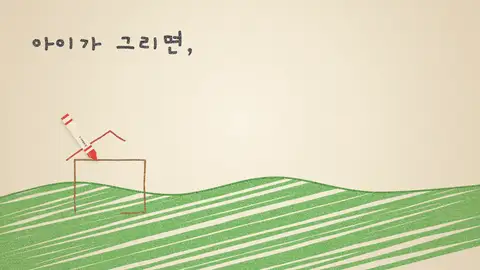</a>
<br/><b>꼬마 화가</b> · <code>crayon</code>
<br/><sub>a picture-book app → crayon on drawing paper, drawn as you watch · bright pop 112 BPM</sub>
<br/><sub><a href="https://raw.githack.com/AwesomeZun/Awesome-Showreels/main/skills/motion-showreel/examples/crayon/dist/crayon-v1.0.0.html">▶ Play</a> · <a href="skills/motion-showreel/examples/crayon/dist/crayon-v1.0.0.html">HTML</a> · <a href="skills/motion-showreel/examples/crayon">Source</a></sub>
</td>
<td align="center" valign="top" width="50%">
<a href="https://raw.githack.com/AwesomeZun/Awesome-Showreels/main/skills/motion-showreel/examples/paper-collage/dist/paper-collage-v1.0.0.html">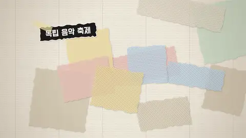</a>
<br/><b>종이비행 페스티벌 2026</b> · <code>paper-collage</code>
<br/><sub>a music festival → torn paper slapped down on the beat · bright pop 128 BPM</sub>
<br/><sub><a href="https://raw.githack.com/AwesomeZun/Awesome-Showreels/main/skills/motion-showreel/examples/paper-collage/dist/paper-collage-v1.0.0.html">▶ Play</a> · <a href="skills/motion-showreel/examples/paper-collage/dist/paper-collage-v1.0.0.html">HTML</a> · <a href="skills/motion-showreel/examples/paper-collage">Source</a></sub>
</td>
</tr>
<tr>
<td align="center" valign="top" width="50%">
<a href="https://raw.githack.com/AwesomeZun/Awesome-Showreels/main/skills/motion-showreel/examples/whiteboard/dist/whiteboard-v1.0.0.html"></a>
<br/><b>피싱 메일 3초 판별법</b> · <code>whiteboard</code>
<br/><sub>a security training → a hand draws it in marker on one long board · corporate 112 BPM</sub>
<br/><sub><a href="https://raw.githack.com/AwesomeZun/Awesome-Showreels/main/skills/motion-showreel/examples/whiteboard/dist/whiteboard-v1.0.0.html">▶ Play</a> · <a href="skills/motion-showreel/examples/whiteboard/dist/whiteboard-v1.0.0.html">HTML</a> · <a href="skills/motion-showreel/examples/whiteboard">Source</a></sub>
</td>
<td align="center" valign="top" width="50%">
<a href="https://raw.githack.com/AwesomeZun/Awesome-Showreels/main/skills/motion-showreel/examples/infographic/dist/infographic-v1.0.0.html">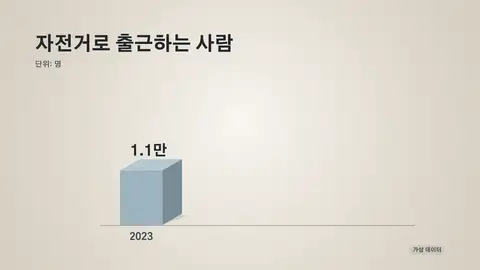</a>
<br/><b>한빛시 자전거 리포트 2026</b> · <code>infographic</code>
<br/><sub>a city report → isometric charts that grow and count · corporate 128 BPM</sub>
<br/><sub><a href="https://raw.githack.com/AwesomeZun/Awesome-Showreels/main/skills/motion-showreel/examples/infographic/dist/infographic-v1.0.0.html">▶ Play</a> · <a href="skills/motion-showreel/examples/infographic/dist/infographic-v1.0.0.html">HTML</a> · <a href="skills/motion-showreel/examples/infographic">Source</a></sub>
</td>
</tr>
<tr>
<td align="center" valign="top" width="50%">
<a href="https://raw.githack.com/AwesomeZun/Awesome-Showreels/main/skills/motion-showreel/examples/minimal-ui/dist/minimal-ui-v1.0.0.html">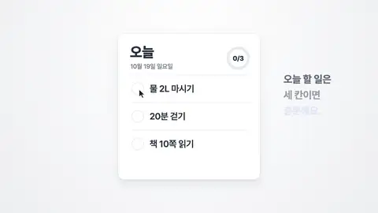</a>
<br/><b>하루 세 칸</b> · <code>minimal-ui</code>
<br/><sub>a habit app → white cards, one blue, a cursor that really uses it · bright pop 128 BPM</sub>
<br/><sub><a href="https://raw.githack.com/AwesomeZun/Awesome-Showreels/main/skills/motion-showreel/examples/minimal-ui/dist/minimal-ui-v1.0.0.html">▶ Play</a> · <a href="skills/motion-showreel/examples/minimal-ui/dist/minimal-ui-v1.0.0.html">HTML</a> · <a href="skills/motion-showreel/examples/minimal-ui">Source</a></sub>
</td>
<td align="center" valign="top" width="50%">
<a href="https://raw.githack.com/AwesomeZun/Awesome-Showreels/main/skills/motion-showreel/examples/blueprint/dist/blueprint-v1.0.0.html">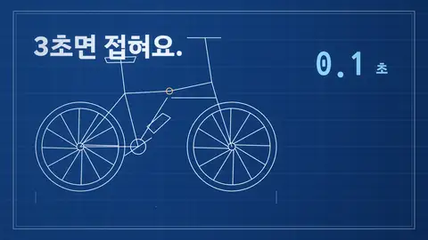</a>
<br/><b>폴드원 E1</b> · <code>blueprint</code>
<br/><sub>a folding e-bike → white line work on blue, then it folds · cinematic 112 BPM</sub>
<br/><sub><a href="https://raw.githack.com/AwesomeZun/Awesome-Showreels/main/skills/motion-showreel/examples/blueprint/dist/blueprint-v1.0.0.html">▶ Play</a> · <a href="skills/motion-showreel/examples/blueprint/dist/blueprint-v1.0.0.html">HTML</a> · <a href="skills/motion-showreel/examples/blueprint">Source</a></sub>
</td>
</tr>
<tr>
<td align="center" valign="top" width="50%">
<a href="https://raw.githack.com/AwesomeZun/Awesome-Showreels/main/skills/motion-showreel/examples/cutaway-3d/dist/cutaway-3d-v1.0.0.html">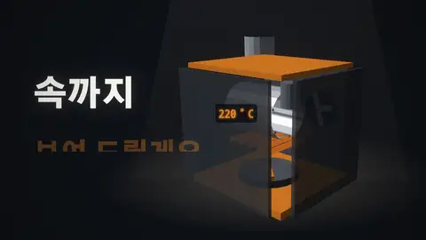</a>
<br/><b>브루큐브</b> · <code>cutaway-3d</code>
<br/><sub>a home coffee roaster → a 3D cutaway that opens and works · corporate 112 BPM</sub>
<br/><sub><a href="https://raw.githack.com/AwesomeZun/Awesome-Showreels/main/skills/motion-showreel/examples/cutaway-3d/dist/cutaway-3d-v1.0.0.html">▶ Play</a> · <a href="skills/motion-showreel/examples/cutaway-3d/dist/cutaway-3d-v1.0.0.html">HTML</a> · <a href="skills/motion-showreel/examples/cutaway-3d">Source</a></sub>
</td>
<td align="center" valign="top" width="50%">
<a href="https://raw.githack.com/AwesomeZun/Awesome-Showreels/main/skills/motion-showreel/examples/chrome-glass/dist/chrome-glass-v1.0.0.html">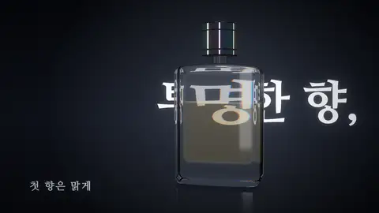</a>
<br/><b>글래스 노트 No.3</b> · <code>chrome-glass</code>
<br/><sub>a perfume → raymarched glass that bends the words behind it · ambient 96 BPM</sub>
<br/><sub><a href="https://raw.githack.com/AwesomeZun/Awesome-Showreels/main/skills/motion-showreel/examples/chrome-glass/dist/chrome-glass-v1.0.0.html">▶ Play</a> · <a href="skills/motion-showreel/examples/chrome-glass/dist/chrome-glass-v1.0.0.html">HTML</a> · <a href="skills/motion-showreel/examples/chrome-glass">Source</a></sub>
</td>
</tr>
<tr>
<td align="center" valign="top" width="50%">
<a href="https://raw.githack.com/AwesomeZun/Awesome-Showreels/main/skills/motion-showreel/examples/cinematic-3d/dist/cinematic-3d-v1.0.0.html">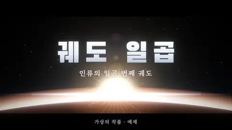</a>
<br/><b>궤도 일곱</b> · <code>cinematic-3d</code>
<br/><sub>a documentary → the sun breaking over the Earth, in scope · cinematic 96 BPM</sub>
<br/><sub><a href="https://raw.githack.com/AwesomeZun/Awesome-Showreels/main/skills/motion-showreel/examples/cinematic-3d/dist/cinematic-3d-v1.0.0.html">▶ Play</a> · <a href="skills/motion-showreel/examples/cinematic-3d/dist/cinematic-3d-v1.0.0.html">HTML</a> · <a href="skills/motion-showreel/examples/cinematic-3d">Source</a></sub>
</td>
<td align="center" valign="top" width="50%">
<a href="https://raw.githack.com/AwesomeZun/Awesome-Showreels/main/skills/motion-showreel/examples/voxel/dist/voxel-v1.0.0.html">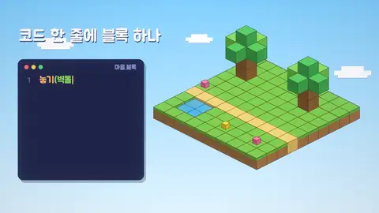</a>
<br/><b>블록 마을</b> · <code>voxel</code>
<br/><sub>a kids' coding camp → one line of code, one block on the beat · bright pop 128 BPM</sub>
<br/><sub><a href="https://raw.githack.com/AwesomeZun/Awesome-Showreels/main/skills/motion-showreel/examples/voxel/dist/voxel-v1.0.0.html">▶ Play</a> · <a href="skills/motion-showreel/examples/voxel/dist/voxel-v1.0.0.html">HTML</a> · <a href="skills/motion-showreel/examples/voxel">Source</a></sub>
</td>
</tr>
<tr>
<td align="center" valign="top" width="50%">
<a href="https://raw.githack.com/AwesomeZun/Awesome-Showreels/main/skills/motion-showreel/examples/pixel-platformer/dist/pixel-platformer-v1.0.0.html">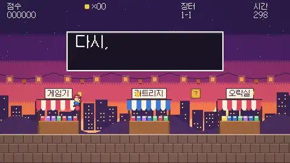</a>
<br/><b>8비트 장터 2026</b> · <code>pixel-platformer</code>
<br/><sub>a retro game fair → a side-scroller at 4x, jumps on the beat · chiptune 144 BPM</sub>
<br/><sub><a href="https://raw.githack.com/AwesomeZun/Awesome-Showreels/main/skills/motion-showreel/examples/pixel-platformer/dist/pixel-platformer-v1.0.0.html">▶ Play</a> · <a href="skills/motion-showreel/examples/pixel-platformer/dist/pixel-platformer-v1.0.0.html">HTML</a> · <a href="skills/motion-showreel/examples/pixel-platformer">Source</a></sub>
</td>
<td align="center" valign="top" width="50%">
<a href="https://raw.githack.com/AwesomeZun/Awesome-Showreels/main/skills/motion-showreel/examples/rock-stage/dist/rock-stage-v1.0.0.html">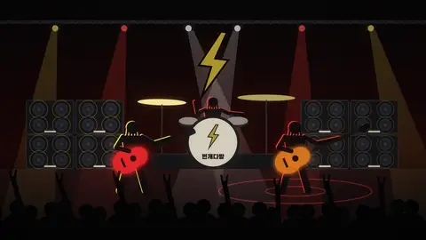</a>
<br/><b>번개다방 〈볼륨 업〉</b> · <code>rock-stage</code>
<br/><sub>a rock gig → each instrument moves its own part of the stage · rock 128 BPM</sub>
<br/><sub><a href="https://raw.githack.com/AwesomeZun/Awesome-Showreels/main/skills/motion-showreel/examples/rock-stage/dist/rock-stage-v1.0.0.html">▶ Play</a> · <a href="skills/motion-showreel/examples/rock-stage/dist/rock-stage-v1.0.0.html">HTML</a> · <a href="skills/motion-showreel/examples/rock-stage">Source</a></sub>
</td>
</tr>
<tr>
<td align="center" valign="top" width="50%">
<a href="https://raw.githack.com/AwesomeZun/Awesome-Showreels/main/skills/motion-showreel/examples/generative-art/dist/generative-art-v1.0.0.html">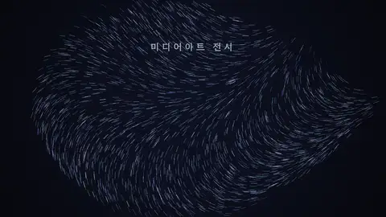</a>
<br/><b>흐름의 지도</b> · <code>generative-art</code>
<br/><sub>a media-art show → lines in a flow field gather into the title · ambient 96 BPM</sub>
<br/><sub><a href="https://raw.githack.com/AwesomeZun/Awesome-Showreels/main/skills/motion-showreel/examples/generative-art/dist/generative-art-v1.0.0.html">▶ Play</a> · <a href="skills/motion-showreel/examples/generative-art/dist/generative-art-v1.0.0.html">HTML</a> · <a href="skills/motion-showreel/examples/generative-art">Source</a></sub>
</td>
<td align="center" valign="top" width="50%">
<a href="https://raw.githack.com/AwesomeZun/Awesome-Showreels/main/skills/motion-showreel/examples/dark-neon/dist/dark-neon-v1.0.0.html">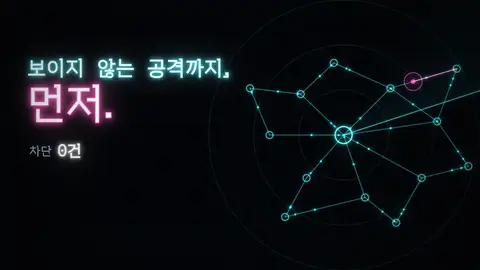</a>
<br/><b>센티넬 X</b> · <code>dark-neon</code>
<br/><sub>AI security → neon tubes, attacks unseen until the radar crosses them · dark synth 128 BPM</sub>
<br/><sub><a href="https://raw.githack.com/AwesomeZun/Awesome-Showreels/main/skills/motion-showreel/examples/dark-neon/dist/dark-neon-v1.0.0.html">▶ Play</a> · <a href="skills/motion-showreel/examples/dark-neon/dist/dark-neon-v1.0.0.html">HTML</a> · <a href="skills/motion-showreel/examples/dark-neon">Source</a></sub>
</td>
</tr>
<tr>
<td align="center" valign="top" width="50%">
<a href="https://raw.githack.com/AwesomeZun/Awesome-Showreels/main/skills/motion-showreel/examples/cyberpunk/dist/cyberpunk-v1.0.0.html">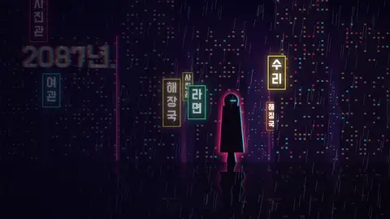</a>
<br/><b>네온 레인 2087</b> · <code>cyberpunk</code>
<br/><sub>an SF game → Seoul in the rain, Korean neon, glitches · dark synth 112 BPM</sub>
<br/><sub><a href="https://raw.githack.com/AwesomeZun/Awesome-Showreels/main/skills/motion-showreel/examples/cyberpunk/dist/cyberpunk-v1.0.0.html">▶ Play</a> · <a href="skills/motion-showreel/examples/cyberpunk/dist/cyberpunk-v1.0.0.html">HTML</a> · <a href="skills/motion-showreel/examples/cyberpunk">Source</a></sub>
</td>
<td align="center" valign="top" width="50%">
<a href="https://raw.githack.com/AwesomeZun/Awesome-Showreels/main/skills/motion-showreel/examples/hologram/dist/hologram-v1.0.0.html">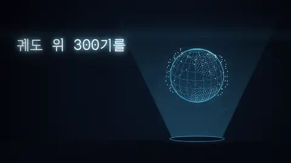</a>
<br/><b>오르빗 컨트롤</b> · <code>hologram</code>
<br/><sub>satellite operations → a projected globe and 300 satellites · dark synth 112 BPM</sub>
<br/><sub><a href="https://raw.githack.com/AwesomeZun/Awesome-Showreels/main/skills/motion-showreel/examples/hologram/dist/hologram-v1.0.0.html">▶ Play</a> · <a href="skills/motion-showreel/examples/hologram/dist/hologram-v1.0.0.html">HTML</a> · <a href="skills/motion-showreel/examples/hologram">Source</a></sub>
</td>
</tr>
<tr>
<td align="center" valign="top" width="50%">
<a href="https://raw.githack.com/AwesomeZun/Awesome-Showreels/main/skills/motion-showreel/examples/ascii/dist/ascii-v1.0.0.html">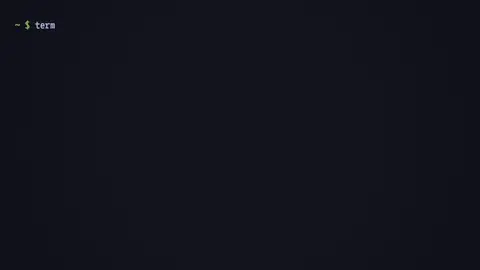</a>
<br/><b>글자판 termpan</b> · <code>ascii</code>
<br/><sub>a terminal dashboard → characters fly in and become a spinning donut · chiptune 128 BPM</sub>
<br/><sub><a href="https://raw.githack.com/AwesomeZun/Awesome-Showreels/main/skills/motion-showreel/examples/ascii/dist/ascii-v1.0.0.html">▶ Play</a> · <a href="skills/motion-showreel/examples/ascii/dist/ascii-v1.0.0.html">HTML</a> · <a href="skills/motion-showreel/examples/ascii">Source</a></sub>
</td>
<td align="center" valign="top" width="50%">
<a href="https://raw.githack.com/AwesomeZun/Awesome-Showreels/main/skills/motion-showreel/examples/clay/dist/clay-v1.0.0.html">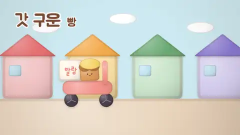</a>
<br/><b>말랑베이커리</b> · <code>clay</code>
<br/><sub>a bread delivery → plasticine at 12 frames a second · bright pop 112 BPM</sub>
<br/><sub><a href="https://raw.githack.com/AwesomeZun/Awesome-Showreels/main/skills/motion-showreel/examples/clay/dist/clay-v1.0.0.html">▶ Play</a> · <a href="skills/motion-showreel/examples/clay/dist/clay-v1.0.0.html">HTML</a> · <a href="skills/motion-showreel/examples/clay">Source</a></sub>
</td>
</tr>
<tr>
<td align="center" valign="top" width="50%">
<a href="https://raw.githack.com/AwesomeZun/Awesome-Showreels/main/skills/motion-showreel/examples/stop-motion/dist/stop-motion-v1.0.0.html">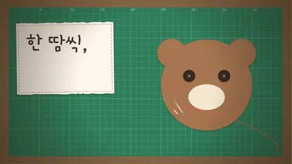</a>
<br/><b>털뭉치 공방</b> · <code>stop-motion</code>
<br/><sub>a felt doll workshop → felt and stitches, shot frame by frame · lo-fi 96 BPM</sub>
<br/><sub><a href="https://raw.githack.com/AwesomeZun/Awesome-Showreels/main/skills/motion-showreel/examples/stop-motion/dist/stop-motion-v1.0.0.html">▶ Play</a> · <a href="skills/motion-showreel/examples/stop-motion/dist/stop-motion-v1.0.0.html">HTML</a> · <a href="skills/motion-showreel/examples/stop-motion">Source</a></sub>
</td>
<td align="center" valign="top" width="50%">
<a href="https://raw.githack.com/AwesomeZun/Awesome-Showreels/main/skills/motion-showreel/examples/cartoon/dist/cartoon-v1.0.0.html">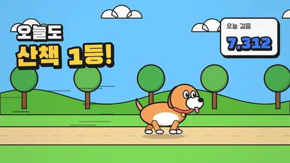</a>
<br/><b>산책왕 멍멍</b> · <code>cartoon</code>
<br/><sub>a dog-walking app → ink lines, smears, a crown for the winner · bright pop 144 BPM</sub>
<br/><sub><a href="https://raw.githack.com/AwesomeZun/Awesome-Showreels/main/skills/motion-showreel/examples/cartoon/dist/cartoon-v1.0.0.html">▶ Play</a> · <a href="skills/motion-showreel/examples/cartoon/dist/cartoon-v1.0.0.html">HTML</a> · <a href="skills/motion-showreel/examples/cartoon">Source</a></sub>
</td>
</tr>
<tr>
<td align="center" valign="top" width="50%">
<a href="https://raw.githack.com/AwesomeZun/Awesome-Showreels/main/skills/motion-showreel/examples/character-show/dist/character-show-v1.0.0.html">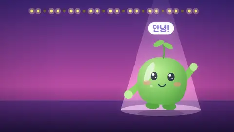</a>
<br/><b>콩이 첫 팬미팅</b> · <code>character-show</code>
<br/><sub>a mascot's fan meeting → one glossy character, a new pose every two beats · bright pop 128 BPM</sub>
<br/><sub><a href="https://raw.githack.com/AwesomeZun/Awesome-Showreels/main/skills/motion-showreel/examples/character-show/dist/character-show-v1.0.0.html">▶ Play</a> · <a href="skills/motion-showreel/examples/character-show/dist/character-show-v1.0.0.html">HTML</a> · <a href="skills/motion-showreel/examples/character-show">Source</a></sub>
</td>
<td align="center" valign="top" width="50%">
<a href="https://raw.githack.com/AwesomeZun/Awesome-Showreels/main/skills/motion-showreel/examples/anime/dist/anime-v1.0.0.html">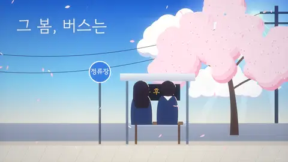</a>
<br/><b>벚꽃 정류장</b> · <code>anime</code>
<br/><sub>a webtoon → an anime background painting, petals and a late bus · corporate 112 BPM</sub>
<br/><sub><a href="https://raw.githack.com/AwesomeZun/Awesome-Showreels/main/skills/motion-showreel/examples/anime/dist/anime-v1.0.0.html">▶ Play</a> · <a href="skills/motion-showreel/examples/anime/dist/anime-v1.0.0.html">HTML</a> · <a href="skills/motion-showreel/examples/anime">Source</a></sub>
</td>
</tr>
<tr>
<td align="center" valign="top" width="50%">
<a href="https://raw.githack.com/AwesomeZun/Awesome-Showreels/main/skills/motion-showreel/examples/ink-wash/dist/ink-wash-v1.0.0.html">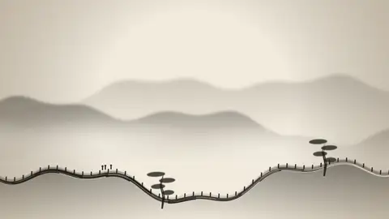</a>
<br/><b>도성 한 바퀴</b> · <code>ink-wash</code>
<br/><sub>a city-wall walking tour → a Korean ink landscape that unrolls like a scroll · koto 96 BPM</sub>
<br/><sub><a href="https://raw.githack.com/AwesomeZun/Awesome-Showreels/main/skills/motion-showreel/examples/ink-wash/dist/ink-wash-v1.0.0.html">▶ Play</a> · <a href="skills/motion-showreel/examples/ink-wash/dist/ink-wash-v1.0.0.html">HTML</a> · <a href="skills/motion-showreel/examples/ink-wash">Source</a></sub>
</td>
<td align="center" valign="top" width="50%">
<a href="https://raw.githack.com/AwesomeZun/Awesome-Showreels/main/skills/motion-showreel/examples/old-film/dist/old-film-v1.0.0.html">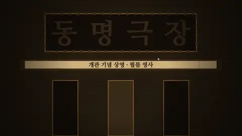</a>
<br/><b>동명극장 재개관</b> · <code>old-film</code>
<br/><sub>a cinema reopening → a worn sepia print, a countdown, intertitles · swing 128 BPM</sub>
<br/><sub><a href="https://raw.githack.com/AwesomeZun/Awesome-Showreels/main/skills/motion-showreel/examples/old-film/dist/old-film-v1.0.0.html">▶ Play</a> · <a href="skills/motion-showreel/examples/old-film/dist/old-film-v1.0.0.html">HTML</a> · <a href="skills/motion-showreel/examples/old-film">Source</a></sub>
</td>
</tr>
<tr>
<td align="center" valign="top" width="50%">
<a href="https://raw.githack.com/AwesomeZun/Awesome-Showreels/main/skills/motion-showreel/examples/woodcut/dist/woodcut-v1.0.0.html">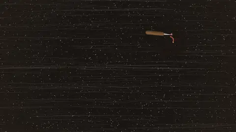</a>
<br/><b>솔뫼 양조장</b> · <code>woodcut</code>
<br/><sub>a makgeolli brewery → a relief print that carves itself · corporate 96 BPM</sub>
<br/><sub><a href="https://raw.githack.com/AwesomeZun/Awesome-Showreels/main/skills/motion-showreel/examples/woodcut/dist/woodcut-v1.0.0.html">▶ Play</a> · <a href="skills/motion-showreel/examples/woodcut/dist/woodcut-v1.0.0.html">HTML</a> · <a href="skills/motion-showreel/examples/woodcut">Source</a></sub>
</td>
<td align="center" valign="top" width="50%">
<a href="https://raw.githack.com/AwesomeZun/Awesome-Showreels/main/skills/motion-showreel/examples/engraving/dist/engraving-v1.0.0.html">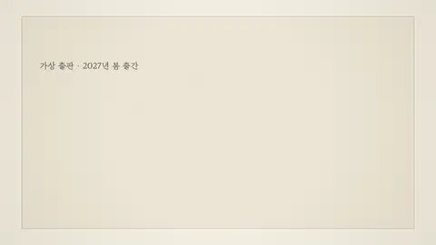</a>
<br/><b>한반도 곤충 도감</b> · <code>engraving</code>
<br/><sub>a field guide → copperplates that engrave themselves · corporate 112 BPM</sub>
<br/><sub><a href="https://raw.githack.com/AwesomeZun/Awesome-Showreels/main/skills/motion-showreel/examples/engraving/dist/engraving-v1.0.0.html">▶ Play</a> · <a href="skills/motion-showreel/examples/engraving/dist/engraving-v1.0.0.html">HTML</a> · <a href="skills/motion-showreel/examples/engraving">Source</a></sub>
</td>
</tr>
<tr>
<td align="center" valign="top" width="50%">
<a href="https://raw.githack.com/AwesomeZun/Awesome-Showreels/main/skills/motion-showreel/examples/silkscreen-poster/dist/silkscreen-poster-v1.0.0.html">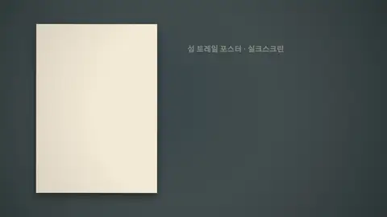</a>
<br/><b>바람섬 다섯 길</b> · <code>silkscreen-poster</code>
<br/><sub>an island walking map → posters pulled one ink at a time · folk 112 BPM</sub>
<br/><sub><a href="https://raw.githack.com/AwesomeZun/Awesome-Showreels/main/skills/motion-showreel/examples/silkscreen-poster/dist/silkscreen-poster-v1.0.0.html">▶ Play</a> · <a href="skills/motion-showreel/examples/silkscreen-poster/dist/silkscreen-poster-v1.0.0.html">HTML</a> · <a href="skills/motion-showreel/examples/silkscreen-poster">Source</a></sub>
</td>
<td align="center" valign="top" width="50%">
<a href="https://raw.githack.com/AwesomeZun/Awesome-Showreels/main/skills/motion-showreel/examples/halftone-dossier/dist/halftone-dossier-v1.0.0.html">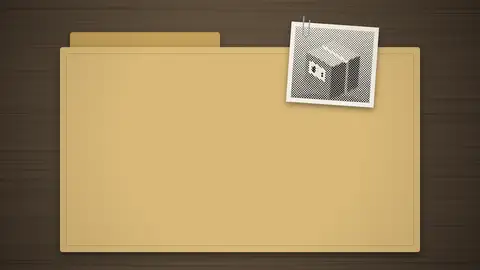</a>
<br/><b>어디쯤 택배</b> · <code>halftone-dossier</code>
<br/><sub>a parcel tracker → a deadpan case file in halftone · swing 128 BPM</sub>
<br/><sub><a href="https://raw.githack.com/AwesomeZun/Awesome-Showreels/main/skills/motion-showreel/examples/halftone-dossier/dist/halftone-dossier-v1.0.0.html">▶ Play</a> · <a href="skills/motion-showreel/examples/halftone-dossier/dist/halftone-dossier-v1.0.0.html">HTML</a> · <a href="skills/motion-showreel/examples/halftone-dossier">Source</a></sub>
</td>
</tr>
<tr>
<td align="center" valign="top" width="50%">
<a href="https://raw.githack.com/AwesomeZun/Awesome-Showreels/main/skills/motion-showreel/examples/stained-glass/dist/stained-glass-v1.0.0.html">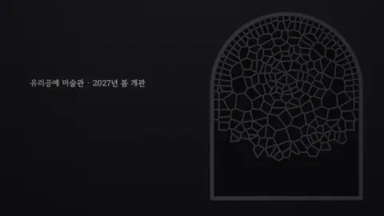</a>
<br/><b>빛뜰 미술관</b> · <code>stained-glass</code>
<br/><sub>a glass-art museum → a window that lights piece by piece · ambient 80 BPM</sub>
<br/><sub><a href="https://raw.githack.com/AwesomeZun/Awesome-Showreels/main/skills/motion-showreel/examples/stained-glass/dist/stained-glass-v1.0.0.html">▶ Play</a> · <a href="skills/motion-showreel/examples/stained-glass/dist/stained-glass-v1.0.0.html">HTML</a> · <a href="skills/motion-showreel/examples/stained-glass">Source</a></sub>
</td>
<td align="center" valign="top" width="50%">
<a href="https://raw.githack.com/AwesomeZun/Awesome-Showreels/main/skills/motion-showreel/examples/shadow-puppet/dist/shadow-puppet-v1.0.0.html">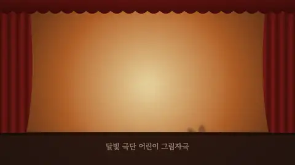</a>
<br/><b>그림자 토끼전</b> · <code>shadow-puppet</code>
<br/><sub>a children’s shadow play → rod puppets behind a lamp-lit cloth · folk 96 BPM</sub>
<br/><sub><a href="https://raw.githack.com/AwesomeZun/Awesome-Showreels/main/skills/motion-showreel/examples/shadow-puppet/dist/shadow-puppet-v1.0.0.html">▶ Play</a> · <a href="skills/motion-showreel/examples/shadow-puppet/dist/shadow-puppet-v1.0.0.html">HTML</a> · <a href="skills/motion-showreel/examples/shadow-puppet">Source</a></sub>
</td>
</tr>
<tr>
<td align="center" valign="top" width="50%">
<a href="https://raw.githack.com/AwesomeZun/Awesome-Showreels/main/skills/motion-showreel/examples/paper-cut/dist/paper-cut-v1.0.0.html">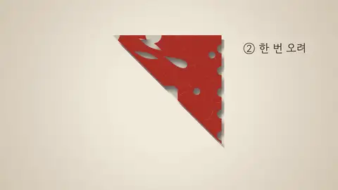</a>
<br/><b>오림 공방</b> · <code>paper-cut</code>
<br/><sub>a paper-cutting class → folded hanji cut and unfolded · bright pop 112 BPM</sub>
<br/><sub><a href="https://raw.githack.com/AwesomeZun/Awesome-Showreels/main/skills/motion-showreel/examples/paper-cut/dist/paper-cut-v1.0.0.html">▶ Play</a> · <a href="skills/motion-showreel/examples/paper-cut/dist/paper-cut-v1.0.0.html">HTML</a> · <a href="skills/motion-showreel/examples/paper-cut">Source</a></sub>
</td>
<td align="center" valign="top" width="50%">
<a href="https://raw.githack.com/AwesomeZun/Awesome-Showreels/main/skills/motion-showreel/examples/one-line/dist/one-line-v1.0.0.html">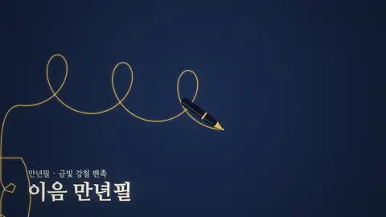</a>
<br/><b>이음 만년필</b> · <code>one-line</code>
<br/><sub>a fountain pen → one gold line that never breaks · ambient 80 BPM</sub>
<br/><sub><a href="https://raw.githack.com/AwesomeZun/Awesome-Showreels/main/skills/motion-showreel/examples/one-line/dist/one-line-v1.0.0.html">▶ Play</a> · <a href="skills/motion-showreel/examples/one-line/dist/one-line-v1.0.0.html">HTML</a> · <a href="skills/motion-showreel/examples/one-line">Source</a></sub>
</td>
</tr>
<tr>
<td align="center" valign="top" width="50%">
<a href="https://raw.githack.com/AwesomeZun/Awesome-Showreels/main/skills/motion-showreel/examples/shape-morph/dist/shape-morph-v1.0.0.html">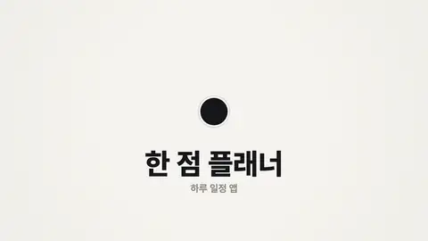</a>
<br/><b>한 점 플래너</b> · <code>shape-morph</code>
<br/><sub>a day planner → one shape that never cuts · bright pop 128 BPM</sub>
<br/><sub><a href="https://raw.githack.com/AwesomeZun/Awesome-Showreels/main/skills/motion-showreel/examples/shape-morph/dist/shape-morph-v1.0.0.html">▶ Play</a> · <a href="skills/motion-showreel/examples/shape-morph/dist/shape-morph-v1.0.0.html">HTML</a> · <a href="skills/motion-showreel/examples/shape-morph">Source</a></sub>
</td>
<td align="center" valign="top" width="50%">
<a href="https://raw.githack.com/AwesomeZun/Awesome-Showreels/main/skills/motion-showreel/examples/liquid/dist/liquid-v1.0.0.html">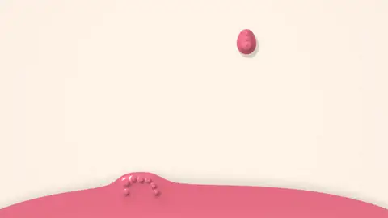</a>
<br/><b>톡톡 스파클링</b> · <code>liquid</code>
<br/><sub>a sparkling drink → glossy WebGL metaballs · bright pop 128 BPM</sub>
<br/><sub><a href="https://raw.githack.com/AwesomeZun/Awesome-Showreels/main/skills/motion-showreel/examples/liquid/dist/liquid-v1.0.0.html">▶ Play</a> · <a href="skills/motion-showreel/examples/liquid/dist/liquid-v1.0.0.html">HTML</a> · <a href="skills/motion-showreel/examples/liquid">Source</a></sub>
</td>
</tr>
<tr>
<td align="center" valign="top" width="50%">
<a href="https://raw.githack.com/AwesomeZun/Awesome-Showreels/main/skills/motion-showreel/examples/synthwave/dist/synthwave-v1.0.0.html">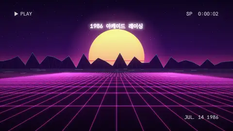</a>
<br/><b>네온 하이웨이 1986</b> · <code>synthwave</code>
<br/><sub>an arcade racer → outrun grid and chrome on a videotape · synthwave 96 BPM</sub>
<br/><sub><a href="https://raw.githack.com/AwesomeZun/Awesome-Showreels/main/skills/motion-showreel/examples/synthwave/dist/synthwave-v1.0.0.html">▶ Play</a> · <a href="skills/motion-showreel/examples/synthwave/dist/synthwave-v1.0.0.html">HTML</a> · <a href="skills/motion-showreel/examples/synthwave">Source</a></sub>
</td>
<td align="center" valign="top" width="50%">
<a href="https://raw.githack.com/AwesomeZun/Awesome-Showreels/main/skills/motion-showreel/examples/spy-titles/dist/spy-titles-v1.0.0.html">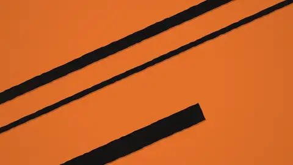</a>
<br/><b>작전명 비단</b> · <code>spy-titles</code>
<br/><sub>a 1960s spy drama → a cut-paper title sequence · swing 128 BPM</sub>
<br/><sub><a href="https://raw.githack.com/AwesomeZun/Awesome-Showreels/main/skills/motion-showreel/examples/spy-titles/dist/spy-titles-v1.0.0.html">▶ Play</a> · <a href="skills/motion-showreel/examples/spy-titles/dist/spy-titles-v1.0.0.html">HTML</a> · <a href="skills/motion-showreel/examples/spy-titles">Source</a></sub>
</td>
</tr>
<tr>
<td align="center" valign="top" width="50%">
<a href="https://raw.githack.com/AwesomeZun/Awesome-Showreels/main/skills/motion-showreel/examples/bauhaus/dist/bauhaus-v1.0.0.html">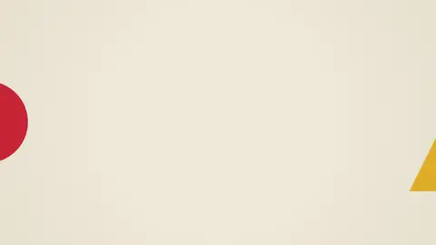</a>
<br/><b>조형 연구소 여름 학교</b> · <code>bauhaus</code>
<br/><sub>a design summer school → shapes on a module grid, one move a beat · dark synth 128 BPM</sub>
<br/><sub><a href="https://raw.githack.com/AwesomeZun/Awesome-Showreels/main/skills/motion-showreel/examples/bauhaus/dist/bauhaus-v1.0.0.html">▶ Play</a> · <a href="skills/motion-showreel/examples/bauhaus/dist/bauhaus-v1.0.0.html">HTML</a> · <a href="skills/motion-showreel/examples/bauhaus">Source</a></sub>
</td>
<td align="center" valign="top" width="50%">
<a href="https://raw.githack.com/AwesomeZun/Awesome-Showreels/main/skills/motion-showreel/examples/variety-captions/dist/variety-captions-v1.0.0.html">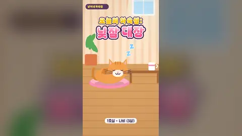</a>
<br/><b>냥이네 하숙집</b> · <code>variety-captions</code>
<br/><sub>a variety show → 9:16 captions that pop, punch-ins and freezes · bright pop 128 BPM</sub>
<br/><sub><a href="https://raw.githack.com/AwesomeZun/Awesome-Showreels/main/skills/motion-showreel/examples/variety-captions/dist/variety-captions-v1.0.0.html">▶ Play</a> · <a href="skills/motion-showreel/examples/variety-captions/dist/variety-captions-v1.0.0.html">HTML</a> · <a href="skills/motion-showreel/examples/variety-captions">Source</a></sub>
</td>
</tr>
<tr>
<td align="center" valign="top" width="50%">
<a href="https://raw.githack.com/AwesomeZun/Awesome-Showreels/main/skills/motion-showreel/examples/sticker-explainer/dist/sticker-explainer-v1.0.0.html">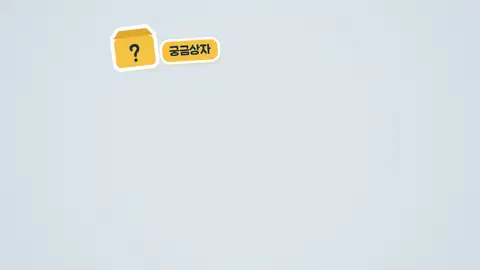</a>
<br/><b>궁금상자</b> · <code>sticker-explainer</code>
<br/><sub>a science channel → stickers on one big board, a gliding camera · corporate 112 BPM</sub>
<br/><sub><a href="https://raw.githack.com/AwesomeZun/Awesome-Showreels/main/skills/motion-showreel/examples/sticker-explainer/dist/sticker-explainer-v1.0.0.html">▶ Play</a> · <a href="skills/motion-showreel/examples/sticker-explainer/dist/sticker-explainer-v1.0.0.html">HTML</a> · <a href="skills/motion-showreel/examples/sticker-explainer">Source</a></sub>
</td>
<td align="center" valign="top" width="50%">
<a href="https://raw.githack.com/AwesomeZun/Awesome-Showreels/main/skills/motion-showreel/examples/assembly-manual/dist/assembly-manual-v1.0.0.html">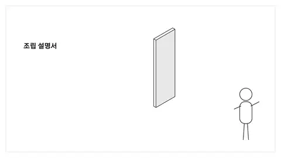</a>
<br/><b>반듯 선반</b> · <code>assembly-manual</code>
<br/><sub>a flat-pack shelf → a wordless assembly manual · corporate 112 BPM</sub>
<br/><sub><a href="https://raw.githack.com/AwesomeZun/Awesome-Showreels/main/skills/motion-showreel/examples/assembly-manual/dist/assembly-manual-v1.0.0.html">▶ Play</a> · <a href="skills/motion-showreel/examples/assembly-manual/dist/assembly-manual-v1.0.0.html">HTML</a> · <a href="skills/motion-showreel/examples/assembly-manual">Source</a></sub>
</td>
</tr>
<tr>
<td align="center" valign="top" width="50%">
<a href="https://raw.githack.com/AwesomeZun/Awesome-Showreels/main/skills/motion-showreel/examples/watercolour-toon/dist/watercolour-toon-v1.0.0.html">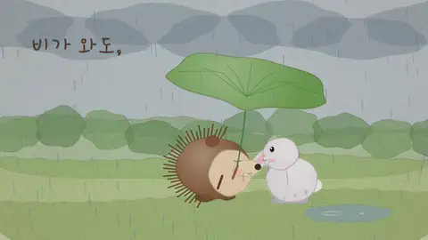</a>
<br/><b>비 오는 날의 밤톨이</b> · <code>watercolour-toon</code>
<br/><sub>a picture book → watercolour washes, characters that act · corporate 96 BPM</sub>
<br/><sub><a href="https://raw.githack.com/AwesomeZun/Awesome-Showreels/main/skills/motion-showreel/examples/watercolour-toon/dist/watercolour-toon-v1.0.0.html">▶ Play</a> · <a href="skills/motion-showreel/examples/watercolour-toon/dist/watercolour-toon-v1.0.0.html">HTML</a> · <a href="skills/motion-showreel/examples/watercolour-toon">Source</a></sub>
</td>
<td align="center" valign="top" width="50%">
<a href="https://raw.githack.com/AwesomeZun/Awesome-Showreels/main/skills/motion-showreel/examples/lyric-video/dist/lyric-video-v1.0.0.html">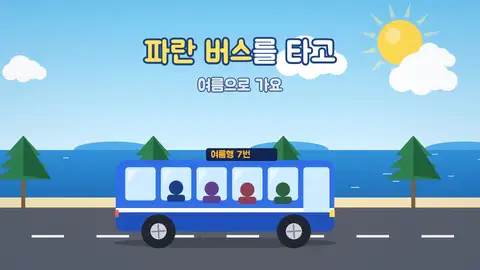</a>
<br/><b>파란 버스</b> · <code>lyric-video</code>
<br/><sub>a band’s single → a lyric video the engine sings · bright pop 112 BPM</sub>
<br/><sub><a href="https://raw.githack.com/AwesomeZun/Awesome-Showreels/main/skills/motion-showreel/examples/lyric-video/dist/lyric-video-v1.0.0.html">▶ Play</a> · <a href="skills/motion-showreel/examples/lyric-video/dist/lyric-video-v1.0.0.html">HTML</a> · <a href="skills/motion-showreel/examples/lyric-video">Source</a></sub>
</td>
</tr>
<tr>
<td align="center" valign="top" width="50%">
<a href="https://raw.githack.com/AwesomeZun/Awesome-Showreels/main/skills/motion-showreel/examples/collision-music/dist/collision-music-v1.0.0.html">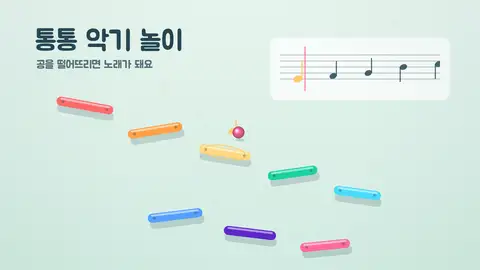</a>
<br/><b>통통 악기 놀이</b> · <code>collision-music</code>
<br/><sub>a music-play app → marbles that play the bars they hit · ambient 128 BPM</sub>
<br/><sub><a href="https://raw.githack.com/AwesomeZun/Awesome-Showreels/main/skills/motion-showreel/examples/collision-music/dist/collision-music-v1.0.0.html">▶ Play</a> · <a href="skills/motion-showreel/examples/collision-music/dist/collision-music-v1.0.0.html">HTML</a> · <a href="skills/motion-showreel/examples/collision-music">Source</a></sub>
</td>
<td align="center" valign="top" width="50%">
<a href="https://raw.githack.com/AwesomeZun/Awesome-Showreels/main/skills/motion-showreel/examples/chronicle/dist/chronicle-v1.0.0.html">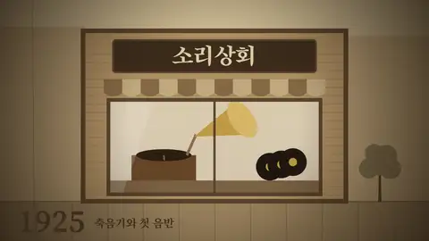</a>
<br/><b>소리상회 100년</b> · <code>chronicle</code>
<br/><sub>a music shop’s centenary → one shopfront in five eras · corporate 112 BPM</sub>
<br/><sub><a href="https://raw.githack.com/AwesomeZun/Awesome-Showreels/main/skills/motion-showreel/examples/chronicle/dist/chronicle-v1.0.0.html">▶ Play</a> · <a href="skills/motion-showreel/examples/chronicle/dist/chronicle-v1.0.0.html">HTML</a> · <a href="skills/motion-showreel/examples/chronicle">Source</a></sub>
</td>
</tr>
<tr>
<td align="center" valign="top" width="50%">
<a href="https://raw.githack.com/AwesomeZun/Awesome-Showreels/main/skills/motion-showreel/examples/microgame/dist/microgame-v1.0.0.html">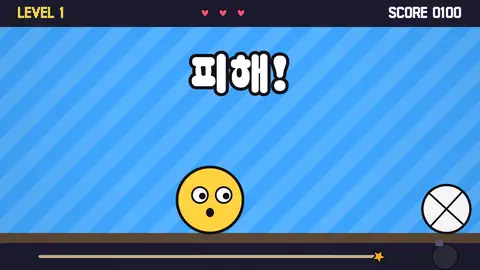</a>
<br/><b>5초 미션</b> · <code>microgame</code>
<br/><sub>a party game → microgames that get shorter · chiptune 144 BPM</sub>
<br/><sub><a href="https://raw.githack.com/AwesomeZun/Awesome-Showreels/main/skills/motion-showreel/examples/microgame/dist/microgame-v1.0.0.html">▶ Play</a> · <a href="skills/motion-showreel/examples/microgame/dist/microgame-v1.0.0.html">HTML</a> · <a href="skills/motion-showreel/examples/microgame">Source</a></sub>
</td>
<td align="center" valign="top" width="50%">
<a href="https://raw.githack.com/AwesomeZun/Awesome-Showreels/main/skills/motion-showreel/examples/zoom-dive/dist/zoom-dive-v1.0.0.html">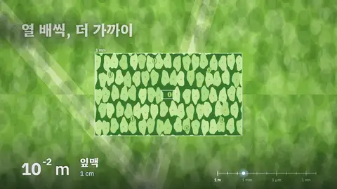</a>
<br/><b>끝없는 확대</b> · <code>zoom-dive</code>
<br/><sub>a science exhibition → powers of ten, 1 m to 0.1 nm · ambient 96 BPM</sub>
<br/><sub><a href="https://raw.githack.com/AwesomeZun/Awesome-Showreels/main/skills/motion-showreel/examples/zoom-dive/dist/zoom-dive-v1.0.0.html">▶ Play</a> · <a href="skills/motion-showreel/examples/zoom-dive/dist/zoom-dive-v1.0.0.html">HTML</a> · <a href="skills/motion-showreel/examples/zoom-dive">Source</a></sub>
</td>
</tr>
<tr>
<td align="center" valign="top" width="50%">
<a href="https://raw.githack.com/AwesomeZun/Awesome-Showreels/main/skills/motion-showreel/examples/mosaic/dist/mosaic-v1.0.0.html">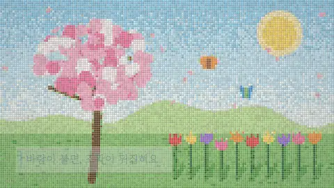</a>
<br/><b>유리 타일 정원</b> · <code>mosaic</code>
<br/><sub>subway public art → 14,400 glass tiles that flip · ambient 112 BPM</sub>
<br/><sub><a href="https://raw.githack.com/AwesomeZun/Awesome-Showreels/main/skills/motion-showreel/examples/mosaic/dist/mosaic-v1.0.0.html">▶ Play</a> · <a href="skills/motion-showreel/examples/mosaic/dist/mosaic-v1.0.0.html">HTML</a> · <a href="skills/motion-showreel/examples/mosaic">Source</a></sub>
</td>
<td align="center" valign="top" width="50%">
<a href="https://raw.githack.com/AwesomeZun/Awesome-Showreels/main/skills/motion-showreel/examples/cel-anime-80s/dist/cel-anime-80s-v1.0.0.html">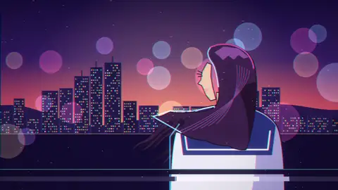</a>
<br/><b>한강 시티 라이트 1988</b> · <code>cel-anime-80s</code>
<br/><sub>a TV anime → 1980s cel paint on twos, VHS · city pop 112 BPM</sub>
<br/><sub><a href="https://raw.githack.com/AwesomeZun/Awesome-Showreels/main/skills/motion-showreel/examples/cel-anime-80s/dist/cel-anime-80s-v1.0.0.html">▶ Play</a> · <a href="skills/motion-showreel/examples/cel-anime-80s/dist/cel-anime-80s-v1.0.0.html">HTML</a> · <a href="skills/motion-showreel/examples/cel-anime-80s">Source</a></sub>
</td>
</tr>
<tr>
<td align="center" valign="top" width="50%">
<a href="https://raw.githack.com/AwesomeZun/Awesome-Showreels/main/skills/motion-showreel/examples/neo-brutal/dist/kablok-v1.0.0.html"></a>
<br/><b>kablok</b> · <code>neo-brutal</code>
<br/><sub>a landing page → hard shadows, slabs · funk 112 BPM</sub>
<br/><sub><a href="https://raw.githack.com/AwesomeZun/Awesome-Showreels/main/skills/motion-showreel/examples/neo-brutal/dist/kablok-v1.0.0.html">▶ Play</a> · <a href="assets/demo-neo-brutal-v1.0.0.mp4">MP4</a> · <a href="skills/motion-showreel/examples/neo-brutal/dist/kablok-v1.0.0.html">HTML</a> · <a href="skills/motion-showreel/examples/neo-brutal">Source</a></sub>
</td>
<td align="center" valign="top" width="50%">
<a href="https://raw.githack.com/AwesomeZun/Awesome-Showreels/main/skills/motion-showreel/examples/editorial-luxe/dist/maison-veyrande-v1.0.0.html"></a>
<br/><b>Maison Veyrande</b> · <code>editorial-luxe</code>
<br/><sub>a fashion press release → Bodoni, ivory and black · piano 80 BPM</sub>
<br/><sub><a href="https://raw.githack.com/AwesomeZun/Awesome-Showreels/main/skills/motion-showreel/examples/editorial-luxe/dist/maison-veyrande-v1.0.0.html">▶ Play</a> · <a href="assets/demo-editorial-luxe-v1.0.0.mp4">MP4</a> · <a href="skills/motion-showreel/examples/editorial-luxe/dist/maison-veyrande-v1.0.0.html">HTML</a> · <a href="skills/motion-showreel/examples/editorial-luxe">Source</a></sub>
</td>
</tr>
<tr>
<td align="center" valign="top" width="50%">
<a href="https://raw.githack.com/AwesomeZun/Awesome-Showreels/main/skills/motion-showreel/examples/paper-behaviour/dist/gut-metabolite-anxiety-v1.0.0.html"></a>
<br/><b>Gut metabolite and anxiety</b> · <code>paper-behaviour</code>
<br/><sub>a mouse-behaviour paper → tracks seen from above · 104 BPM</sub>
<br/><sub><a href="https://raw.githack.com/AwesomeZun/Awesome-Showreels/main/skills/motion-showreel/examples/paper-behaviour/dist/gut-metabolite-anxiety-v1.0.0.html">▶ Play</a> · <a href="skills/motion-showreel/examples/paper-behaviour/dist/gut-metabolite-anxiety-v1.0.0.html">HTML</a> · <a href="skills/motion-showreel/examples/paper-behaviour">Source</a></sub>
</td>
<td align="center" valign="top" width="50%">
<a href="https://raw.githack.com/AwesomeZun/Awesome-Showreels/main/skills/motion-showreel/examples/botanical-organic/dist/mistfold-v1.0.0.html"></a>
<br/><b>Mistfold</b> · <code>botanical-organic</code>
<br/><sub>a tea brand story → watercolour, growth time-lapse · guitar 96 BPM</sub>
<br/><sub><a href="https://raw.githack.com/AwesomeZun/Awesome-Showreels/main/skills/motion-showreel/examples/botanical-organic/dist/mistfold-v1.0.0.html">▶ Play</a> · <a href="assets/demo-botanical-organic-v1.0.0.mp4">MP4</a> · <a href="skills/motion-showreel/examples/botanical-organic/dist/mistfold-v1.0.0.html">HTML</a> · <a href="skills/motion-showreel/examples/botanical-organic">Source</a></sub>
</td>
</tr>
<tr>
<td align="center" valign="top" width="50%">
<a href="https://raw.githack.com/AwesomeZun/Awesome-Showreels/main/skills/motion-showreel/examples/pixel-isometric/dist/pebble-and-bean-v2.1.0.html"></a>
<br/><b>Pebble & Bean</b> · <code>pixel-isometric</code>
<br/><sub>a café opening → cosy isometric pixel art in 16 pastels · lo-fi 86 BPM</sub>
<br/><sub><a href="https://raw.githack.com/AwesomeZun/Awesome-Showreels/main/skills/motion-showreel/examples/pixel-isometric/dist/pebble-and-bean-v2.1.0.html">▶ Play</a> · <a href="skills/motion-showreel/examples/pixel-isometric/dist/pebble-and-bean-v2.1.0.html">HTML</a> · <a href="skills/motion-showreel/examples/pixel-isometric">Source</a></sub>
</td>
<td align="center" valign="top" width="50%">
<a href="https://raw.githack.com/AwesomeZun/Awesome-Showreels/main/skills/motion-showreel/examples/sports-kinetic/dist/velmora-42-v1.0.0.html"></a>
<br/><b>VELMORA 42</b> · <code>sports-kinetic</code>
<br/><sub>a race-timing app → broadcast type, real splits · drum and bass 176 BPM</sub>
<br/><sub><a href="https://raw.githack.com/AwesomeZun/Awesome-Showreels/main/skills/motion-showreel/examples/sports-kinetic/dist/velmora-42-v1.0.0.html">▶ Play</a> · <a href="assets/demo-sports-kinetic-v1.0.0.mp4">MP4</a> · <a href="skills/motion-showreel/examples/sports-kinetic/dist/velmora-42-v1.0.0.html">HTML</a> · <a href="skills/motion-showreel/examples/sports-kinetic">Source</a></sub>
</td>
</tr>
<tr>
<td align="center" valign="top" width="50%">
<a href="https://raw.githack.com/AwesomeZun/Awesome-Showreels/main/skills/motion-showreel/examples/art-deco/dist/the-emerald-fan-v1.0.0.html"></a>
<br/><b>THE EMERALD FAN</b> · <code>art-deco</code>
<br/><sub>a jazz-age invitation → gilded frames · swing 112 BPM</sub>
<br/><sub><a href="https://raw.githack.com/AwesomeZun/Awesome-Showreels/main/skills/motion-showreel/examples/art-deco/dist/the-emerald-fan-v1.0.0.html">▶ Play</a> · <a href="assets/demo-art-deco-v1.0.0.mp4">MP4</a> · <a href="skills/motion-showreel/examples/art-deco/dist/the-emerald-fan-v1.0.0.html">HTML</a> · <a href="skills/motion-showreel/examples/art-deco">Source</a></sub>
</td>
<td align="center" valign="top" width="50%">
<a href="https://raw.githack.com/AwesomeZun/Awesome-Showreels/main/skills/motion-showreel/examples/research-cli/dist/spark-bench-v1.1.0.html"></a>
<br/><b>spark-bench</b> · <code>research-cli</code>
<br/><sub>a research CLI → GPU points, real terminal · dark synth 128 BPM</sub>
<br/><sub><a href="https://raw.githack.com/AwesomeZun/Awesome-Showreels/main/skills/motion-showreel/examples/research-cli/dist/spark-bench-v1.1.0.html">▶ Play</a> · <a href="assets/demo-research-cli-v1.1.0.mp4">MP4</a> · <a href="skills/motion-showreel/examples/research-cli/dist/spark-bench-v1.1.0.html">HTML</a> · <a href="skills/motion-showreel/examples/research-cli">Source</a></sub>
</td>
</tr>
<tr>
<td align="center" valign="top" width="50%">
<a href="https://raw.githack.com/AwesomeZun/Awesome-Showreels/main/skills/motion-showreel/examples/academic-paper/dist/alveolar-repair-atlas-v2.0.0.html"></a>
<br/><b>Alveolar repair atlas v2</b> · <code>academic-paper</code>
<br/><sub>a single-cell paper → one nucleus, tissue to 3D atlas and back · 96 BPM</sub>
<br/><sub><a href="https://raw.githack.com/AwesomeZun/Awesome-Showreels/main/skills/motion-showreel/examples/academic-paper/dist/alveolar-repair-atlas-v2.0.0.html">▶ Play</a> · <a href="skills/motion-showreel/examples/academic-paper/dist/alveolar-repair-atlas-v2.0.0.html">HTML</a> · <a href="skills/motion-showreel/examples/academic-paper">Source</a></sub>
</td>
<td align="center" valign="top" width="50%">
<a href="https://raw.githack.com/AwesomeZun/Awesome-Showreels/main/skills/motion-showreel/examples/pixel-jrpg/dist/lanternforge-v2.1.0.html"></a>
<br/><b>Lanternforge 2.0</b> · <code>pixel-jrpg</code>
<br/><sub>a game-engine release → HD-2D JRPG trailer, real light on pixel art · 120 BPM</sub>
<br/><sub><a href="https://raw.githack.com/AwesomeZun/Awesome-Showreels/main/skills/motion-showreel/examples/pixel-jrpg/dist/lanternforge-v2.1.0.html">▶ Play</a> · <a href="skills/motion-showreel/examples/pixel-jrpg/dist/lanternforge-v2.1.0.html">HTML</a> · <a href="skills/motion-showreel/examples/pixel-jrpg">Source</a></sub>
</td>
</tr>
<tr>
<td align="center" valign="top" width="50%">
<a href="https://raw.githack.com/AwesomeZun/Awesome-Showreels/main/skills/motion-showreel/examples/paper-transformer/dist/attention-explainer-v1.0.0.html"></a>
<br/><b>Attention Is All You Need, explained</b> · <code>paper-transformer</code>
<br/><sub>a landmark paper → typeset like the paper, attention computed · 110 BPM</sub>
<br/><sub><a href="https://raw.githack.com/AwesomeZun/Awesome-Showreels/main/skills/motion-showreel/examples/paper-transformer/dist/attention-explainer-v1.0.0.html">▶ Play</a> · <a href="skills/motion-showreel/examples/paper-transformer/dist/attention-explainer-v1.0.0.html">HTML</a> · <a href="skills/motion-showreel/examples/paper-transformer">Source</a></sub>
</td>
<td align="center" valign="top" width="50%">
<a href="https://raw.githack.com/AwesomeZun/Awesome-Showreels/main/skills/motion-showreel/examples/paper-organoid/dist/wnt-pulse-organoids-v2.0.0.html"></a>
<br/><b>WNT-pulse organoids</b> · <code>paper-organoid</code>
<br/><sub>an organoid paper → a lab notebook that keeps itself · 100 BPM</sub>
<br/><sub><a href="https://raw.githack.com/AwesomeZun/Awesome-Showreels/main/skills/motion-showreel/examples/paper-organoid/dist/wnt-pulse-organoids-v2.0.0.html">▶ Play</a> · <a href="skills/motion-showreel/examples/paper-organoid/dist/wnt-pulse-organoids-v2.0.0.html">HTML</a> · <a href="skills/motion-showreel/examples/paper-organoid">Source</a></sub>
</td>
</tr>
</table>

<sub>Each loop is one moment of the reel at real speed, without sound. <b>▶ Play</b> opens the full reel in your browser with music, where you can switch between its lengths (the same file is in each folder's <code>dist/</code>: 1–5 MB, opens offline, number keys switch lengths). Projects and data are fictional and labelled as such on screen (the sixteen toyz.kr apps are real; the data they show is their own fictional sample data); the two explainers and the Transformer explainer cover real ideas, with toy models or rounded textbook values, and say so. The twenty-four style examples are fictional projects too (the city wall and gates in <code>ink-wash</code> are real); only the drawing styles come from the video, not its characters or frames. The twenty-four that follow the video’s styles borrow only the style from eight repositories (<a href="https://github.com/lemomo-ai/lemo-opuscar">lemo-opuscar</a>, <a href="https://github.com/Vincentwei1021/mg-styles-15">mg-styles-15</a>, <a href="https://github.com/mexicat/pdoom-video">pdoom-video</a>, <a href="https://github.com/JohnHeibel/PDoomVideo">PDoomVideo</a>, <a href="https://github.com/JohnHeibel/ClaudeAnimationBase">ClaudeAnimationBase</a>, <a href="https://github.com/yihui-dev/awesome-opus5-5-videos">awesome-opus5-5-videos</a>, <a href="https://github.com/athemeroy/awesome-claude-5-5-videos">awesome-claude-5-5-videos</a>, <a href="https://github.com/joeseesun/opus-video-prompts">opus-video-prompts</a>); every project is fictional, the recorded instruments are CC0 (VCSL and VSCO 2 Community Edition), and the lyrics and voice of 「파란 버스」 were made for this repository.</sub>

<details>
<summary><b>Style decisions per example</b></summary>

| Example | Source | Mood | Palette | Type | Motion | Music (BPM) |
|---|---|---|---|---|---|---|
| `academic-paper` | single-cell paper | airy, precise | blush · coral | Source Serif 4 | 3D nuclei, tissue ↔ atlas | corporate 96 |
| `anime` | coming-of-age webtoon | wistful, luminous | sky blue · cherry pink | Gowun Dodum | tilt, drifting clouds, petals | corporate 112 |
| `art-deco` | invitation | opulent, nocturnal | black · gold | Limelight | symmetrical | swing 112 |
| `ascii` | terminal dashboard | clever, playful | Tokyo Night | Nanum Gothic Coding | typing, characters landing | chiptune 128 |
| `assembly-manual` | flat-pack shelf | calm, clear | black line on white · one blue | Gothic A1 | isometric parts slide in, screws turn | corporate 112 |
| `bauhaus` | design workshop | geometric, ordered | red · blue · yellow · black on cream | Gothic A1 · Do Hyeon | one move per beat, quarter turns, overprint | dark synth 128 (dorian) |
| `blueprint` | folding e-bike | precise, clean | blueprint blue · white · one yellow | IBM Plex Sans KR | lines drawn, a mechanical fold | cinematic 112 |
| `botanical-organic` | tea brand story | calm, earthy | oat · leaf green | Fraunces | slow | guitar 96 |
| `cartoon` | dog-walking app | bouncy, funny | sky · grass · ink | Black Han Sans · Jua | squash, stretch, smears | bright pop 144 |
| `cel-anime-80s` | anime opening | romantic, nostalgic | dusk violet · rose · neon cyan | Black Han Sans · Nanum Myeongjo | characters on twos, pans, a title slam | city pop 112 (slap bass, sax) |
| `character-show` | mascot fan meeting | adorable, showy | stage violet · bean green · gold | Jua | a pose every two beats | bright pop 128 |
| `chrome-glass` | perfume | quiet, precious | night · silver · champagne | Nanum Myeongjo | raymarched glass, chrome sheen | ambient 96 (lydian) |
| `chronicle` | shop centenary | warm, proud | one palette per era on dark wood | Song Myung · Yeon Sung · Do Hyeon · Black Han Sans · Pretendard | odometer years, era surfaces | corporate 112 + era riffs |
| `cinematic-3d` | documentary trailer | epic, quiet | space black · air blue · dawn orange | Noto Serif KR · Black Han Sans | slow camera, a shader Earth | cinematic 96 |
| `clay` | bread delivery | cosy, cute | cream · crust gold · coral | Jua · Dongle | stop motion, boiling clay | bright pop 112 |
| `collision-music` | music-play app | playful, precise | mint · rainbow bars | Jua | parabolas solved from the notes | ambient 128 (marimba) |
| `crayon` | picture-book app | warm, clumsy | drawing paper · crayon colours | Gaegu | lines that boil, drawn at hand speed | bright pop 112 |
| `cutaway-3d` | home coffee roaster | precise, warm | graphite · orange trim | Gothic A1 | casing slides open, parts turn | corporate 112 |
| `cyberpunk` | SF game trailer | wet, lurid | violet night · magenta · cyan | Do Hyeon · Orbit | rain, reflections, glitch | dark synth 112 |
| `dark-neon` | AI security platform | sharp, vigilant | black · cyan · magenta | Orbit | neon stutter, radar reveal | dark synth 128 |
| `deploy-kit` | launch kit | brisk, technical | paper · cobalt | Pretendard | file streams | drum and bass 176 |
| `editorial-luxe` | press release | elegant, quiet | ivory · champagne | Bodoni Moda | slow | piano 80 |
| `engraving` | insect field guide | precise, scholarly | copper · cream · one red wash | Nanum Myeongjo · Diphylleia | burin cuts, hatching | corporate 112 |
| `explainer-llm` | LLM explainer notes | curious, lucid | navy · yellow | KaTeX Main | maths animation | ambient 96 |
| `explainer-sunlight` | science notes | wondrous, bright | violet · sun gold | Nunito | flat-vector dives | bright pop 128 |
| `focus-space` | focus timer | quiet, deep | deep green · chrome | Pretendard | time-lapse | ambient 96 |
| `form-01` | feedback board | precise, editorial | ink · metal · pin colours | Pretendard | pins, versions | cinematic 112 |
| `frame` | portfolio builder | clean, quick | paper · orange | Pretendard | live typing | corporate 112 |
| `generative-art` | media-art exhibition | quiet, wondrous | night navy · blues · gold | Hahmlet | particles integrated from birth | ambient 96 |
| `halftone-dossier` | parcel-tracking app | deadpan, funny | manila · newsprint · red | Black Han Sans · Nanum Gothic Coding | stamps, flashes, typed reports | swing 128 (minor) |
| `hologram` | satellite operations | calm, futuristic | dark room · holo blue · orange | Orbit · Nanum Gothic Coding | projected light, flicker | dark synth 112 |
| `infographic` | city cycling report | clear, smart | paper map · data colours | Gothic A1 | bars grow, numbers count | corporate 128 |
| `ink-wash` | city-wall walking tour | calm, dignified | rice paper · ink · one red seal | Nanum Brush Script · Song Myung | washes bleed, strokes paint | koto ambient 96 |
| `layr` | notes workspace | calm, structured | near-black · steel · lime | Pretendard | glass layers | dark synth 112 |
| `liquid` | sparkling water | fizzy, glossy | candy pink · lime · grape | Bagel Fat One · Jua | metaballs merge, drops splash | bright pop 128 |
| `loop` | habit app | steady, friendly | periwinkle · navy | Pretendard | a ring that fills | corporate 128 |
| `lyric-video` | summer single | bright, breezy | sky · sea blue · bus blue · yellow | Jua · Gowun Dodum | syllables pop on their notes | bright pop 112 + formant voice |
| `microgame` | party game | frantic, funny | a primary per mission · black outlines | Bagel Fat One · Galmuri11 | missions of 4, 2, 1 beats | chiptune 144 |
| `minimal-ui` | habit app | clean, calm | near-white · one blue | Pretendard | cursor-driven UI | bright pop 128 |
| `mood-fm` | mood radio | warm, chromatic | the mood's own colour | Pretendard | dial sweeps | lo-fi 96 |
| `mosaic` | public artwork | sparkling, fresh | subway white · glass palette | Grandiflora One · Gowun Dodum | flip waves in a shader | ambient 112 |
| `motion-kit` | interaction kit | playful, exact | electric blue · orange | Pretendard | app animations replayed | bright pop 128 |
| `neo-brutal` | landing page | loud, blunt | cream · lemon | Archivo | hard snaps | funk 112 |
| `newsprint` | newspaper | factual, civic | newsprint · red | Newsreader | steady | piano 96 |
| `offgrid` | local map app | nocturnal, local | night map · lime | Pretendard | one camera push | swing 96 |
| `old-film` | cinema reopening | nostalgic, warm | sepia · bulb yellow | Nanum Myeongjo | film weave, flicker, scratches | swing 128 |
| `one-line` | fountain pen | elegant, calm | navy paper · gold | Nanum Myeongjo · Gowun Batang | one continuous stroke, the camera behind the pen | ambient 80 |
| `orbit-note` | linked-notes app | luminous, connected | electric blue · holo | Pretendard | drawn links | cinematic 96 |
| `paper-behaviour` | mouse-behaviour paper | clean, precise | white · blue | Instrument Sans | tracked from above | corporate 104 |
| `paper-collage` | music festival | loud, handmade | newsprint · cut-paper brights | Black Han Sans · Do Hyeon · Song Myung · Jua | scraps slap down on the beat | bright pop 128 |
| `paper-cut` | New Year class | festive, handmade | hanji red · cream | Song Myung · Gowun Dodum | folds on the beat, cuts, the unfold | bright pop 112 |
| `paper-imaging` | light-sheet paper | luminous, patient | black · green | Manrope | GPU nuclei | ambient 92 |
| `paper-organoid` | organoid paper | warm, hands-on | paper · magenta | Literata | handwritten notebook | corporate 100 |
| `paper-perturbseq` | CRISPR-screen paper | precise, nocturnal | night · orchid | IBM Plex Sans | illustration ↔ data | dark synth 116 |
| `paper-transformer` | landmark paper | elegant, exact | cream · vermilion | STIX Two | typeset | cinematic 110 |
| `pixel-arcade` | game jam | chunky, punchy | night · gold | Press Start 2P | stepped | chiptune 144 |
| `pixel-isometric` | café opening | cosy, warm | cream · latte | Jersey 10 | isometric pixel | lo-fi 86 |
| `pixel-jrpg` | engine release | heroic, nostalgic | night · lantern gold | Pixelify Sans | HD-2D light | cinematic 120 |
| `pixel-kit` | brand-image tool | crafty, consistent | near-black · orchid | Pretendard | a wall that turns over | swing 128 |
| `pixel-platformer` | retro game fair | nostalgic, cheeky | dusk bands · coin gold | Galmuri11 | game physics on the beat | chiptune 144 |
| `pixel-pocket` | hiking app | calm, outdoorsy | four greens | 5×7 bitmap | dithered tone steps | chiptune 108 |
| `playful-app` | app README | playful, bouncy | light · pink | Nunito | springy | bright pop 120 |
| `pulse` | maker dashboard | crisp, instrumental | aluminium · orange | Pretendard | meters, snaps | bright pop 112 |
| `read-room` | reading room | quiet, literary | paper · marker orange | Pretendard | pen-speed highlights | ambient 96 |
| `research-cli` | research CLI | technical, cool | dark · cyan | Space Grotesk | damped | dark synth 128 |
| `riso-zine` | zine | loud, scrappy | newsprint · fluo pink | Anton | jumpy | lo-fi 160 |
| `rock-stage` | rock gig | loud, electric | black · bolt yellow · stage red | Black Han Sans | per-instrument reactions | rock 128 |
| `shadow-puppet` | shadow play | warm, playful | lamp amber · black silhouettes | Song Myung · Gowun Batang | puppets on rods, boards on strings | folk 96 (pentatonic) |
| `shape-morph` | planner app | clean, playful | warm paper · ink · coral | Pretendard | one shape morphs on springs, a seamless loop | bright pop 128 |
| `silkscreen-poster` | island walking courses | sunny, handmade | five spot inks on paper | Gasoek One · Gothic A1 | a squeegee pull per beat, misregistration | folk 112 |
| `sketchnote` | workshop handout | hand-drawn, friendly | whiteboard · orange | Shantell Sans | handwritten | bright 104 |
| `sports-kinetic` | race-timing app | energetic, exact | track black · orange | Barlow Condensed | fast | drum and bass 176 |
| `spy-titles` | spy drama | cool, tense | orange · teal · black · cream | Black Han Sans · Gothic A1 | bars on the diagonal, match cuts, a stop | swing 128 (minor) |
| `stained-glass` | museum opening | luminous, serene | jewel glass on dark stone | Grandiflora One · Gowun Batang | lead drawn, pieces light, floor light drifts | ambient 80 (lydian, organ) |
| `sticker-explainer` | science explainer | friendly, smart | board grey · sticker brights | Jua · Gothic A1 | stickers slap down, a dotted path grows | corporate 112 |
| `stop-motion` | felt doll workshop | tender, handmade | cutting-mat green · felt browns | Gamja Flower | 8 fps, a hand-held camera | lo-fi 96 |
| `sumi-wabi` | ryokan site | quiet, restrained | washi · one vermilion | Shippori Mincho | very slow | koto 72 |
| `swiss-grid` | architecture brief | precise, ordered | paper · one red | Schibsted Grotesk | on the grid | synth 124 |
| `synthwave` | arcade racer | nostalgic, fast | violet · magenta · cyan | Gugi · Orbit | grid rush, chrome slam, palms | synthwave 96 (gated snare) |
| `tiny-beat` | beat maker | warm, rhythmic | black · lime | Pretendard | on the step grid | lo-fi 80 |
| `tiny-tools` | developer toolbox | crisp, nimble | night · violet | Pretendard | paste and answer | chiptune 128 |
| `trove` | bookmark app | sleek, nocturnal | black · lime | Pretendard | orbit, chrome | dark synth 128 |
| `variety-captions` | vertical variety show | noisy, cute | sunburst yellow · candy captions | Bagel Fat One · Jua · Black Han Sans | captions pop letter by letter, punch-in, freeze | bright pop 128 (vertical) |
| `voxel` | kids' coding camp | playful, tactile | sky · grass · brick | Jua | blocks land on the beat | bright pop 128 |
| `watercolour-toon` | picture book | warm, gentle | cream paper · rain blue · chestnut | Hi Melody · Gowun Dodum | keyframed acting, washes that boil on twos | corporate 96 (harp, pizzicato) |
| `whiteboard` | security training | calm, clear | whiteboard · marker black · red | Nanum Pen Script | a drawing hand, a camera along the board | corporate 112 |
| `woodcut` | brewery centenary | earthy, proud | ink black · paper · vermilion | Black And White Picture · Song Myung | gouges carve, prints lift | corporate 96 |
| `zoom-dive` | science exhibition | wondrous, calm | walnut · leaf greens · navy · black | Hahmlet · IBM Plex Sans KR | one logarithmic zoom | ambient 96 (lydian) |

Each folder's <code>style.json</code> records every decision and the evidence from the source behind it.

</details>

---

## Real productions

The method comes from four real projects made before this repo.

<table>
<tr>
<td align="center" valign="top" width="50%">
<a href="https://github.com/AwesomeZun/FDDD"></a>
<br/><b>FDDD</b> · research data reel · 128 BPM
<br/><sub><a href="https://raw.githack.com/AwesomeZun/FDDD/main/showreel/dist/fddd-showreel-en-v1.1.0.html">▶ Play</a> · <a href="https://github.com/AwesomeZun/FDDD">Repo</a></sub>
</td>
<td align="center" valign="top" width="50%">
<a href="https://github.com/AwesomeZun/CC-statusline"></a>
<br/><b>CC-statusline</b> · terminal tool reel
<br/><sub><a href="https://raw.githubusercontent.com/AwesomeZun/CC-statusline/main/assets/reel.gif">▶ Play</a> · <a href="https://github.com/AwesomeZun/CC-statusline">Repo</a></sub>
</td>
</tr>
<tr>
<td align="center" valign="top" width="50%">
<a href="assets/case-kbeautygate-30s-v1.0.0.mp4"></a>
<br/><b>K-BeautyGate</b> · hackathon pitch reel · 120 BPM
<br/><sub><a href="assets/case-kbeautygate-30s-v1.0.0.mp4">▶ MP4 (30 s)</a></sub>
</td>
<td align="center" valign="top" width="50%">
<a href="https://flygate.kr/showreel/FlyGate_showreel_v4.3.0.html"></a>
<br/><b>FlyGate</b> · narrated research reel
<br/><sub><a href="https://flygate.kr/showreel/FlyGate_showreel_v4.3.0.html">▶ Play</a> · <a href="https://flygate.kr/showreel/FlyGate_showreel_v4.3.0.mp4">MP4</a> · <a href="https://github.com/AwesomeZun/Project-FlyGate">Repo</a></sub>
</td>
</tr>
</table>

---

## Features

<p align="center"><b>Style from your source</b><br/>Palette, type, pace and music are read from your material, with the evidence written down. No presets.</p>
<p align="center"></p>

<p align="center"><b>Real material, not decoration</b><br/>Your app's UI, your CLI's output, your paper's figures, your data. Code-drawn motion around it.</p>
<p align="center"></p>

<p align="center"><b>Any length</b><br/>15, 30 or 60 s from one plan. Longer cuts add scenes; nothing is slowed down.</p>
<p align="center"></p>

<p align="center"><b>Music and sound effects included</b><br/>Synthesized to fit the style, from koto to drum and bass, and timed to the picture.</p>
<p align="center"></p>

<p align="center"><b>Optional narration</b><br/>Gemini TTS on your own key, checked by speech-to-text, with captions.</p>
<p align="center"></p>

<p align="center"><b>Ready to share</b><br/>An MP4 for each length, plus a web version: one 1–2 MB HTML file with every length and its music. It opens in any browser without internet, switches length with the number keys, steps frame by frame for review, and can be sent in a chat or played from a link.</p>
<p align="center"></p>

---

## How it works

1. **Read the source.** Measure palette, fonts, tone and density; write `style.json` with the reasons.
2. **Storyboard.** One message per scene; exact wording and disclaimers fixed up front.
3. **Pick the proof.** Real UI, real terminal output, real figures, real numbers.
4. **Plan the cuts.** All lengths on one beat grid.
5. **Build and score.** Scenes are code; music and SFX are synthesized from the same cue list.
6. **Check and ship.** Stills, motion and audio checks, then MP4 and HTML.

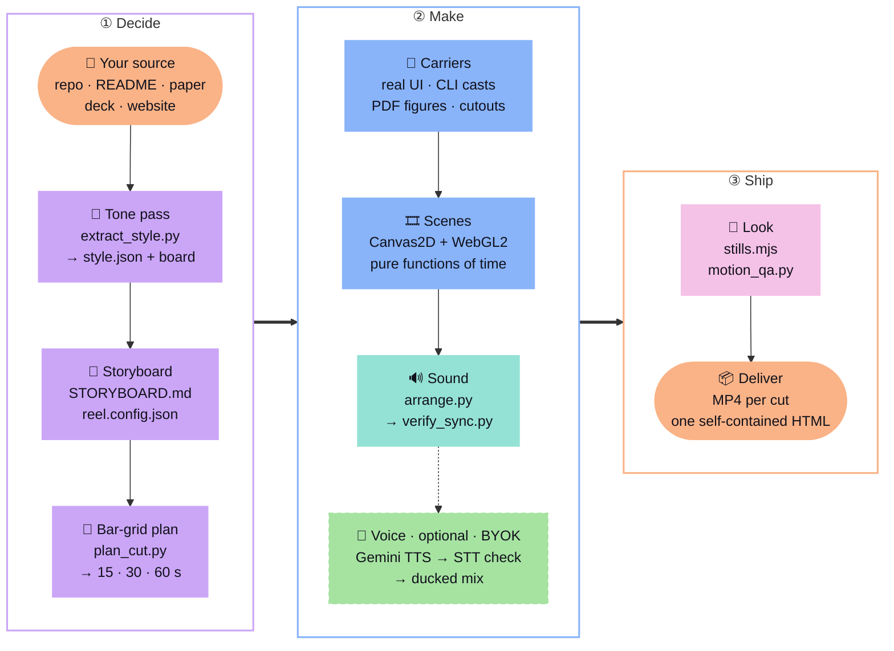

---

## Install

The skill is a folder of instructions (`SKILL.md`) and command-line tools, so any coding agent can use it.

**Claude Code**

```
/plugin marketplace add AwesomeZun/Awesome-Showreels
/plugin install awesome-showreels@awesome-showreels
```

**Codex CLI (OpenAI)**

```bash
git clone https://github.com/AwesomeZun/Awesome-Showreels.git
mkdir -p ~/.codex/skills && cp -r Awesome-Showreels/skills/motion-showreel ~/.codex/skills/
```

**Gemini CLI**

```bash
gemini extensions install https://github.com/AwesomeZun/Awesome-Showreels
```

**Any other agent:** clone the repo and tell the agent to follow `skills/motion-showreel/SKILL.md` (the repo's `AGENTS.md` points there).

**One-time setup** (the agent runs it on first use):

```bash
cd <skill folder>/runtime && npm install
python3 -m pip install numpy scipy pillow opencv-python pymupdf fonttools brotli
```

---

## Prompts to try

| | Ask your agent |
|---|---|
| 📦 **Repo** | *Make a 30-second showreel from this repo, plus a 15-second cut.* |
| 📄 **Paper** | *Turn `paper.pdf` into a 45-second explainer using the paper's own figures.* |
| 🖼️ **Deck** | *Make a launch teaser from `pitch.pptx` in the deck's colors and fonts.* |
| ⌨️ **CLI** | *Make a 15-second reel with a real terminal capture of `mytool demo`.* |
| 🎤 **Narration** | *Narrate the 30-second cut with my Gemini key.* |
| ⏱️ **Longer** | *Make a 60-second version of the reel.* |
| 💡 **Just an idea** | *Make a 20-second reel for my bakery's weekend market: sourdough, cinnamon buns, Saturday 9 to 1.* |

---

## FAQ

<details>
<summary><b>Do I need an API key?</b></summary>

No. Everything renders on your machine and the music is synthesized locally. Only the optional narration needs a key: your own Gemini key (see [Bring your own key](#bring-your-own-key)).

</details>

<details>
<summary><b>What does it cost?</b></summary>

The skill is free (MIT). Building a reel uses your agent's plan like any other task. Narration and extra mascot poses use your own accounts, and only when you agree.

</details>

<details>
<summary><b>Is anything in the examples faked?</b></summary>

The projects are fictional and say so on screen. What they show is real: captured app UI, real terminal recordings, data from the example's own files.

</details>

<details>
<summary><b>Vertical or square video?</b></summary>

Yes, as a re-layout of the same project (`"size": [1080, 1920]` or `[1080, 1080]`), not a crop.

</details>

<details>
<summary><b>Can it use my own mascot or logo?</b></summary>

Yes. Images become clean cutouts (macOS Vision or OpenCV) that blink, bounce and squash on the beat.

</details>

<details>
<summary><b>What is the HTML file?</b></summary>

The web version of the reel: one small file with every length and its music. Open it in any browser, even offline. Space plays and pauses, ← → step, number keys switch cuts, F is fullscreen.

</details>

<details>
<summary><b>Under the hood</b></summary>

- **Runtime:** Canvas2D + WebGL2; every frame is a function of time, so stills, MP4 and the web version match exactly.
- **Planner:** `timing/plan_cut.py` lays every cut on one bar grid; longer cuts add scenes and holds.
- **Audio:** `audio/synth.py`, `arrange.py`, `verify_sync.py` (numpy/scipy, no samples): presets from ambient to chiptune, swing and drum and bass; every cue checked against the picture, -14 LUFS.
- **Captures:** `tools/capture_ui.mjs` (app UI), `capture_cli.py` (terminal), `pdf_figures.py` (paper figures), `prep_assets.py` + `lift.swift` (cutouts).
- **Narration:** `narration/tts_gemini.py` with speech-to-text checks, ducking and captions.
- **Big reels:** `templates/showreel-workflow.js` splits the work across many agents on Claude Code; other agents run the same steps in order.
- **This page:** every preview was rendered by the skill from [`docs/readme-reel/`](docs/readme-reel/).

</details>

---

## Requirements

| | Needed for |
|---|---|
| Node.js 20+ and Chrome/Chromium | rendering stills, MP4 and the web version |
| ffmpeg | MP4 and audio encoding |
| Python 3.9+ with numpy, scipy, Pillow, opencv-python | style pass, planner, music, cutouts |
| *Optional:* pymupdf, fonttools + brotli | PDFs, font subsets |
| *Optional:* soundfile, soxr and curl | recorded instruments (two CC0 libraries, fetched once into a cache) |
| *Optional:* macOS 14+ with `swiftc` | Vision cutouts (OpenCV elsewhere) |
| *Optional:* your Gemini API key | narration |

---

## Bring your own key

Narration is the only feature that needs a key, and it is off unless you ask for it. The skill ships no key and never searches for one.

- Save it once in your own terminal: `python3 <skill folder>/narration/tts_gemini.py key save` (macOS Keychain), or set `GEMINI_API_KEY` before starting your agent.
- `key status` shows which source is used; `key check` tests it for free.
- Never paste a key into a chat. Without a key, `--dry-run` tests the whole chain offline.

---

## Tests

```bash
python3 -B -m unittest discover -s tests
node --test tests/*.test.mjs
```

---

## License

[MIT](LICENSE). Example fonts are under the SIL Open Font License with their license files. All music and sound effects are synthesized; no samples are included.

<div align="center">

⭐ **Star it if it made your project look as good as it is.**

**Every animation on this page was made with this skill.**

</div>
